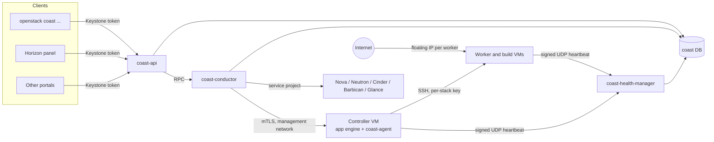

# Coast

Coast is an OpenStack service for cloud operators who want to offer
application hosting to their projects. A project creates a
**stack**: an app engine controller VM plus one or more worker
VMs, and optionally build servers. Coast creates and runs those servers
for them. The member then deploys apps to the stack from a git repository
or a container image and gets a URL with TLS. They never log in to the
VMs or the engine.

Coast runs like other OpenStack services such as Trove and Octavia. It has
its own API in the Keystone catalog (service type `app-hosting`), policy
in code, quotas, microversions and CADF notifications. Users reach it
through the `openstack coast` CLI (python-coastclient), the Horizon panel
(coast-dashboard) or the REST API.

Developed by Gozunga (https://gozunga.com). Apache License 2.0.

The API serves microversions 1.0 to 1.28
([`coast/api/microversions.py`](coast/api/microversions.py)).

## What a project can do

Default policy (`coast/policies/`): readers list and show; members
create and change workloads; the project `manager` role (or admin) is
required to delete a stack and to add or remove servers.

- **Stacks:** create (member). Add or remove workers and build servers
  (manager). A controller cannot be removed, and removing a server that
  still hosts apps or services returns 409. Resize one server, or all
  workers at once, to a strictly larger flavor (API 1.26, member); Coast
  replaces the VM and moves its volumes, ports and floating IP. To move
  to a smaller flavor, add a smaller worker and move the apps. Upgrade
  the app engine to a newer supported version and, when a rollback point
  exists, roll that upgrade back by request (member). Manual server
  failover is admin-only; the health manager fails over stale servers
  on its own.
- **Ingress rules:** add and delete IPv4 TCP, UDP or ICMP rules for the
  stack's workers (API 1.25). Coast lists its own HTTP, HTTPS and
  controller SSH rules as read-only `managed` entries. The management
  security groups are not shown to projects and cannot be changed by
  them.
- **App groups and environments:** organise workloads by app group
  (for example `website`) and environment (for example `test` and
  `production`).
- **Apps:** deploy from git (Dockerfile, Nixpacks, static or Compose) or
  from a container image. Set environment variables and secrets, view
  deployments and logs, roll back a deployment, restart, stop, and run
  commands in a container.
- **Services:** create databases and other services from the template
  catalog. Database services support backups and restore with a cloud
  Swift-compatible object-storage endpoint. Backups are not verified end to end in 0.1.0;
  full verification is tracked for 0.1.1 in issue #124.
- **Domains:** each app gets a default URL. Custom domains are added and
  verified through Coast; with Designate in the same project Coast can
  create the DNS records itself.
- **Storage:** named volumes and file mounts for apps, stored on the
  server's Cinder data volume.
- **Activity:** an event history for each stack, plus metrics for
  services.

The interfaces expose different subsets of the API. Use the CLI or REST
API for engine upgrade/rollback, rolling stack resize, server removal,
exports, Cinder volume management, quota administration, deployment
rollback, and app group/environment rename; the Horizon panel lacks these
actions. The full command list is in python-coastclient. The REST contract
is in [api.md](doc/source/api.md) and `api-ref/`.

## Quickstart

With python-coastclient installed (see
[client.md](doc/source/client.md)) and OpenStack credentials loaded, this creates a stack and runs an nginx container on
it. Create commands return at once; wait for `ACTIVE` before the next step.

Plan names come from `openstack coast plan list` and vary by cloud.
Use the worker name returned by `server list` (`worker-1` for the first
worker in a new stack). Creating an app group also creates its `production`
environment.

```console
$ openstack coast stack create shop --plan standard-2 \
    --worker kind=vm,plan=worker-small
$ openstack coast stack show shop -c Status
$ openstack coast server list --stack shop
$ openstack coast appgroup create website --stack shop
$ openstack coast environment list --appgroup website
$ openstack coast app create web --appgroup website --environment production \
    --server worker-1 --image nginx --tag stable-alpine --ports 80
$ openstack coast logs --service web --tail 20
$ openstack coast domain add --service web web.example.com
```

What the flags do:

- `stack create --plan` names the plan for the stack's controller.
  `--worker kind=vm,plan=worker-small` adds one VM worker with that plan;
  repeat `--worker` for more workers.
- `-c Status` prints only the status column. `--stack shop` limits the
  server list to that stack, and `appgroup create --stack shop` creates the
  app group in it. `--appgroup website` lists that app group's environments.
- `app create` places the app in the app group and environment named by
  `--appgroup` and `--environment` and runs it on the worker named by
  `--server`. `--image` and `--tag` name the container image, and
  `--ports 80` is the port the container listens on; an app needs a port
  before it can have a domain.
- `logs --service web` selects the workload; `--tail 20` returns the last
  20 log lines (the API default is 200).
- `domain add --service web` attaches the domain to the app `web`. With no
  other flags, Coast requests a Let's Encrypt certificate and leaves DNS to
  you: the output's `dns_records` lists the TXT verification record and the
  A (or AAAA) record to create, plus a CNAME alternative when a default
  hostname is available. Add `--auto-dns` with `--zone` to have Coast manage
  the records in a Designate zone instead.

More worked examples (env vars, ingress rules, backups, resize, engine
upgrade and rollback) are in [client.md](doc/source/client.md#worked-examples).
The full walkthrough, including the dashboard, is
[quickstart.md](doc/source/quickstart.md).

## Resources

The hierarchy is **stack > appgroup > environment > app or service**.

| Resource | What it is | CLI |
|---|---|---|
| Stack | The controller, workers, build servers, their network, volumes and secrets | `openstack coast stack` |
| Server | One controller, worker or build VM in a stack | `openstack coast server` |
| App group | A group of workloads inside a stack | `openstack coast appgroup` |
| Environment | A stage inside an app group | `openstack coast environment` |
| App | A workload built from git or an image | `openstack coast app` |
| Service | A workload created from the template catalog or an image | `openstack coast service` |

The API serves `/v1/stacks` and `/v1/services`. App groups and
environments are nested under their parents. Service list and create are
flat and take `appgroup_id` and `environment_id`.

## Architecture



| Component | Job |
|---|---|
| `coast-api` | Authenticates with Keystone, checks policy and quota, stores the request and hands work to the conductor. It never calls guests. |
| `coast-conductor` | Creates and deletes servers, networks and volumes, deploys workloads, runs failover, upgrade and rollback. Loads the driver for each stack. |
| `coast-health-manager` | Receives HMAC-signed heartbeats, marks stale servers and starts failover. |
| `coast-console-proxy` | Proxies container terminal sessions. |
| `coast-agent` | Runs in each guest. On the controller it proxies the engine API over mTLS. All guests send heartbeats. |
| Driver | Translates Coast objects into documented public app engine API calls. |

How resources are placed:

- Stack servers, networks, ports, floating IPs and volumes live in the
  operator's `service` project, tagged with the owner's `project_id`,
  as Octavia does with amphorae. Users see them only through Coast.
- Each stack has its own Neutron network and security groups. Guests
  cannot reach the cloud control plane over that network.
- Each server keeps its state on Cinder volumes, so failover and upgrade
  replace the VM and move the same volumes, ports and floating IP to the
  new one.
- Secret values (engine API tokens, SSH and heartbeat keys, env vars,
  Git deploy private keys, database passwords, Dockerfiles, compose files,
  config-file mounts, backup keys) are stored in Barbican in
  the service project. The Coast database holds only references. See
  [Secrets and Barbican](doc/source/secrets.md).

## Engine versions and upgrades

Supported engine versions are listed in one place,
[`coast/common/engine_versions.py`](coast/common/engine_versions.py).
`DEFAULT` selects the default for new stacks; operator version pins must
select a supported release. Each stack records
its own engine version, so stacks on different supported versions can
run side by side.

Do not write engine version numbers into code, tests or docs; read them
from that module.

An upgrade (`{"upgrade": {"image_id": ...}}` on
`/v1/stacks/{id}/action`) needs an ACTIVE, idle stack and a published
controller image whose `coast_engine_version` is supported and not older
than the stack's version. Coast snapshots the controller's data, Docker
and registry volumes and replaces the controller VM with one booted from
the new image, moving the same volumes and ports. It then replaces each
worker and build VM in turn from the published worker image of the same
version, stopping at the first failure. Nothing rolls back on its own.
If the upgrade fails before the new controller boots, the stack stays
ACTIVE on the old VM; after that, a failure sets the stack to ERROR. From
ACTIVE or ERROR the owner can send `{"upgrade_rollback": {}}`, which
boots the recorded previous image on copies of the snapshots; without a
complete rollback point it returns 409. See "Upgrade (engine / image)"
in [lifecycle.md](doc/source/lifecycle.md) and
[design/engine-upgrade.md](doc/source/design/engine-upgrade.md).

## Repository layout

```
coast/
  api/                 coast-api (pecan, keystonemiddleware, microversions)
  agent/               coast-agent, built into guest images
  common/              config, policy, RPC, clients, TLS, engine versions
  conductor/           provisioning, deploy, failover and upgrade flows
  console/             console proxy
  db/                  SQLAlchemy models and alembic migrations
  drivers/             CoastDriver base, app engine driver and noop
  health_manager/      heartbeat receiver and failover
  network/             Neutron helpers
  objects/             oslo.versionedobjects
  policies/            policy in code
  cmd/                 console entry points
  tests/               unit and functional tests
api-ref/               REST API reference
etc/coast/             sample config, api-paste.ini, generator configs
devstack/              DevStack plugin
tools/build-images/    guest image builds (diskimage-builder)
tools/kolla/           kolla-ansible role and kolla-build overlay
releasenotes/          reno notes
doc/source/            design and operator docs
```

## Development

```bash
git clone https://github.com/gozunga/coast.git && cd coast
python3 -m venv .venv && . .venv/bin/activate
pip install tox
tox -e pep8          # style checks
tox -e py3           # unit tests
tox -e functional    # functional tests
tox -e docs          # build the docs
tox -e api-ref       # build the API reference
tox -e releasenotes  # lint reno notes
tox -e cover         # unit coverage, fails under 80%
```

`tox -e genconfig`, `genpolicy`, `template-catalog`, `kolla-role` and
`kolla-images` check generated files and the Kolla overlay. `tox.ini`
lists every environment. Add a reno note for user-visible changes.

## Deploying

- **DevStack:** `enable_plugin coast <coast git url>`. See
  [devstack/README.md](devstack/README.md).
- **Kolla-Ansible:** an overlay role and kolla-build image overlay under
  `tools/kolla/`. Single-controller deployment has been verified;
  multi-controller HA acceptance is deferred until a staging cloud exists
  (Q141). See [install-kolla.md](doc/source/install-kolla.md) and
  [kolla.md](doc/source/kolla.md).
- **Guest images:** see [tools/build-images](tools/build-images/README.rst).

## Documentation

The [documentation index](doc/source/index.rst) includes the operator,
portal and contributor guides.

| Doc | Covers |
|---|---|
| [quickstart.md](doc/source/quickstart.md) | Create a stack and deploy an app, CLI and dashboard |
| [client.md](doc/source/client.md) | The `openstack coast` CLI: commands, microversions, worked examples |
| [architecture.md](doc/source/architecture.md) | Components and control flows |
| [data-model.md](doc/source/data-model.md) | Tables, fields and states |
| [api.md](doc/source/api.md) | REST endpoints, policies, quotas, microversions |
| [driver-interface.md](doc/source/driver-interface.md) | Driver interface and engine mapping |
| [lifecycle.md](doc/source/lifecycle.md) | Stack create, upgrade, delete, failover and health |
| [networking.md](doc/source/networking.md) | Networks, security groups, ingress, egress and DNS |
| [security.md](doc/source/security.md) | Threat model and controls |
| [operations.md](doc/source/operations.md) | Config options and runbooks |

## License

Apache License 2.0. Copyright 2026 Gozunga and Coast contributors. See
[LICENSE](LICENSE) and [NOTICE](NOTICE) for licensing and third-party notices.
