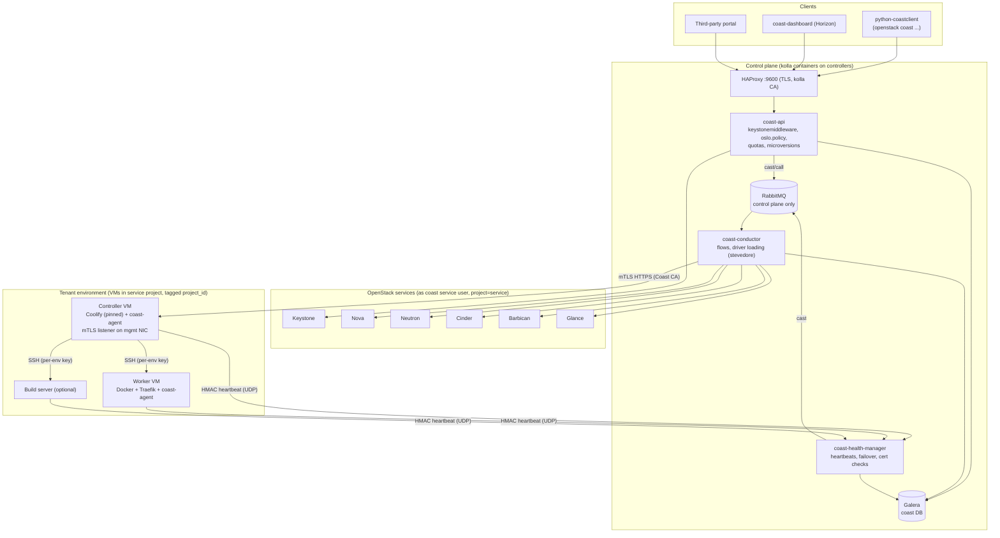
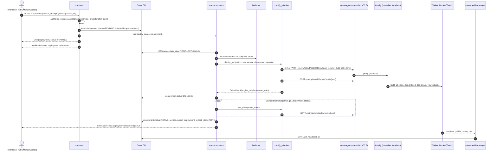
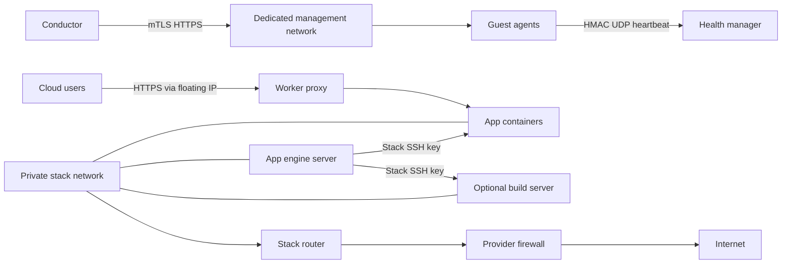

# Architecture

## 1. Goals and non-goals

**Goals**
- Tenants deploy services (git repo, Dockerfile, Compose, or registry image)
  to isolated, operator-managed infrastructure through an OpenStack API.
- Behave like any other OpenStack service: Keystone auth, catalog entry,
  policy-in-code, quotas, microversions, CADF notifications, kolla deployment.
- Engine-agnostic core: Coolify v4 first, others (Dokploy, plain Compose)
  possible via drivers.

Q94: the tenant infra resource is a **stack**. A Coast **appgroup**
(example `website`) is one Coolify project. A Coast **environment** is
one Coolify environment. A Coast **service** is the workload. It maps
to one Coolify application, database, or one-click service. See
data-model.md.

**Non-goals (v1)**
- Patching/forking Coolify. Exposing the Coolify UI/API to tenants.
- Multi-tenant shared workers. Shared build servers.
- Managed databases (that's Trove's job; services can run their own DB containers).
- Shared Octavia edge, Heat resources, Kata/gVisor
  (all later/optional).

## 2. Components



| Component | Responsibility | Talks to |
|---|---|---|
| `coast-api` | Validate, authorize (policy + project scope), quota-check, persist desired state, cast to conductor, return 202. Never calls guests or Coolify. | Keystone (authtoken), DB, RabbitMQ |
| `coast-conductor` | Executes flows: provision stack, add/remove server, deploy, rollback, domains, secrets push, delete/offboard, upgrade and periodic settings reconciliation. Loads the driver per stack. | DB, RabbitMQ, Nova/Neutron/Cinder/Barbican/Glance, guests via mTLS |
| `coast-health-manager` | Receives HMAC-signed heartbeats, marks stale servers, triggers failover and certificate rotation. | DB, RabbitMQ (casts to conductor) |
| `coast-agent` (in guest image) | Tiny HTTPS service on the mgmt NIC with mTLS. On controller: reverse-proxies the Coolify API (bound to localhost) + exposes `/health`, `/version`. On all guests: sends heartbeats, reports disk/docker health. | Coolify (localhost), health-manager |
| Driver (`coolify_v4`) | Pure translation of Coast objects to Coolify API calls through the agent proxy. No cloud calls. | Controller via mTLS |

> The mTLS listener is provided by **coast-agent** (Coast code, in the Coast-built image) in
> front of Coolify's API, so Coolify stays unmodified and its API/UI is bound
> to localhost / never reachable from tenant networks.

### Process model
- `coast-api`: WSGI under Apache/uwsgi in kolla, stateless, N replicas.
- `coast-conductor`: oslo.service, RPC server on topic `coast-conductor`,
  N replicas (work distributed by Rabbit; per-stack locking in DB via
  `stacks.task_state` compare-and-swap so two conductors never act on
  the same stack concurrently).
- `coast-health-manager`: one per controller node, UDP listener on the Coast
  mgmt network + periodic tasks; DB row locking for failover election.

## 3. Ownership model (Octavia amphora pattern)

- All guest resources (servers, ports, volumes, networks, SGs, FIPs) are
  created by the `coast` service user **in the `service` project**, tagged
  `coast`, `project_id=<tenant>`, `stack_id=<stack id>`.
- Tenants own only Coast API objects. Their Keystone project is the
  owning `project_id` on every Coast row.
- Usage is attributed back to the tenant project via Coast notifications
  (`coast.server.exists`, `coast.volume.exists`). These are current-resource
  snapshots, not complete billing history (Q75).

Guest VMs are disposable. Image upgrades and failover boot a new VM, move
both Cinder volumes and the existing Neutron ports/FIP, restore identity
from config drive / conductor, then delete the old VM. Persistent state is
under `/data` or `/var/lib/docker/volumes`. Exports include `/data` and only
the Docker volume's `volumes/` subtree; images, build cache, overlay layers
and containers are rebuildable and excluded. DB containers must be quiesced
before export (stop or app-level dump). Prefer service storage under `/data`
where possible. Coolify version upgrades are separate:
snapshot `/data` before its migration. See lifecycle.md for the replace flow.

## 4. RPC

- RPC API version `1.0` (`coast/conductor/rpcapi.py` / `manager.py`).
- API -> conductor: **cast** for all mutating operations (create stack, deploy,
  delete ...); **call** only for cheap synchronous reads that need the guest
  (e.g. `get_logs` with a short timeout).
- Health-manager -> conductor: cast `failover_server`, `reconcile_environment`.
- Objects passed as `oslo.versionedobjects` with `CoastObjectSerializer`.
- No guest is ever a RabbitMQ client.
- M1 casts explicitly carry quota deltas and an acceptance revision, since
  transient context attributes and timestamp microseconds are not preserved
  by the default serializers. The conductor loads the stack's driver
  (`coolify_v4` or `noop`) and provisions real cloud resources
  in the service project. Exports upload archives from the guest to Swift or
  S3 and return time-limited URLs (see operations.md).

## 5. Deploy sequence (git source, happy path)



For adopted engines, enqueue and polling use short transactions with durable
checkpoints and reference-only startup/periodic recovery (lifecycle.md).
An unknown enqueue outcome fails without another POST. Q59 is deferred.
Reference-only recovery stays in force.

Failure: any step error -> `deployment.status=FAILED`, `fault` recorded
(sanitized), the service keeps serving the previous `current_deployment_id`.

## 6. Stack provisioning sequence

```mermaid
sequenceDiagram
  autonumber
  actor U as Tenant
  participant A as coast-api
  participant C as coast-conductor
  participant N as Neutron
  participant B as Barbican
  participant V as Nova/Ironic + Cinder
  participant G as coast-agent (controller)
  participant D as driver

  U->>A: POST /v1/stacks {name, plan, region}
  A-->>C: cast create_stack
  A-->>U: 202 status=BUILDING
  A-->>U: notification coast.environment.create.start
  C->>N: create stack network/subnet/router, SGs (mgmt, ingress, egress rules)
  C->>B: store SSH private key, heartbeat HMAC key, registry credential
  C->>V: boot controller (golden image, config drive: agent certs, CA, HMAC key)
  C->>V: create+attach data (/data) and docker (/var/lib/docker) volumes
  C->>G: wait for mTLS /health (timeout -> revert)
  C->>D: bootstrap_environment (token -> Barbican; .env stays on controller data volume). ensure_project is a later call (Q94).
  C->>V: boot first worker (config drive: controller SSH public key)
  C->>V: create+attach worker data and docker volumes
  C->>D: register_server(worker)
  C->>N: floating IP -> worker
  C->>C: status=ACTIVE, emit coast.environment.create.end
```

Q47 event names stay `coast.environment.create.*`. The resource is the stack.

## 7. Technology choices

| Concern | Choice | Why |
|---|---|---|
| API framework | pecan + WSME | Same as Octavia/Trove; agents can crib patterns |
| Long flows | taskflow (or simple step engine with revert) | Octavia precedent; resumable |
| Cloud SDK | openstacksdk + keystoneauth | One session, all services |
| Driver loading | stevedore `coast.drivers` | Standard OpenStack plugin model |
| Guest channel | HTTPS + mTLS, Coast CA | Octavia model; no guest on Rabbit |
| Heartbeats | UDP + HMAC-SHA256 | Octavia model; cheap, stateless |

## 8. Guest network boundaries



The management NIC has no default route. Environment DHCP supplies the
stack-router default. The provider firewall blocks control-plane and
management destinations. RabbitMQ has no guest connections. Each stack
has separate networks and keys; cloud resources remain in the service
project under the current ownership model. See networking.md for port
rules and operations.md for host isolation requirements.

## Supported engine releases (issue 56)

`coast/common/engine_versions.py` is the release registry. The last release
is the default for `[coolify] pinned_version`; the option must select a
supported release and affects new stacks only. Existing stacks continue to
use their own `engine_version`. Public engine observations accept any
supported release, then stack operations verify the stack's exact version.
Golden images bake one version into `/usr/lib/coast/engine-version`.
First boot and local bootstrap accept only that version's stock images.
Retained `/data` identity is preserved; first boot updates `LATEST_IMAGE`
and keeps `AUTOUPDATE=false`, loopback bindings and terminals disabled.

To add a Coolify release:

1. Verify the public API, bootstrap contract, stock installer and offline
   artifact checksums, helper/support tags and template bytes. Add one
   release data row in `engine_versions.py`, reusing a reviewed profile
   only when the bytes and contracts match. Changed contracts require code
   and tests as well as release data.
2. Extend offline tests for the release, mixed fleets, upgrade and rollback.
   The literal guard prevents new runtime version pins elsewhere.
3. Build controller and worker images with reviewed immutable digest locks;
   publish their matching `coast_engine_version` metadata. Snapshot-backed
   upgrades and rollback use these published images and retain rollback
   points on partial failure. A transient supported old version during boot
   is retried until the upgrade deadline.
4. After deploying on an isolated test cloud, run the contract suite for
   each supported release with `COAST_CONTRACT_COOLIFY_VERSION` set. Run
   live upgrade/rollback acceptance there. Offline CI is not live evidence.
