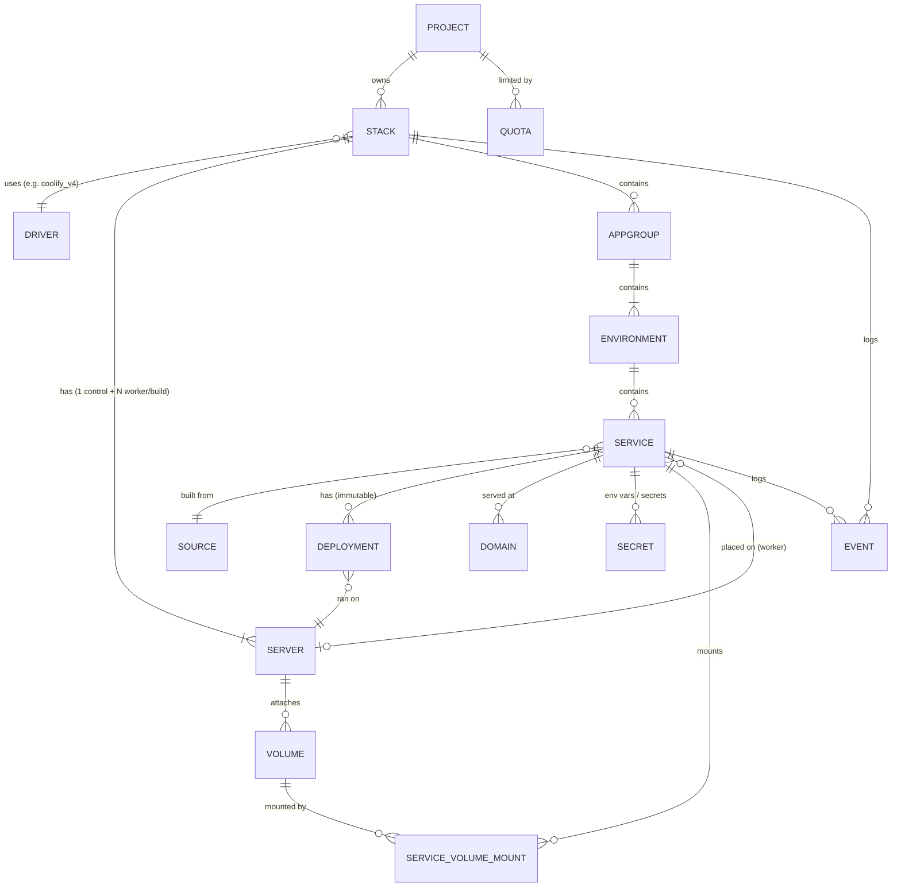
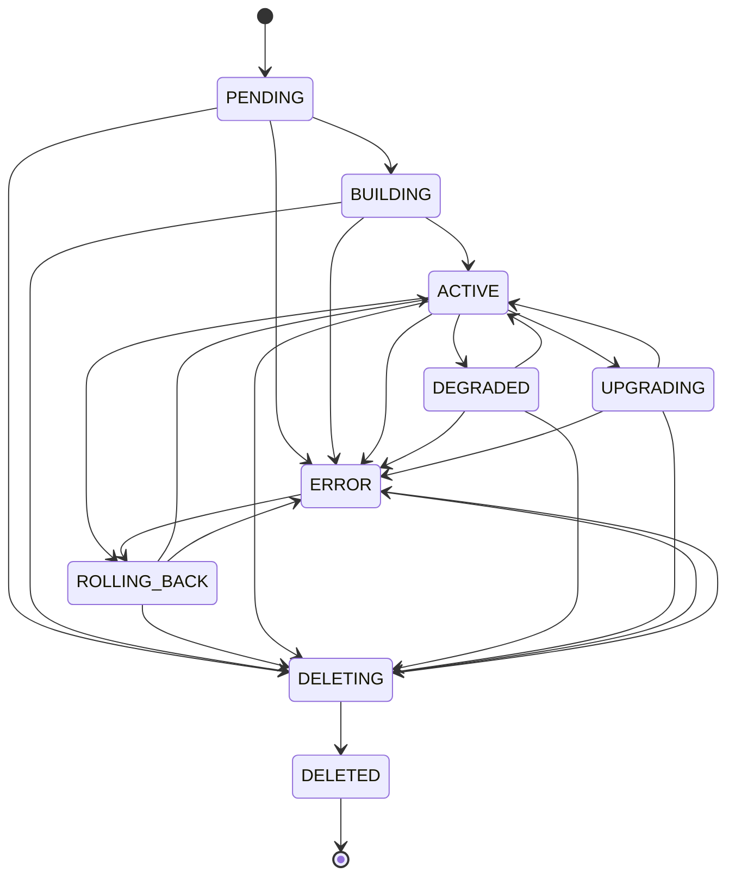
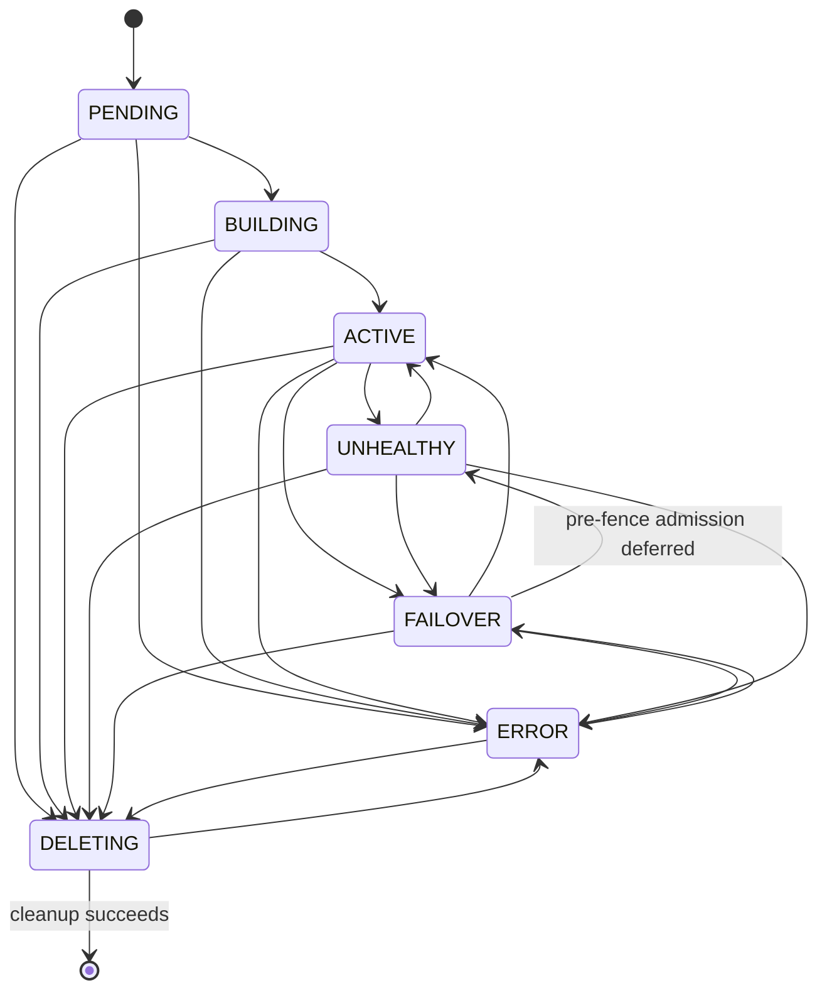
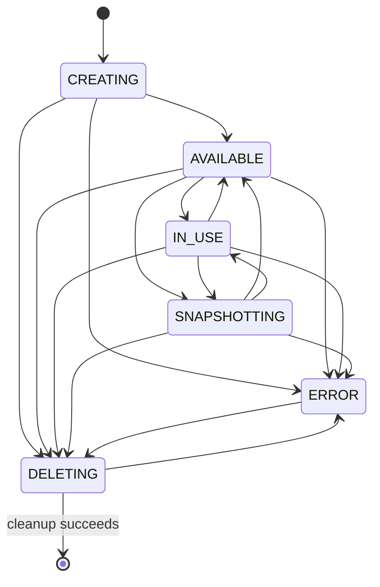
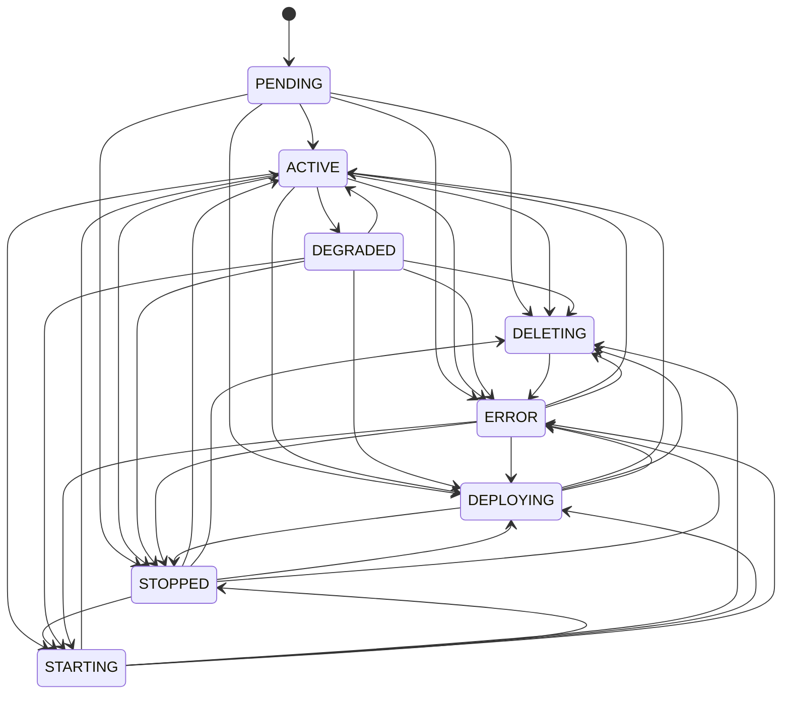
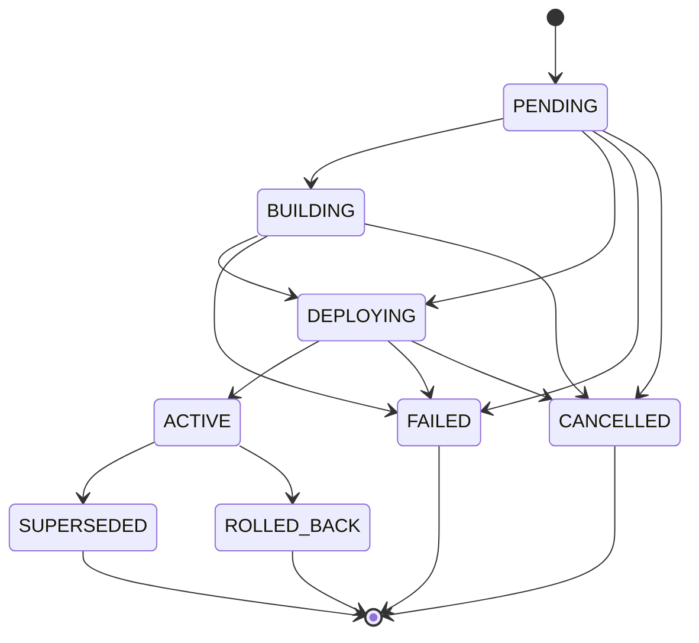
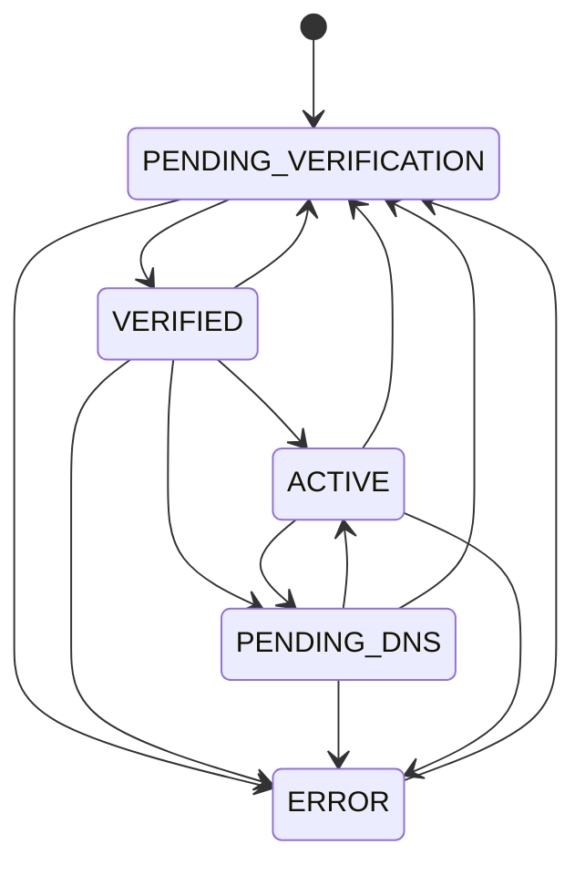
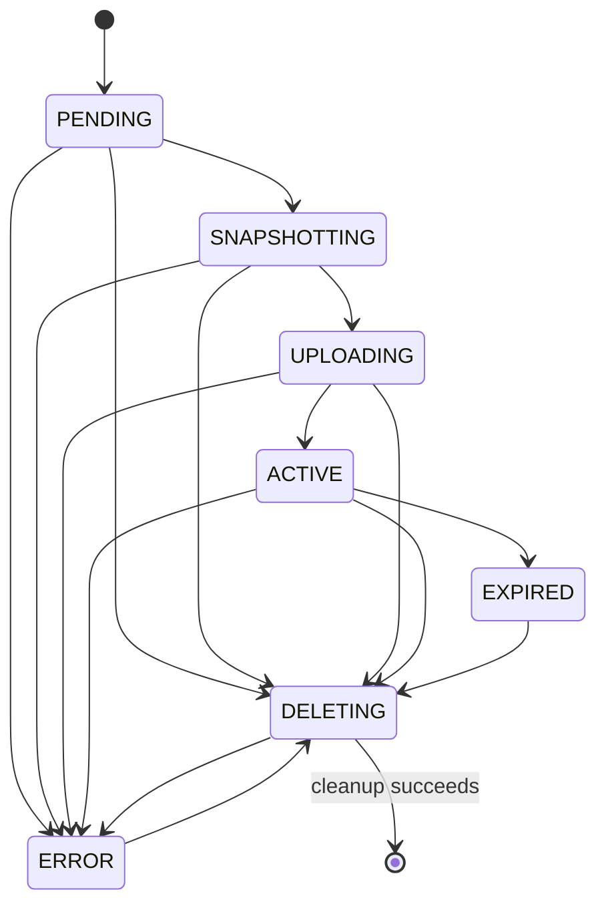

# Data model

Tables use the configured Coast database; MySQL/MariaDB supports Galera,
and SQLite is used for offline tests. The schema is defined in
`coast/db/models.py`, `coast/db/backup_models.py` and
`coast/db/base_models.py`; versioned fields are in `coast/objects/`.
Conventions:

- PK `id` = UUID4 string (`String(36)`), exposed in the API. Exception:
  `quotas` and `quota_usages` use `project_id` as their sole PK.
- Every tenant-owned row has `project_id` (Keystone project, `String(36)`,
  indexed). Every query on a tenant path filters by it.
- `created_at`, `updated_at` (UTC, `DateTime`), on every table.
  `created_at` is non-null with a Python UTC insert default; `updated_at`
  is nullable with a Python UTC update default. `deleted_at` is nullable
  without a default. These are ORM defaults, not SQL server defaults.
- All constraints and indexes have deterministic names. Tables use InnoDB
  and utf8mb4 on MySQL/MariaDB.
- `status` = coarse lifecycle state shown to users; `task_state` = the
  in-flight operation, used for compare-and-swap locking by the conductor.
- Engine-side identifiers are stored in `engine_ref` (opaque string, e.g. a
  Coolify UUID). Never exposed to non-admins.
- Secret values are **never** stored in the DB; only Barbican secret refs
  (`*_ref`). See [Secrets and Barbican](secrets.md) for each ref's
  lifecycle.
- Soft delete (`deleted_at`) on `stacks`, `appgroups`,
  `environments`, `servers`, `services` and `deployments` (billing/audit
  history). Everything else is hard-deleted.

Q94 (James, 2026-10-10 17:53 CT, names updated 17:55 CT): a **stack** is
pure infra. It holds the controller, servers, network, volumes, floating
IPs and infra secrets. It has no stage. The plan flavor does not imply a
stage. A stack contains **appgroup** rows. Each appgroup is one
Coolify project. An example name is `website`. Each appgroup contains
**environment** rows. Each environment is one Coolify environment.
A **service** row represents an app, a service or a database, distinguished
by `kind`.
It may contain one or several containers. It belongs to one appgroup and one
environment. It maps to one Coolify application, database, or service.
Deployments, domains and secrets belong to the service.

## ER diagram

`PROJECT` (Keystone) and `DRIVER` (stevedore entry point) are not tables.

## Status enums (`coast/common/states.py`)

| Resource | `status` values |
|---|---|
| stack | `PENDING`, `BUILDING`, `ACTIVE`, `DEGRADED`, `UPGRADING`, `ROLLING_BACK`, `ERROR`, `DELETING`, `DELETED` |
| appgroup | `PENDING`, `ACTIVE`, `ERROR`, `DELETING`, `DELETED` |
| environment | `PENDING`, `ACTIVE`, `ERROR`, `DELETING`, `DELETED` |
| server | `PENDING`, `BUILDING`, `ACTIVE`, `UNHEALTHY`, `FAILOVER`, `ERROR`, `DELETING` |
| volume | `CREATING`, `AVAILABLE`, `IN_USE`, `SNAPSHOTTING`, `ERROR`, `DELETING` |
| service | `PENDING`, `ACTIVE`, `STOPPED`, `DEGRADED`, `ERROR`, `STARTING`, `DEPLOYING`, `DELETING` |
| storage | `AVAILABLE`, `IN_USE` |
| backup | `PENDING`, `BUILDING`, `ACTIVE`, `ERROR`, `DELETING`, `DELETED` |
| backup_job | `PENDING`, `BUILDING`, `ACTIVE`, `ERROR` |
| deployment | `PENDING`, `BUILDING`, `DEPLOYING`, `ACTIVE`, `SUPERSEDED`, `FAILED`, `CANCELLED`, `ROLLED_BACK` |
| domain | `PENDING_VERIFICATION`, `VERIFIED`, `PENDING_DNS` (records changed, waiting to resolve), `ACTIVE` (TLS issued), `ERROR` |
| export | `PENDING`, `SNAPSHOTTING`, `UPLOADING`, `ACTIVE`, `EXPIRED`, `ERROR`, `DELETING` |

`task_state` (stack, appgroup, environment, server, service): `NONE` or an operation name
(`PROVISIONING`, `ADDING_SERVER`, `DEPLOYING`, `ROLLING_BACK`, `UPGRADING`,
`FAILING_OVER`, `DELETING`, `RECONCILING`).

### Allowed transitions

These tables define resource `status` edges, not action authorization.
The flows in lifecycle.md and the async actions in api.md still enforce
preconditions, tenant policy, and operation locks. `task_state` is only
for compare-and-swap (CAS) locking; it is not part of these tables.

Same-state transitions (X -> X) are allowed idempotent no-ops and are not
listed. Both states must belong to the resource, even for a no-op.
`check_transition` returns None for allowed edges. Unknown resources,
unknown states, and disallowed edges raise `InvalidStateTransition`, a
`Conflict` with code 409. The helper only checks: callers must persist the
change and emit the required notification.

Status edges are resource-specific: for example, a BUILDING backup must
settle before deletion.
Deletion remains subject to task locks and resource-use preconditions;
this rule permits recovery, it does not bypass those checks. Domains use
direct deletion instead. Deployments retain their final status on soft
deletion. An empty target cell means no outgoing status edges.

DELETING is not terminal: failed cleanup moves to ERROR with a sanitized
fault, and ERROR -> DELETING permits a retry. For servers, volumes, services,
and exports, DELETING is the last successful status before row removal
or soft deletion. Only successful cleanup removes or soft-deletes rows.

#### Stack

Stack create, upgrade, health/failover, and offboarding flows apply.
Upgrade starts only from ACTIVE. Rollback starts from ACTIVE or ERROR
and uses ROLLING_BACK -> ACTIVE / ERROR. ERROR has no create or upgrade retry:
lifecycle.md does not define one. A failed delete can return to ERROR,
then retry deletion. DELETED is terminal; set `deleted_at` when
offboarding completes. The stack has no stage states.

| From | Allowed to |
|---|---|
| `PENDING` | `BUILDING`, `ERROR`, `DELETING` |
| `BUILDING` | `ACTIVE`, `ERROR`, `DELETING` |
| `ACTIVE` | `DEGRADED`, `UPGRADING`, `ROLLING_BACK`, `ERROR`, `DELETING` |
| `DEGRADED` | `ACTIVE`, `ERROR`, `DELETING` |
| `UPGRADING` | `ACTIVE`, `ERROR`, `DELETING` |
| `ERROR` | `ROLLING_BACK`, `DELETING` |
| `ROLLING_BACK` | `ACTIVE`, `ERROR`, `DELETING` |
| `DELETING` | `DELETED`, `ERROR` |
| `DELETED` |  |

#### appgroup and environment

Create moves `PENDING` to `ACTIVE` or `ERROR`. `ACTIVE` and `ERROR` can
move to `DELETING`. `DELETING` moves to `DELETED` or back to `ERROR`.
`DELETED` is terminal. These two resources have no upgrade or failover
states. A stack plan does not select either name.

#### Server

Server add and health/failover flows apply. ACTIVE -> FAILOVER supports
the admin action. UNHEALTHY -> ACTIVE permits heartbeat recovery before
failover; UNHEALTHY -> ERROR covers bare-metal paging. ERROR permits admin
failover or deletion. Admin failover may retry FAILOVER/FAILING_OVER after
`[health_manager] admin_failover_stuck_timeout` seconds since the last
server update (default 600). DELETING is the last successful status; set `deleted_at` after
cleanup. Do not hard-delete the row.

| From | Allowed to |
|---|---|
| `PENDING` | `BUILDING`, `ERROR`, `DELETING` |
| `BUILDING` | `ACTIVE`, `ERROR`, `DELETING` |
| `ACTIVE` | `UNHEALTHY`, `FAILOVER`, `ERROR`, `DELETING` |
| `UNHEALTHY` | `ACTIVE`, `FAILOVER`, `ERROR`, `DELETING` |
| `FAILOVER` | `ACTIVE`, `UNHEALTHY`, `ERROR`, `DELETING` |
| `ERROR` | `FAILOVER`, `DELETING` |
| `DELETING` | `ERROR` |

#### Volume

Server add/remove, upgrade snapshots, export snapshots, and offboarding
apply. Snapshot completion returns to the prior attachment status
(AVAILABLE or IN_USE); the flow must retain that information. ERROR
permits only deletion. DELETING is the last successful status; remove the row after
cleanup.

| From | Allowed to |
|---|---|
| `CREATING` | `AVAILABLE`, `ERROR`, `DELETING` |
| `AVAILABLE` | `IN_USE`, `SNAPSHOTTING`, `ERROR`, `DELETING` |
| `IN_USE` | `AVAILABLE`, `SNAPSHOTTING`, `ERROR`, `DELETING` |
| `SNAPSHOTTING` | `AVAILABLE`, `IN_USE`, `ERROR`, `DELETING` |
| `ERROR` | `DELETING` |
| `DELETING` | `ERROR` |

#### Service

Service create/deploy/rollback and API start/stop/restart actions apply.
Creation without deployment ends in STOPPED. Health/reconcile can move
ACTIVE <-> DEGRADED; successful deploy/start/reconcile can recover ERROR
to ACTIVE, or a successful stop can move it to STOPPED. A failed new
deployment keeps the service ACTIVE only when the engine reports its
previous release ACTIVE. Otherwise the service becomes ERROR, including
crash loops, unavailable runtime status and failed initial deployments.
FAILED is a deployment state, not a service state. The previous deployment
pointer and history are retained.
DELETING is the last successful status; set `deleted_at` after cleanup,
do not hard-delete the row.

| From | Allowed to |
|---|---|
| `PENDING` | `ACTIVE`, `DELETING`, `DEPLOYING`, `ERROR`, `STOPPED` |
| `ACTIVE` | `DEGRADED`, `DELETING`, `DEPLOYING`, `ERROR`, `STARTING`, `STOPPED` |
| `STOPPED` | `ACTIVE`, `DELETING`, `DEPLOYING`, `ERROR`, `STARTING` |
| `DEGRADED` | `ACTIVE`, `DELETING`, `DEPLOYING`, `ERROR`, `STARTING`, `STOPPED` |
| `ERROR` | `ACTIVE`, `DELETING`, `DEPLOYING`, `STARTING`, `STOPPED` |
| `STARTING` | `ACTIVE`, `DELETING`, `DEPLOYING`, `ERROR`, `STOPPED` |
| `DEPLOYING` | `ACTIVE`, `DELETING`, `ERROR`, `STOPPED` |
| `DELETING` | `ERROR` |

#### Deployment

Service deploy/rollback applies. Image deployment and rollback can skip
BUILDING. Cancel applies only before ACTIVE. ACTIVE -> SUPERSEDED marks
a release replaced by a normal deployment; ACTIVE -> ROLLED_BACK marks
the current release replaced by a successful rollback. The rollback
target is not changed: rollback creates a new deployment. SUPERSEDED,
FAILED, CANCELLED, and ROLLED_BACK are terminal. There is no DELETING
status: offboarding sets `deleted_at` without changing the final status.

| From | Allowed to |
|---|---|
| `PENDING` | `BUILDING`, `DEPLOYING`, `FAILED`, `CANCELLED` |
| `BUILDING` | `DEPLOYING`, `FAILED`, `CANCELLED` |
| `DEPLOYING` | `ACTIVE`, `FAILED`, `CANCELLED` |
| `ACTIVE` | `SUPERSEDED`, `ROLLED_BACK` |
| `SUPERSEDED` |  |
| `FAILED` |  |
| `CANCELLED` |  |
| `ROLLED_BACK` |  |

#### Domain

API domain verify and health/reconcile of domains apply. VERIFIED can
reach ACTIVE directly if DNS already resolves; otherwise use PENDING_DNS.
A routing change moves ACTIVE to PENDING_DNS. ERROR must pass verification
again before activation. Domains are exempt from the DELETING rule:
from any status, call `set_domains` without the domain, then hard-delete
the row only after the driver call succeeds. There is no deletion edge
or terminal status in the domain graph.

| From | Allowed to |
|---|---|
| `PENDING_VERIFICATION` | `ERROR`, `VERIFIED` |
| `VERIFIED` | `ACTIVE`, `ERROR`, `PENDING_DNS`, `PENDING_VERIFICATION` |
| `PENDING_DNS` | `ACTIVE`, `ERROR`, `PENDING_VERIFICATION` |
| `ACTIVE` | `ERROR`, `PENDING_DNS`, `PENDING_VERIFICATION` |
| `ERROR` | `PENDING_VERIFICATION` |

#### Export

Export and object-storage housekeeping apply. ACTIVE -> EXPIRED means
object retention has expired, not that a download URL has expired.
`renew_url` leaves the status unchanged while the object exists. EXPIRED
can reach DELETING for row cleanup; ERROR permits only deletion. DELETING
is the last successful status; remove the row after cleanup.

| From | Allowed to |
|---|---|
| `PENDING` | `SNAPSHOTTING`, `ERROR`, `DELETING` |
| `SNAPSHOTTING` | `UPLOADING`, `ERROR`, `DELETING` |
| `UPLOADING` | `ACTIVE`, `ERROR`, `DELETING` |
| `ACTIVE` | `EXPIRED`, `ERROR`, `DELETING` |
| `EXPIRED` | `DELETING` |
| `ERROR` | `DELETING` |
| `DELETING` | `ERROR` |

## Tables

### stacks
Pure infra for one tenant: one controller, its servers, and its network.
No stage. The plan does not imply a stage. `engine_ref` is not a Coolify
project UUID.

| Field | Type | Null | Notes |
|---|---|---|---|
| id | String(36) | no | PK |
| project_id | String(36) | no | Keystone owner, indexed |
| name | String(255) | no | unique per Keystone project (excluding deleted), enforced by DB API |
| description | String(255) | yes | |
| driver | String(64) | no | stevedore name, e.g. `coolify_v4` |
| engine_version | String(64) | no | engine version, one of `SUPPORTED_ENGINE_VERSIONS` in `coast/common/engine_versions.py` |
| plan | String(64) | no | size/plan name (maps to flavors). Not a stage. |
| status | String(32) | no | |
| task_state | String(32) | no | default `NONE` |
| task_owner | String(64) | yes | Operation holder. |
| task_started_at | DateTime | yes | Task acquisition time, UTC. |
| default_domain | String(253) | yes | Optional default suffix. |
| dns_zone_id | String(36) | yes | Customer DNS zone. |
| dns_trust_id | String(255) | yes | Customer DNS trust reference. |
| previous_image_id | String(36) | yes | Controller rollback image. |
| previous_engine_version | String(64) | yes | Recorded rollback version. |
| upgrade_snapshots | JSON | yes | Rollback snapshots by volume purpose. |
| upgrade_checkpoint | JSON | yes | Durable upgrade/recovery intent. |
| conductor_host | String(255) | yes | Conductor task owner; NULL when released. Same-host restart recovers interrupted tasks according to their flow and clears ownership after recovery. |
| fault | Text | yes | last sanitized error, admin-visible detail |
| network_id | String(36) | yes | Neutron net (service project) |
| subnet_id | String(36) | yes | |
| router_id | String(36) | yes | |
| sg_ingress_id | String(36) | yes | tenant-facing SG |
| sg_mgmt_id | String(36) | yes | mgmt SG |
| engine_ref | String(255) | yes | opaque controller ref; not a Coolify project UUID |
| engine_token_ref | String(255) | yes | Barbican ref of engine API token |
| engine_token_previous_ref | String(255) | yes | Previous Barbican token ref retained until revocation and secret deletion succeed |
| engine_token_name | String(80) | yes | Current managed engine token name |
| engine_token_previous_name | String(80) | yes | Exact previous token name to revoke during rotation |
| engine_token_rotation_id | String(36) | yes | Durable rotation UUID, cleared after completion |
| engine_token_created_at | DateTime | yes | Creation/checkpoint time of the current token; initial tokens record bootstrap storage time |
| heartbeat_key_ref | String(255) | yes | Barbican ref of the per-stack HMAC key. Q86 RESOLVED, James-approved 2026-10-10 17:33 CT. In `0001_initial` |
| ssh_key_ref | String(255) | yes | Barbican ref of controller->worker private key |
| registry_secret_ref | String(255) | yes | Barbican ref of the per-stack registry username and password JSON. Hidden from the public API. Q125, in `0001_initial`, stack object 1.3 |
| ssh_public_key | Text | yes | public half (not secret) |
| created_at / updated_at / deleted_at | DateTime | | |

### appgroups
One row is one Coolify project (Q94). An example name is `website`.
It is not a Keystone project. `project_id` is the Keystone owner.

| Field | Type | Null | Notes |
|---|---|---|---|
| id | String(36) | no | PK |
| project_id | String(36) | no | Keystone owner, indexed |
| stack_id | String(36) | no | FK stacks, indexed |
| name | String(255) | no | unique among live rows in the stack (DB API) |
| description | String(255) | yes | |
| status | String(32) | no | |
| task_state | String(32) | no | default `NONE` |
| engine_ref | String(255) | yes | Coolify project UUID |
| created_at / updated_at / deleted_at | DateTime | | |

### environments
One Coolify environment inside an appgroup. This table is not the
stack. The name is a label. The stack plan does not select it.

| Field | Type | Null | Notes |
|---|---|---|---|
| id | String(36) | no | PK |
| project_id | String(36) | no | Keystone owner, indexed |
| appgroup_id | String(36) | no | FK appgroups, indexed |
| name | String(255) | no | unique among live rows in the appgroup (DB API) |
| description | String(255) | yes | |
| status | String(32) | no | |
| task_state | String(32) | no | default `NONE` |
| engine_ref | String(255) | yes | Coolify environment UUID |
| created_at / updated_at / deleted_at | DateTime | | |

### servers
Any machine in a stack.

| Field | Type | Null | Notes |
|---|---|---|---|
| id | String(36) | no | PK |
| stack_id | String(36) | no | FK stacks, indexed |
| project_id | String(36) | no | denormalized for filtering |
| name | String(255) | no | |
| hostname | String(63) | yes | Saved guest DNS label; immutable after creation |
| kind | String(16) | no | `vm` \| `baremetal` \| `byo` |
| role | String(16) | no | `control` \| `worker` \| `build` |
| status / task_state | String(32) | no | |
| flavor_id | String(36) | yes | Nova flavor (vm/baremetal) |
| image_id | String(36) | yes | Glance image used |
| compute_id | String(36) | yes | Nova server UUID (admin only) |
| ironic_node_id | String(36) | yes | baremetal only |
| mgmt_ip | String(64) | yes | Coast mgmt network IP |
| private_ip | String(64) | yes | env network IP |
| floating_ip | String(64) | yes | public IP (worker) |
| floating_ip_id | String(36) | yes | |
| agent_cert_serial | String(64) | yes | current mTLS cert serial |
| agent_cert_expires_at | DateTime | yes | |
| last_heartbeat_at | DateTime | yes | from health-manager |
| engine_ref | String(255) | yes | e.g. Coolify server UUID |
| fault | Text | yes | |
| created_at / updated_at / deleted_at | DateTime | | |

Constraints: exactly one live `role=control` per stack (partial-unique
emulated in the DB API; a soft-deleted control row does not count).
`kind=byo` is reserved (not in v1 API).

### volumes
Cinder volumes owned by Coast in the service project.

| Field | Type | Null | Notes |
|---|---|---|---|
| id | String(36) | no | PK |
| stack_id | String(36) | no | FK stacks |
| project_id | String(36) | no | |
| server_id | String(36) | yes | FK servers (attached to) |
| name | String(255) | no | |
| size_gb | Integer | no | |
| volume_type | String(64) | yes | Cinder type |
| mount_path | String(255) | no | default `/data` |
| purpose | String(16) | no | API defaults to `data`; `data`, `docker`, `scratch`, `controller`; provisioning also records the controller-only `registry` volume. |
| cinder_volume_id | String(36) | yes | returned only for `coast:volume:get_detail` |
| status | String(32) | no | |
| created_at / updated_at | DateTime | | |

Each VM has `purpose=data` mounted at `/data` (Coolify: `/data/coolify`)
and an automatically created `purpose=docker` volume at `/var/lib/docker`.
Export/snapshot covers `/data` and Docker named volumes under
`/var/lib/docker/volumes`. A Docker volume export includes only its
`volumes/` subtree, not images, build cache, overlay layers or containers.
Customer named volumes are `storages` rows. Their bytes live on the
worker `purpose=docker` disk under `volumes/`. Coast does not create a
Cinder volume per storage and does not bind a host path. Both Cinder
volumes move during guest replacement, so those bytes move with the
worker. An export of the Docker Cinder volume includes that `volumes/`
subtree. Delete of a `storages` row does not remove the Docker volume.
Named volumes and bind mounts are separate storage types: binds use
`host_path` and do not reserve named-volume capacity.
DB containers must be quiesced (stop or app-level dump) before export tar;
see lifecycle.md for snapshot and manifest rules.
The public volume-create enum is `data|docker|scratch|controller`.
Provisioning additionally creates a controller-only `purpose=registry`
volume mounted at `/var/lib/registry`; controllers retain all three volumes.
Volumes have no `task_state` column. The API compare-and-swaps `status`
for delete and snapshot. See api.md.

### sources
Where a service's code or image comes from.

| Field | Type | Null | Notes |
|---|---|---|---|
| id | String(36) | no | PK |
| project_id | String(36) | no | |
| type | String(16) | no | `git`, `image`, `template`, `dockerfile` or `compose` |
| repo_url | String(1024) | yes | git (https) |
| branch | String(255) | yes | default `main` |
| build_pack | String(32) | yes | `nixpacks` \| `dockerfile` \| `compose` \| `static` |
| dockerfile_path / compose_path | String(255) | yes | |
| base_directory | String(255) | yes | monorepo subdir |
| image | String(1024) | yes | registry image as `name:tag` (Q99); API and frozen specs separate `image` and `tag` |
| credentials_ref | String(255) | yes | Barbican deploy private-key reference; never plaintext. |
| deploy_public_key | Text | yes | Non-secret OpenSSH deploy public key. |
| deploy_key_rotation | JSON | yes | Pending rotation phase, owned secret refs, public key, engine refs, and retry timestamp; never private key content. |
| created_at / updated_at | DateTime | | |

Migration `0019_deploy_public_key` follows `0018_service_fault` and adds
`sources.deploy_public_key` and `sources.deploy_key_rotation`. It retains
the database fault column introduced by the preceding migration.

### services
One row maps to one Coolify
application, database, or service.

| Field | Type | Null | Notes |
|---|---|---|---|
| id | String(36) | no | PK |
| stack_id | String(36) | no | FK stacks; app group is derived through environment, not stored on this row. |
| environment_id | String(36) | yes | FK environments; required by workload creation. |
| kind | String(16) | no | `app`, `service` or `database`, chosen at creation; default `app`. |
| template_id | String(255) | yes | Selected template slug. |
| compose_ref | String(255) | yes | Barbican Compose content reference. |
| dockerfile_ref | String(255) | yes | Barbican Dockerfile content reference. |
| file_mount_secret_refs | JSON | yes | Current and retained-deployment content references. |
| task_owner | String(64) | yes | Operation holder. |
| task_started_at | DateTime | yes | Task acquisition time, UTC. |
| default_dns_zone_id | String(36) | yes | Copied customer DNS zone. |
| default_dns_trust_id | String(255) | yes | Copied customer DNS trust. |
| webhook_nonce | String(64) | yes | Per-service webhook token nonce. |
| project_id | String(36) | no | |
| name | String(63) | no | DNS-label safe; database names are unique among live services and databases in the stack. |
| description | String(255) | yes | |
| source_id | String(36) | yes | FK sources; null for standalone databases. |
| server_id | String(36) | yes | FK servers; API creation requires an explicit worker |
| ports | String(255) | yes | exposed container port(s), e.g. `3000` |
| replicas | Integer | no | default 1 (v1: 1 only) |
| cpu_limit / memory_limit_mb | Float / Integer | yes | container limits |
| reconcile_fault | Text | yes | fault owned by runtime reconcile; API 1.5 |
| unhealthy_since | DateTime | yes | first unhealthy runtime observation, UTC; internal |
| running_since | DateTime | yes | first continuous running observation, UTC; internal |
| health_check | String(16) | no | `none` for new API creates and the SQL server default; the ORM insert default remains `http` |
| health_check_port | Integer | yes | HTTP check port; null selects the first app port |
| healthcheck_path | String(255) | yes | HTTP check path; null selects `/`; API 1.4 also accepts `health_check_path` |
| auto_deploy | Boolean | no | git push webhook enablement |
| status / task_state | String(32) | no | |
| current_deployment_id | String(36) | yes | FK deployments |
| engine_ref | String(255) | yes | Coolify application, database, or service UUID |
| settings_changed_at | DateTime | yes | Last deployment-affecting settings change. `pending_changes` prefers a complete frozen spec. |
| default_domain_enabled | Boolean | no | Default true; API 1.23 default route preference. |
| default_domain | String(253) | yes | Stored default hostname. The API returns it as `default_url`. |
| created_at / updated_at / deleted_at | DateTime | | |

### deployments (immutable)
A snapshot of everything needed to reproduce a release. Rows are never
updated except `status`, timestamps, `engine_ref`, `fault`, `log_ref`,
and driver-reported `resolved_ref` (Q33).

| Field | Type | Null | Notes |
|---|---|---|---|
| id | String(36) | no | PK |
| service_id | String(36) | no | FK, indexed |
| project_id | String(36) | no | |
| number | Integer | no | monotonically increasing per service (`#42`), unique `(service_id, number)` |
| source_ref | String(255) | yes | requested git commit SHA / branch / image reference |
| runtime_log | Text | yes | sanitized runtime output as JSON lines with timestamps and streams, at most 65535 UTF-8 bytes; API 1.5 |
| resolved_ref | String(255) | yes | exact commit SHA or image digest (`sha256:...`) used; null until the driver reports it |
| spec | JSON | no | frozen service spec (build pack, ports, limits, mounts, env var *names* + secret ref versions) |
| image_digest | String(255) | yes | built image digest (for rollback) |
| server_id | String(36) | yes | FK servers, where it ran |
| trigger | String(16) | no | `api` \| `rollback` \| `webhook` \| `reconcile` |
| rollback_of | String(36) | yes | FK deployments, deployment this re-applies |
| status | String(32) | no | |
| fault | Text | yes | |
| engine_ref | String(255) | yes | e.g. Coolify deployment UUID |
| log_ref | String(255) | yes | opaque driver log reference, admin-only, no secrets |
| started_at / finished_at | DateTime | yes | |
| created_at / updated_at / deleted_at | DateTime | | |

### domains

| Field | Type | Null | Notes |
|---|---|---|---|
| id | String(36) | no | PK |
| service_id | String(36) | no | FK |
| project_id | String(36) | no | |
| primary | Boolean | no | Default false; at most one per service, serialized by the service row lock. |
| fqdn | String(253) | no | globally unique (across all projects) |
| verification_token | String(64) | no | value for `_coast-challenge.<fqdn>` TXT |
| verified_at | DateTime | yes | |
| tls | String(16) | no | `letsencrypt` (default) or `none` |
| auto_dns | Boolean | no | Coast manages records in the tenant's Designate zone (same project) |
| dns_mode | String(16) | no | `designate` \| `manual` (computed at create) |
| status | String(32) | no | |
| created_at / updated_at | DateTime | | |

Default hostname: Coast stores `<name>-<id4>.<dashed-ip>.<suffix>` when
the worker floating IP is valid, otherwise `<name>-<id4>.<suffix>`.
The suffix is `[domains] default_suffix`. See networking.md.

### secrets (service env vars)

| Field | Type | Null | Notes |
|---|---|---|---|
| id | String(36) | no | PK |
| service_id | String(36) | no | FK |
| project_id | String(36) | no | |
| key | String(255) | no | env var name, unique per service |
| is_secret | Boolean | no | true => value write-only via API |
| value_ref | String(255) | no | Barbican secret ref (all values, secret or not). Each change writes a new secret; see [secrets](secrets.md#per-app-service) |
| build_time | Boolean | no | expose at build as well as runtime; API 1.6 defaults true for applications, false for templates; older API defaults false |
| version | Integer | no | bumps on each change (captured in deployment.spec) |
| created_at / updated_at | DateTime | | |

(service_volume_mounts)=
### app_volume_mounts

| Field | Type | Null | Notes |
|---|---|---|---|
| id | String(36) | no | PK |
| project_id | String(36) | no | owner, indexed |
| service_id | String(36) | no | FK |
| volume_id | String(36) | no | FK volumes (must be on the service's server) |
| sub_path | String(255) | no | dir under volume mount, e.g. `services/<service>/uploads` |
| container_path | String(255) | no | e.g. `/app/uploads` |
| read_only | Boolean | no | |
| created_at / updated_at | DateTime | | common timestamp rules |

This table is not the customer storage API. Customer named volumes use
`storages`.

### storages

Named volume accounted on the worker Docker disk. API 1.10.

| Field | Type | Null | Notes |
|---|---|---|---|
| id | String(36) | no | PK |
| project_id | String(36) | no | indexed |
| stack_id | String(36) | no | FK stacks; unique with name |
| name | String(63) | yes | volume name; null for service-owned binds |
| size_gb | Integer | yes | accounted GiB for volumes; null for binds; not a filesystem quota |
| status | String(32) | no | `AVAILABLE` \| `IN_USE` |
| origin | String(16) | no | `api` \| `template` |
| type | String(16) | no | `volume` (default) or `bind`. |
| host_path | String(4096) | yes | Source path for a bind. |
| read_only | Boolean | no | Default false. |
| service_id | String(36) | yes | FK services; kept after detach |
| server_id | String(36) | yes | FK servers; kept after detach |
| container_path | String(255) | yes | set only while `IN_USE` |
| created_at / updated_at | DateTime | | no `deleted_at`; delete is hard |

### exports

| Field | Type | Null | Notes |
|---|---|---|---|
| id | String(36) | no | PK |
| stack_id | String(36) | no | FK stacks |
| project_id | String(36) | no | |
| status | String(32) | no | `PENDING`, `SNAPSHOTTING`, `UPLOADING`, `ACTIVE`, `EXPIRED`, `ERROR`, `DELETING` |
| volume_ids | JSON | no | volumes included |
| backend | String(16) | no | `swift` \| `s3` |
| artifacts | JSON | yes | per volume: object name, size, sha256 (no URLs stored) |
| object_expires_at | DateTime | yes | when housekeeping deletes the objects |
| fault | Text | yes | |
| created_at / updated_at | DateTime | | |

Download URLs are minted on request and never stored.

### events (tenant-visible activity log)

| Field | Type | Null | Notes |
|---|---|---|---|
| id | String(36) | no | PK |
| project_id | String(36) | no | |
| stack_id | String(36) | yes | FK stacks. Set for infra events. |
| resource_type / resource_id | String(32) / String(36) | no | |
| action | String(64) | no | e.g. `deployment.create` |
| outcome | String(16) | no | `start` \| `success` \| `failure` |
| message | String(1024) | yes | sanitized |
| detail | JSON | yes | Selected infrastructure facts; no secret or env values (0023). |
| request_id | String(64) | yes | `req-...` |
| created_at | DateTime | no | UTC insert default |
| updated_at | DateTime | yes | UTC update default |

SERVER-8 uses a volume activity event with action `delete.cleanup` as its
durable operation receipt. The bounded message stores the accepted
revision, Cinder reference, quota amount, checkpoints and event intent.
The API returns a null message for these internal receipts, including
field-selected responses. `resource_id` is not a volume foreign key, so
completion receipts remain after volume row deletion. Do not expire them.
No table, column or versioned-object field is added.

### console_tokens

One row is a single-use shell grant. The raw token is not stored.

| Field | Type | Null | Notes |
|---|---|---|---|
| id | String(36) | no | PK |
| token_hash | String(64) | no | SHA-256 hex; unique |
| project_id | String(36) | no | owner, indexed |
| stack_id | String(36) | no | FK stacks, indexed |
| resource_type | String(16) | no | `app` or `service` |
| resource_id | String(36) | no | workload id, indexed |
| command | JSON | yes | null is an interactive shell |
| user_id | String(255) | no | caller |
| expires_at | DateTime | no | UTC, default 60 seconds |
| used_at | DateTime | yes | set when the token is consumed |
| created_at / updated_at | DateTime | | common timestamp rules |

Migration `0002_console_tokens` creates this table. Downgrade drops it.

### quotas / quota_usages
Standard per-project quota (Octavia style).

| Field | Type | Notes |
|---|---|---|
| project_id | String(36) | PK |
| environments, servers, apps, domains, volume_gb, build_servers, baremetal_servers, storage_gb | Integer | `-1` unlimited, `null` = use config default. `environments` counts stacks; `apps` counts workloads; `storage_gb` accounts named storage. |
| in_use_* / reserved_* (quota_usages) | Integer | non-null, Python and SQL default 0, updated transactionally |
| created_at / updated_at | DateTime | common timestamp rules, both tables |

Quota usages have `in_use_<resource>` and `reserved_<resource>` columns for
each of the eight resources listed above. Quota limits are nullable with
no default. Both quota tables have an index on `project_id`.

Live stack, appgroup, environment and service name uniqueness is
enforced by the DB API under a project-scoped lock, not by a database
unique constraint. Stack names are unique per Keystone project. Appgroup
names are unique per stack. Environment names are unique per appgroup.
Service names are unique per environment.
The `quota_usages` row also serves as the per-project lock sentinel (Q21).
Deleted rows do not reserve names. A soft-deleted control server does not
block a new live control server in the same stack. The circular
service current-deployment FK is named and uses `use_alter` on MySQL; SQLite
creates it inline.

## Mapping to Coolify v4 (informative; normative in driver-interface.md)

| Coast | Coolify |
|---|---|
| Stack | One Coolify *instance* (controller VM) plus its network, servers, volumes, FIPs and infra secrets. No Coolify project. No stage. |
| appgroup | One Coolify *project* |
| environment | One Coolify *environment* |
| Server role=control | Coolify's localhost server |
| Server role=worker/build | Coolify *private key* (`POST /security/keys`) + *server* (`POST /servers` with `server_role` deployment/build, then `POST /servers/{uuid}/validate`) |
| Service | Coolify *application* (git, image, dockerfile), Coolify *database*, or Coolify *service* (one-click, Q95) |
| Deployment | `POST /deploy?uuid=...` -> Coolify deployment UUID; rollback `POST /applications/{uuid}/rollback` |
| Secret | Coolify application env (`/applications/{uuid}/envs`) |
| Domain | Coolify application `domains` request field (Traefik + Let's Encrypt) |
| app_volume_mount | Coolify application storage (`/applications/{uuid}/storages`) |

### Stack-delete snapshot receipts (Q106)

`stack_delete_snapshots` has UUID `id`, indexed `project_id`, indexed
`stack_id` FK, non-null `volume_id`, `cinder_volume_id`, and
`cinder_snapshot_id` (all String(36)), non-null `status` String(32), and
common timestamps. `(stack_id, volume_id)` is unique; `volume_id` is not
a foreign key. It retains each volume's Cinder snapshot reference
across teardown retries. Nullable `retention_days` records the selected
retention once. Nullable `expires_at` is a UTC timestamp set atomically
with successful stack deletion, to completion time plus those days.
Expired receipts are hard-deleted only after confirmed Cinder absence.

## Engine rollback metadata (Q132)

Private nullable stack columns: `previous_image_id` String(36),
`previous_engine_version` String(64), `upgrade_snapshots` JSON (purpose to
Cinder UUID), and `upgrade_checkpoint` JSON (durable operation intent and
cloud references). No secret values or public fields. See
[engine upgrade](design/engine-upgrade.md) for replacement and retention.
Stack ACTIVE and ERROR may enter ROLLING_BACK; ROLLING_BACK may enter
ACTIVE, ERROR, or DELETING. Server ERROR may enter FAILOVER for explicit
stack rollback recovery only.

(compose-content-m39)=
## Compose content

`services.compose_ref` is a nullable Barbican reference (`String(255)`).
Deployment `spec.compose_ref` freezes that reference. No compose plaintext
is stored in either table. See the
[compose contract](contributor/specs/compose-editor.md).

(config-file-mounts-m39)=
## Config-file mounts

`file_mounts` has a UUID `id`, tenant `project_id`, workload `service_id`
foreign key, `container_path` (255), `content_ref` (1024, Barbican), optional
`resource_name` (255), and the standard timestamps. A unique constraint
covers `(service_id, container_path)`. Rows are hard deleted. There is no
plaintext content column. Migration `0006_file_mounts` adds the table and
the nullable internal JSON `services.file_mount_secret_refs` list. This
list keeps content references used by current rows or retained deployment
specs for log masking and cleanup; unreferenced versions are pruned after
commit.
See [Config files](contributor/specs/storage.md#config-files-m39-api-115)
for validation, apply and deletion rules.

## Admin stack inventory (API 1.18)

The API derives server_count and workload_count from live Server and
Service rows. They are not persisted columns. service_project_id comes
from the configured service credential and does not change owner project_id.
Server create/delete compute_id and replacement old_compute_id/new_compute_id
use existing Event.detail JSON; no schema migration is needed.

(service-metrics-m44)=
## Service metrics

`service_metrics` stores a UUID `id`, `service_id` foreign key,
`container_name` (128 characters), `resolution` (30, 300 or 3600 seconds),
UTC `timestamp`, `cpu_percent` (float), `memory_bytes` (64-bit integer),
nullable `memory_limit_bytes` (64-bit integer) and `sample_count` for
weighted averages, with standard creation/update timestamps.
The service/container/resolution/timestamp key is unique. Indexes cover
(service, resolution, timestamp) reads and (resolution, timestamp) expiry.
There is no soft deletion: deleting a service removes its samples.
Project ownership comes from a project-filtered join to the service.
Migration `0009_service_metrics` adds the table.

(typed-storage-mounts-m45-api-119)=
### Typed storage mounts

`storages.type` is `volume` (default) or `bind`. `host_path` is nullable
String(4096); `read_only` is a non-null boolean, default false. Name and
size are nullable for service-owned binds. The existing stack/name unique
constraint permits multiple null bind names. Binds have no capacity charge.
No new table or project-wide bind resource is added.

(database-backups-m46)=
## Database backups

All four backup tables have UUID `id`, indexed `project_id` and common
timestamps and no `deleted_at` column (`coast/db/backup_models.py`).
Deleting a backup removes its stored objects and keeps the `backups` row
with status `DELETED`; the API omits those rows from listings
(`coast/conductor/backups.py`, `coast/api/v1/backup_controllers.py`).

| Table | Stored fields beyond common columns |
|---|---|
| `backup_policies` | Unique non-null `service_id` FK; `enabled` boolean (false), `hour` / `minute` integers (2 / 0), `keep_daily` / `keep_weekly` integers (14 / 8), required `engine` String(16) and `container` String(128); nullable `key_ref` / `signing_key_ref` String(1024), `last_scheduled_at` DateTime. |
| `backups` | Required `service_id` FK, `kind` String(16), `status` String(32), `engine` String(16), `container` String(128); nullable `size_bytes` BigInteger, `started_at` / `finished_at` DateTime, `duration_seconds` Float, `error` String(255), `engine_version` String(128), `sha256` String(64), `segments` JSON, `key_ref` String(1024). |
| `backup_jobs` | Required `backup_id` / `service_id` FKs, `operation` String(16), `status` String(32); nullable `error` String(255), `started_at` / `finished_at` DateTime and `safety_backup_id` String(36). |
| `backup_accounts` | Unique `project_id` and required `key_ref` String(1024), the project's Swift signing key reference. |

See [Database backups](contributor/specs/database-backups.md) for the
API contract, durable operations, storage permissions, secrets and limits.

### Customer DNS links (API 1.22)

| Table | Field | Type | Null | Purpose |
|---|---|---|---|---|
| stacks | default_domain | String(253) | yes | optional default suffix |
| stacks | dns_zone_id | String(36) | yes | linked customer zone |
| stacks | dns_trust_id | String(255) | yes | Keystone trust reference |
| services | default_dns_zone_id | String(36) | yes | zone copied on create |
| services | default_dns_trust_id | String(255) | yes | trust copied on create |
| domains | verification_started_at | DateTime | yes | start of the current verification attempt |
| domains | zone_id | String(36) | yes | selected customer zone |
| domains | dns_trust_id | String(255) | yes | linked-zone trust reference |
| domains | managed_records | JSON | yes | observed recordsets, not credentials |
| domains | dns_previous | JSON | yes | previous link retained until cleanup |
| domains | record_type | String(8) | yes | A, AAAA or CNAME preference |
| domains | status_reason | String(255) | yes | fixed safe DNS failure reason |

A domain edit can return VERIFIED, PENDING_DNS or ACTIVE to
PENDING_VERIFICATION. It rotates the token and clears verified_at.
The previous link includes the old name, zone and trust reference so cleanup
can retry after a process restart. DNS observations do not replace desired
state or exact recordset ownership checks.

### Task holder metadata (API 1.24)

Both services and stacks have nullable `task_owner` (String(64)) and
`task_started_at` (DateTime, UTC). CAS acquisition from NONE records the
operation name (default: the task name) and start time; release clears both.
Same-state CAS preserves both. These fields are bookkeeping, not an
independent lease or permission to take over another operation. The conductor
may recover an abandoned service claim after five minutes while holding the
service row lock and revalidating its holder, state and timestamp. Domain
casts hold that row until completion. Unstarted PENDING deployments older
than five minutes fail before claim release; running deployments and backup
jobs retain their tasks for their own recovery, protecting live work.
See lifecycle.md, "Domain task scope".

Controller failover also reclaims expired workload claims under service row
locks after the greater of five minutes, `deploy_timeout` and `start_timeout`.
It protects fresh tasks/deployments and unfinished backup jobs, then claims
services for failover so delayed callbacks cannot finish the old operation.
Expired deployments are marked FAILED only after replacement controller
health succeeds. See lifecycle.md, "Health and failover".

## Worker ingress rules (API 1.25)

Migration `0014_ingress_rules` adds `ingress_rules`: UUID `id`, indexed
`project_id`, indexed `stack_id` foreign key, `protocol` (4 characters),
nullable integer `port_range_min` / `port_range_max`, IPv4 `source`
(18 characters), nullable `description` (255 characters), `created_at`
and `updated_at`. Rules are hard-deleted. Stack and project locks serialize
limit and duplicate checks, including ICMP rules with nullable ports.
Managed rules are derived, never stored in this table.
Stack teardown explicitly deletes its ingress rules before soft-deleting the
stack; the foreign key cascade alone cannot clean up a soft-deleted parent.

## Standalone databases

A database is a `services` row with `kind='database'`. It reuses service
quota, task locks, reconcile, failover, runtime logs and backup records.
It has no application source or template. The source relationship must
permit database rows without a source. Parents and worker placement are
validated as for service creation.

The database migration adds nullable fields for engine, version, initial
database name, username, public access settings and Barbican secret
references. These fields apply to database rows. Secret values never go
in these columns. Public access settings record enablement, port and
source. The catalog is `DATABASES` in `coast/common/engine_versions.py`;
it supplies supported releases, reviewed images, defaults, ports and
backup support. Do not duplicate catalog values in documentation.

Names are unique among live services and databases in a stack. Database
status follows service lifecycle rules. Creation starts at `PENDING`,
then uses `CREATING` or `STARTING`, and ends at `ACTIVE` or `ERROR`.
Database data lives in a named volume on the worker's Docker volume.
Worker failover preserves that volume. Database deletion removes its
named data volumes; stop preserves them.

The database API exposes only database rows. Service list and show exclude
them. `kind=database` is not a valid service-list filter. Database backup
policies derive the engine and container from the database. A `new_copy`
restore creates another database with the same engine, version and
placement. See the [database API contract](api.md#databases).

A database is a `services` row with `kind=database`. Nullable columns are
`engine`, `engine_version`, `db_name`, `db_username`, `public_enabled`,
`public_port`, `public_source`, `password_ref` and `root_password_ref`.
The two password columns contain only Barbican references. Placement,
quota, task ownership, timestamps, soft deletion and name uniqueness reuse
the service model. A private source row holds the reviewed image for the
shared schema; it is never exposed by service routes or used for dispatch.
The engine UUID is also its container-network hostname. Public URLs omit
passwords; only the credentials endpoint resolves secret references.

The database response computes `restart_required` from the existing
`settings_changed_at` checkpoint. It stays true after limit configuration
is saved and clears when an explicit start/restart successfully queues the
runtime change. No additional database column is needed.

The nullable Text column `services.fault` stores a fixed customer-safe
failure reason for database rows. It contains no exception details and is
null before failure, when a new action starts, and on ACTIVE or STOPPED.

Migration `0020_service_dockerfile` follows `0019_deploy_public_key`.
Repository-free Dockerfile sources store only `services.dockerfile_ref`
(opaque Barbican reference), snapshotted as `dockerfile_ref` in deployments.
Repository-free Compose sources reuse `compose_ref`; both source rows store
only their type. See contributor/specs/compose-editor.md for the contract.
