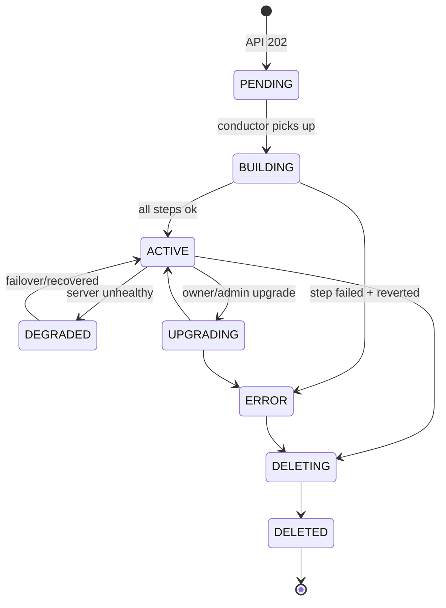
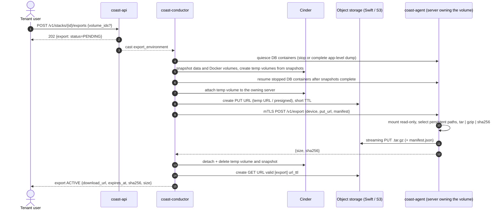

# Lifecycle

All flows run in `coast-conductor` as ordered, idempotent steps with
revert. Before starting, the conductor does a compare-and-swap on the
resource's `task_state` (`NONE` -> `<OP>`); if it fails, the request is
rejected/requeued. On completion `task_state` returns to `NONE`. On
unrecoverable error: `status=ERROR`, `fault` set, partial resources reverted
(or left tagged for the janitor if revert itself fails).

## Noop driver

The `noop` driver uses deterministic fake cloud operations for offline
flows. Real provisioning uses the stack-create and server flows below.
The noop path creates the controller data volume and requested servers
from capacity reserved by the API; it does not model plan-dependent Docker
and worker volume sizes.

RPC version 1.0 casts carry versioned objects, the exact quota delta mapping,
and an acceptance revision that preserves timestamp microseconds. The
revision is separate because versioned DateTime fields omit microseconds
on the wire. The request context does not carry a Keystone token or
plaintext environment variables. The API sends stored references instead.

The bounded fake operations hold the project sentinel and stack and
resource row locks in one DB transaction. Task CAS checks the API lock.
State completion, task release, quota completion and a sanitized activity
receipt commit together. Status changes emit oslo.messaging notifications.
The API emits `coast.<resource>.<action>.start` when it accepts a
create, update, or delete. The conductor emits `start`, `end`, and
`error` after that attempt's transaction commits. Payloads contain
identifiers and status only. See api.md.
Existing event IDs identify completed operations; repeated messages do not complete a reservation twice. A failed step runs
reverse-order revert, rolls back partial DB writes and held quota, records
a generic fault, and releases the task. Arbitrary exception messages are
discarded.

Volume create and extend have no task_state column. Their start receipts
are written in the acceptance transaction, with only the held GiB amount
in the event message. Completion coalesces pending size changes under the
volume lock and records each receipt's outcome. Delete rolls back pending
amounts before releasing the already committed capacity. This handles
unordered casts without adding a column or a reservation table (Q44).

Service, deployment, domain and export casts use this same completion.
Create without a deployment leaves the service STOPPED. A deployment moves
from PENDING to DEPLOYING to ACTIVE and sets the service ACTIVE. Rollback
does that for the new row and marks the previous current deployment
ROLLED_BACK. Cancel releases the service task and leaves the deployment
CANCELLED. A failed deployment uses FAILED, not ERROR. Domain verification
follows the domain flow below (Q100). Export create records
SNAPSHOTTING, UPLOADING, then ACTIVE and releases the stack lock.
It does not write an archive, an expiry, or a URL. Export delete removes
the row. Q102: `snapshot_retention_days` without `snapshot_volumes`
returns 400 before any write. Real teardown, snapshot-on-delete, and
export-before-delete are implemented.
Q45 is resolved: cleanup sets `deleted_at` on the server row. Service and
deployment history foreign keys stay valid. Stack offboarding with
that history completes on the noop driver.

Real network flows must use resumable steps rather than hold this bounded
fake-cloud transaction across network requests.

(domain-verification-m3)=
### Domain verification

Q100 is **RESOLVED, PM-decided, FYI James**. Domain create stays
PENDING_VERIFICATION and does not publish the name. A verify request starts
TXT checks. A matching token in `TXT _coast-challenge.<fqdn>` moves the
domain from PENDING_VERIFICATION to VERIFIED. The conductor then calls
`driver.set_domains` and moves the domain to PENDING_DNS.
A changed domain list on a running workload is applied by an image-reusing
restart, without a build (issue 29). Stopped workloads remain stopped.
This also applies to domain removal, stack default domains and automatic DNS. Routing and TLS
checks must succeed before the domain moves to ACTIVE.

ACTIVE requires all three checks: the TXT record contains the domain's
token; routing has a CNAME equal to the service's default hostname, or any
A/AAAA answer equal to the service's worker floating IP; and a conductor
HTTPS probe to `https://<fqdn>/` completes a TLS handshake with SNI and a
certificate valid for the FQDN under the system trust store. Any HTTP
status counts. Coolify's worker Traefik obtains the certificate through
Let's Encrypt HTTP-01; Coast checks it, rather than issuing it.

A state-driven conductor periodic task processes PENDING_VERIFICATION
domains only after a verify request, plus VERIFIED and PENDING_DNS domains.
It resumes from stored state after a restart. DNS resolution uses dnspython.
New `[domains]` options are `nameservers` (default empty, for system
resolvers), `poll_interval` (30 seconds), `verification_timeout` (24 hours
for TXT), and `activation_timeout` (1 hour for routing/TLS). A timeout moves
the domain to ERROR with a user-safe fault. Retry follows
ERROR -> PENDING_VERIFICATION. No new API fields are added.

Proxied/CDN domains are not supported: they fail the routing check. Support
for these domains is a future item (Q100).

RPC semantics follow the
[oslo.messaging client reference](https://docs.openstack.org/oslo.messaging/latest/reference/rpcclient.html):
casts do not guarantee delivery order or remote completion. If handoff
fails, the API retains accepted state and reservations for operator
recovery, except for unclaimed stack creates: the API cancels those and
releases their reservations as described below. There is no automatic
reservation expiry (Q39).

## Stack create



Steps:
1. Quota already reserved by API; commit reservation.
2. **Network**: create the stack network `coast-env-<id>` net/subnet/router
   (gateway to external), SGs (`ctrl`, `node`, egress rules), tag everything.
3. **Secrets**: generate the stack SSH keypair (ed25519) -> Barbican;
   generate the per-stack heartbeat HMAC key -> Barbican
   (`heartbeat_key_ref`); generate the registry username and password
   JSON -> Barbican (`registry_secret_ref`, Q125); issue controller
   agent cert from Coast CA.
4. **Controller**: boot `coast-coolify-controller` image (plan flavor) with
   NIC0 mgmt (`coast-mgmt` SG) + NIC1 stack network; config drive carries agent
   cert/key, CA, HMAC key, server id, health-manager addresses. No FIP.
5. **Controller volumes**: create + attach `purpose=data` at `/data`
   (Coolify uses `/data/coolify`), `purpose=docker` at `/var/lib/docker`,
   and `purpose=registry` at `/var/lib/registry` (Q125). Mount them before
   the engine starts. Guest replacement keeps these volumes. The registry
   volume is not an API purpose and is not part of export snapshots.
6. Wait for agent `GET /health` over mTLS (timeout `[controller_worker] build_timeout`).
7. **Engine bootstrap** (agent-local, see next section): conductor calls the
   agent's one-shot `POST /v1/bootstrap`; the returned engine API token goes to
   Barbican (`engine_token_ref`). The `.env` stays on the controller data
   volume. Then
   `driver.bootstrap_environment` applies instance settings only (Q94).
   It does not create a Coolify project. Verify
   `driver.get_engine_version` == the stack's recorded `engine_version`.
8. **Workers / build** (from request): for each -> *Server add* flow below.
9. `status=ACTIVE`, notification `coast.environment.create.end`
   (Q47 name; the resource is the stack).

(m3-controller-only-implementation)=
### Controller and initial-server implementation

`coast.conductor.stack_create` runs a serial Taskflow. No cloud or
agent request holds a DB transaction. The initial project-scoped claim
changes PENDING to BUILDING and commits the API reservation. Duplicate
casts do not run another create flow or settle quota twice.

Initial `workers` use each requested `kind` and `plan`. When
`build_server=true`, exactly one configured VM plan must allow the build
role; missing or ambiguous build plans fail before cloud creation. No
tenant API fields or plan columns are added (SERVER-6, PM-decided).
The controller becomes ACTIVE after bootstrap and version verification.
Then the same `AddServer` tasks used by separate server add requests run
inside this serial flow, with a build VM before workers. This order lets
the engine validate deployment workers against an existing build server.
The stack stays BUILDING with its PROVISIONING task until all servers
complete. The API reservation already includes these servers; it is
committed once, not again per server. Each VM reserves its additional
data and Docker volume GiB before Cinder creation. Bare-metal requests
still fail closed at the SERVER-4 boundary.

The tasks create the stack network and the tagged management and stack
ports, then checkpoint SSH and HMAC Barbican references. The controller
uses the second host address of the configured stack subnet. The first
host is reserved for its router. Existing plan definitions select the
control-role VM flavor. Exactly one active Glance image must match the
configured controller tag and owner, with `coast_role=controller`.
An optional `controller_image_id` narrows this selection; it does not
bypass the owner, tag, role or active-status checks.

Both Cinder volumes are created and become available before Nova boot.
They are supplied in Nova's boot-time block-device mapping, with
`delete_on_termination=false`. This implements steps 4 and 5 without a
race between the engine start and volume attachment. The data size comes
from the accepted quota delta. The Docker size and type come from
operator configuration. Additional Docker GiB are reserved and committed
in the same short transaction as its Coast volume row.

The config drive contains base64 cloud-config user data: root-owned 0600
agent configuration, a serverAuth certificate and key, client CA trust,
the existing server CA public trust certificate,
the server id, the stack id, the HMAC key, and health-manager IPv4
addresses. It also formats only unformatted volumes and mounts `/data`
and `/var/lib/docker` through `/dev/disk/by-id/coast-<cinder id>`.
A cloud-init bootcmd links that path to the attached virtio-blk or
virtio-scsi disk and installs a udev rule for later boots. The bootcmd
does not stop `docker.service` and does not mask `docker.socket`.
The vendor unit requires that socket and starts dockerd with `-H fd://`.
A mask fails the requirement, so Docker never starts and the controller
agent never listens. A stop during cloud-init cancels the queued Docker
start. The image orders `docker.socket` after the Cinder mount wait, so
dockerd does not keep a root-disk database over the moved Coolify
database. The stored API token then stays valid. Failover does not
bootstrap again.
The virtio-blk serial is the first 20 characters of the Cinder id. The
virtio-scsi serial is those 20 characters, or the full id when libvirt
sets the SCSI device id. The image may use either disk bus. It must
start the engine and the agent only after cloud-init mounts and guest
route setup finish. Units ordered after `cloud-final.service`, directly
or through
dependencies, are enabled under `cloud-init.target`, not
`multi-user.target`. This includes Docker, guest route setup,
the agent and controller first boot. The image hooks remove their old
multi-user target links to avoid Ubuntu cloud-init ordering cycles.
It must not put persistent engine state on the root disk. This
flow does not install or patch the engine, generate root credentials, or
change the Q78 boundary.

After Nova ACTIVE and mTLS `/health`, a durable bootstrap start event
precedes the one-shot POST. The request contains only the pinned version.
Q78's token-only agent does not consume root credential fields. The token
is checkpointed in Barbican; the `.env` stays on the controller data
volume. Then the
driver bootstrap and the exact engine-version check run. Only then does
the controller become ACTIVE. Initial server tasks run next, and the
stack becomes ACTIVE and releases the provisioning task only after all
requested servers complete. Final server and stack states settle in one
DB transaction.

Taskflow reverts the failed task and completed tasks in reverse order.
Initial servers revert in reverse order before the controller. Nova
deletion must complete before volumes, identity secrets, or networks
are removed. If any initial guest remains (including uncertain engine
registration with a failed unregister), keep the controller and its
volumes, shared network, and Barbican references for operator recovery.
A partial failure leaves the stack and created server/volume rows in
ERROR with the remaining cloud references; accepted capacity is released
once, as in the existing provisioning flows. Lost Nova and Cinder create
replies are found by deterministic names and ownership tags or metadata.
Nova, Cinder, and
port names use `[DEFAULT] resource_name_prefix`; the default `coast`
keeps existing names byte-identical. Keep the same prefix while managed
resources exist: retry, adoption, and cleanup use the configured prefix. A name alone is not
enough. A failed delete keeps its cloud reference. A failed guest delete
keeps its dependent resources and secret references for operator
recovery. Failures use a fixed fault. Raw SDK and agent exceptions and
sensitive Taskflow return values are omitted. Nova config-drive and
Barbican transport payload logging stays disabled when operator debug
logging is enabled.

Conductor restart recovery records
`[DEFAULT] host` in the stack's nullable `conductor_host` when the conductor
claims its task. Releasing the stack task clears the host. Before consuming
RPC, startup changes only this host's stacks with a non-NONE task to ERROR,
clears the task and host, and records "Interrupted by conductor restart".
Skip RECONCILING: existing deployment recovery keeps its lock and host until release (PM decision).
Saved cloud references remain intact, and a later DELETE is accepted.
An interrupted create (task ``PROVISIONING``) releases the accepted quota
once, the same as a failed create. It records one create failure for each
stack, server, volume, service, or domain that has no create success or
failure yet. The resource type is the repository name (``environment``
for the stack). A later DELETE does not release that capacity again.
An interrupted delete does not record those create failures. DELETE
releases any capacity that is still charged when it completes.
The recount lowers in-use counters to the live rows. It does not raise a
counter. It skips a resource that still has a reservation. It does not
run while another stack in the project is ``BUILDING`` or ``PROVISIONING``,
because that create may already have committed quota before its rows exist.
Failed volumes are the exception. After a failed create, or when delete
removes volumes that did not release quota per row, ``volume_gb`` is
released once if four conditions are true: a volume reservation remains,
no stack create is in flight, no volume row still counts, and in-use
``volume_gb`` is exactly those volumes. A different in-use value stays.
A second call does nothing.
When that failed create's volume rows are already gone and delete has
no volume cleanup receipt, delete lowers in-use ``volume_gb`` to the
live rows even if a volume reservation remains. It does not do this
while another stack create is in flight. A cleanup receipt that does
not match still leaves that different charge. A volume that was never
marked failed, on a stack whose create failed, is released once when
its Cinder volume is already gone. A second delete does nothing. The
reservation is not cleared.
Keep the host identity stable across restarts and distinct between hosts.
An unclaimed stack create (PENDING, PROVISIONING, NULL conductor_host) can
be cancelled by DELETE. The API and conductor serialize this decision with
the project sentinel and stack row lock. Before handoff the API stores the
exact reservation in the create activity receipt. Failed handoff marks an
unclaimed stack ERROR, clears its task, rolls back that reservation and
marks the receipt failed in one transaction. A late or duplicate cast cannot
restart that create or settle its quota again. A claimed create retains its
lock and capacity. DELETE then follows the ordinary teardown flow.
Without an acceptance receipt, cancellation recovers the outstanding stack
quota counters only while no other stack/server create or volume operation
in the project could own them. Otherwise DELETE returns 409 for retry after
those operations finish. The recovery uses the held counters, preserves
unrelated quota resources, and records the recovered delta in the failure
receipt; it does not infer capacity from current configuration defaults.
There are no heartbeats, cross-host takeover, or new periodic recovery tasks.
Server, service and deployment recovery beyond the same stack lock is OPEN.
Duplicate RPC messages do not take over a running or uncertain attempt.
The operator must inspect recorded steps and tagged resources before cleanup.
This flow does not restart interrupted work. A started bootstrap is never repeated on
that guest. Follow Q80's replacement and recovery rule.

Implementation follows the documented
[Taskflow task/revert contract](https://docs.openstack.org/taskflow/latest/user/atoms.html),
[Nova server resource](https://docs.openstack.org/openstacksdk/latest/user/resources/compute/v2/server.html),
and [cloud-init modules](https://cloudinit.readthedocs.io/en/latest/reference/modules.html).

## Appgroup and environment (Q94)

Create these resources only after the stack is `ACTIVE`:

1. Create an appgroup: `driver.ensure_project` stores the Coolify
   project UUID on `appgroups.engine_ref`. The API also creates a
   `production` environment (Q147), which the conductor activates right
   after the project; if the appgroup fails it goes to ERROR.
2. Create an environment: `driver.ensure_environment` stores the Coolify
   environment UUID on `environments.engine_ref`.
3. Delete an environment only when it is ACTIVE or ERROR, its stack
   is ACTIVE, DEGRADED or ERROR with task NONE or RECONCILING, and it has no
   non-deleted service. Otherwise the API
   returns 409. The conductor calls `driver.delete_environment`. A
   null `engine_ref` skips the driver. Driver NotFound means the
   object is already gone. Success stores status DELETED, then
   soft-deletes the row. Failure stores ERROR and the fixed message
   "Engine cleanup failed; retry delete".
4. Delete an appgroup only when it is ACTIVE or ERROR, its stack
   is ACTIVE, DEGRADED or ERROR with task NONE or RECONCILING, and it has no
   non-deleted environment. Otherwise the
   API returns 409. The conductor calls `driver.delete_project`. A
   null `engine_ref` skips the driver. Driver NotFound means the
   object is already gone. Success stores status DELETED, then
   soft-deletes the row. Failure stores ERROR with the same fixed
   message.
   For both deletes, an ERROR stack skips engine cleanup with a warning.
   On an ACTIVE or DEGRADED stack, EngineUnreachable permits record
   deletion with a warning. Other engine failures retain ERROR and require a retry.
5. These rows have no flavor and no stage list. The stack plan does not
   select an environment.

## Engine bootstrap (Coolify token, agent-local)

Decision Q4: the **coast-agent on the controller VM bootstraps Coolify
locally** and hands the API token back to Coast over mTLS. Nothing about
Coolify is patched; the controller's Coolify UI/API are never reachable
off-box.

```mermaid
sequenceDiagram
  autonumber
  participant C as coast-conductor
  participant B as Barbican
  participant G as coast-agent (controller)
  participant K as Coolify (localhost)
  C->>G: mTLS POST /v1/bootstrap {engine_version}
  G->>G: require image/first-boot installation completed (Q78)
  G->>G: verify stock image tag matches engine_version
  G->>K: wait for GET http://127.0.0.1:8000/api/v1/health
  G->>K: create API token for root user/team (local only, see methods)
  G->>K: POST /api/v1/enable (API on); require loopback API access
  G->>K: GET /api/v1/version == engine_version
  G-->>C: 200 {token, engine_version}
  C->>B: store token; checkpoint reference, managed name and creation time
  G->>G: wipe token from disk/memory, mark bootstrap done (endpoint now 409)
```

Rules:
- **Install at first boot, not at image build.** The golden image carries
  the pinned install script and pre-pulled pinned Coolify container images
  (no internet dependency at boot), but the install itself runs per
  stack so `APP_KEY`, DB passwords and the root user are unique.
- Q78: first boot generates unique root credentials locally. They are
  kept only in the private engine `.env` on the controller data volume.
  Never put them in the config drive or logs.
- Pre-creating the root user via `ROOT_USERNAME`/`ROOT_USER_EMAIL`/
  `ROOT_USER_PASSWORD` (documented Coolify install variables) means the
  public registration page is never exposed.
- Token creation uses the controller-local, version-gated PHP bootstrap in
  `coast/agent/engines/bootstrap.py`. It runs the stock application's Laravel
  bootstrap inside the container, validates the baked release and root-team
  ownership, then creates the root user's token with `root` ability. This
  container execution is limited to initial bootstrap and the explicit
  create/revoke token-rotation protocol.
- `/data/coolify/source/.env` (contains `APP_KEY`, needed for any Coolify
  restore) stays on the controller data volume and in volume snapshots.
- Self-update stays disabled (`AUTOUPDATE=false` in Coolify's `.env`, verify
  per pinned version); upgrades only via Coast's upgrade flow.
- Token rotation: periodic sweep or operator command uses the two-phase
  checkpoint and revocation protocol in [secrets](secrets.md#rotation).
- Failure at any step -> controller is rebuilt from scratch (bootstrap is
  not resumed half-way); stack create reverts per its normal revert path.

### Offline first boot (Q78)

Q78 is **RESOLVED (James approved 2026-10-13)**. The image stages unchanged
installer support files from the selected supported release tag:
`docker-compose.yml`, `docker-compose.prod.yml`, `.env.production`,
`upgrade.sh`, `upgrade-postgres.sh` and `versions.json`. The element checks
per-release SHA256 values from `coast/common/engine_versions.py` before use.
`COAST_COOLIFY_IMAGES_LOCK` supplies reviewed stock engine/helper/support
image digests matching that release. Build-time Docker pulls use those
digests and save the images in a checksummed archive on the image root disk.
Do not start containers or bake secrets into the golden image.

Before Nova controller creation, the conductor reads the stack's existing
router and environment subnet through the Neutron SDK. The router must
exist with an external gateway network and the subnet must exist with a
gateway_ip. Otherwise provisioning fails before Nova create with a fixed,
resource-specific fault. Revert retains the existing cleanup ordering.

After guest route setup, the agent runs the Q103 bounded route/DNS/HTTPS
check and exposes its cached state in internal `/health`. Pending does not
pass health. An error fails the flow immediately with
`no internet egress via stack router`; it cannot proceed to bootstrap.
The same gate covers initial workers/build servers. No heartbeat, DB,
public API or driver interface fields change. Generic exceptions retain
the existing generic fault; only fixed guest-network faults are preserved.

`coast-guest-routes.service` runs after `cloud-final.service` and
`network-online.target`. It matches `[agent] bind_ip` to the static
management address and link MAC in Nova network data. It writes persistent
Netplan configuration: static management IPv4 without a default route,
configured off-link heartbeat host routes via the management gateway,
and Neutron DHCP on the environment NIC. It removes stale management
default routes. Cloud-init does not regenerate the replaced network file.
Both NICs and agent sockets stay in the main namespace. The stack router
owns the only default route. Missing or ambiguous data fails closed.

On controllers, `coast-coolify-firstboot.service` requires cloud-final,
the route service, Docker, `coast-volume-mounts.service`, and the
Cinder mount points `/data`, `/var/lib/docker` and `/var/lib/registry`.
That oneshot waits for the mounts after cloud-final and before dockerd.
`docker.socket` is not masked. Its drop-in requires the mount wait and
sets `DefaultDependencies=no`, so the socket is not ordered before
`sockets.target`. Socket activation cannot start dockerd on the root
disk. The agent requires successful completion of this oneshot. First boot loads the archive into the
mounted Docker volume, creates private directories and unique `.env`
secrets, and provisions Coolify's local SSH key. It uses stock Compose
definitions with a separate private resolved Compose file.
Published engine ports are 8000 and 6001. Both bind to `127.0.0.1`
only. First boot does not publish the built-in terminal port 6002.
Stack create and each service reconcile turn that terminal off through
the engine API. First boot does not write that setting.
After Coolify is up, first boot starts the pinned `registry:3` container.
That container publishes only the environment address and
`[controller_worker] registry_port`. It does not publish `0.0.0.0` or
`127.0.0.1`.
Compose uses `pull_policy=never` and `--pull never`; neither `install.sh`
nor `upgrade.sh` runs. Coolify starts without CDN or registry access.
Optional upstream public-IP discovery does not supply an install artifact.

First boot writes `AUTOUPDATE=false`, `ROOT_USERNAME`, `ROOT_USER_EMAIL`
and a locally generated `ROOT_USER_PASSWORD` into the private `.env`.
The password has a random suffix and meets the stock seeder's mixed-case,
digit and symbol requirements. Do not log these credentials.
The stock install variables and first-boot support files are tied to the
selected release in `coast/common/engine_versions.py`. The image build
verifies its support-file checksums; `coast/agent/firstboot.py` writes the
private environment and starts the staged Compose definitions. The
version-gated `coast/agent/engines/bootstrap.py` repairs missing root-user
and team membership and disables registration before creating a token.

The API allowlist stays unset. Loopback engine port bindings and the agent's
mTLS listener on the guest management address control access. Both guest
NICs remain in the main namespace; control-side management sockets use
`[controller_worker] mgmt_netns`.
The API stays disabled until the existing token bootstrap enables it.
No direct Coolify database access and no `docker exec` into Coolify
occur at first boot. The registry container is separate from Coolify.

James approved the root-user fallback for Q78. The version-gated
controller-local token bootstrap creates missing Coolify user 0 with
`forceFill` and `save`, using `ROOT_USERNAME`, `ROOT_USER_EMAIL` and
`ROOT_USER_PASSWORD` from the container environment. It hashes the
password and exits with status 1 if any value is empty. It does not run
the seeder's DNS validation: `email:rfc,dns` cannot pass offline.
If team 0 exists and user 0 is not attached, it attaches the user with
role `owner`. It sets `InstanceSettings` id 0
`is_registration_enabled=false`. These steps are idempotent, including
membership and settings repair on retry. Any PHP `Throwable` exits with
status 1 without a message. Environment values are never printed.
This is part of the existing Q4 bootstrap exception, not permission for
other engine database access. First boot still does not execute container
commands or write engine settings directly.

First boot uses `[agent] stack_id` from `/etc/coast/coast.conf` for the
synthetic address `<stack-id>@coast.local`. It never receives mail and
has no configuration option. Missing or invalid stack UUIDs fail closed
when creating `.env`. Existing `.env` files are preserved on retry.

Retry and guest replacement preserve `.env`, engine DB volumes and SSH
keys. They load the same pinned archive; they do not repeat token
bootstrap or erase its persistent markers.
First boot does not write a new `.env` when `ssh`, `appgroups`,
`databases` or `services` already exist and `.env` is absent.
A failed step stops the agent dependency chain. Child-process output and
secrets are never sent to the journal. Operators must recover or replace
the guest before they retry stack creation.

(m3-agent-boundary-q78-q81)=
### agent boundary (Q78-Q81)

The image/first-boot lane owns installation, unique root credentials,
loopback-only engine exposure and supported self-update disabling.
The agent does not run an installer. Its version-gated bootstrap exception
enables the API and repairs root-user, team and registration state.
First-boot failure blocks
the agent unit and therefore blocks bootstrap. Existing root credential
fields in the bootstrap body are not used by the token-only agent step
and are not persisted or logged.
`engine_version` must match the immutable guest image release for
bootstrap and rotation, regardless of the control-plane new-stack default.

The agent packages the verified Q4 token logic under
`coast/agent/engines/bootstrap.py`. It checks the stock image tag before
internal access and the Laravel version/root-team ownership in the
verified PHP payload. It enables the API and verifies its version using
loopback only. No engine output is forwarded. Precondition failures,
including rejected loopback API calls, return a sanitized HTTP 412.

The persistent owned 0700 `[agent] state_path` holds bootstrap markers and
private staged replacement tokens during rotation. Staged plaintext is removed
after the conductor checkpoints the new ref and the agent revokes the old name.
An exclusive start marker consumes bootstrap before any engine mutation.
A success marker is synced before the one-shot token response. Concurrent
requests and subsequent restarts return HTTP 409.
A failed attempt is not resumed. Restore these markers with the data
volume during guest replacement; do not remove them to retry bootstrap.
Temporary host token files live in the private volatile `runtime_path`
and are removed on success and failure. Startup removes abandoned token
directories without resetting the one-shot markers. Cleanup of
the container token copy is attempted only after the image-pin check.
A failed Docker cleanup requires operator recovery on the isolated guest.

`POST /v1/bootstrap/rotate-token` requires successful bootstrap and the baked
engine version. It accepts `rotation_id` (UUID), `previous_name` (the exact
previous Coast token name), and `phase` (`create` or `revoke`). The version-gated
Q4 exception creates only the uniquely named replacement on create; it does not
revoke the current token. Its plaintext is staged privately and durably on the
controller volume for retries of that UUID. Interrupted unpublished creation
can replace only its own named candidate. A different pending UUID gets 409.
After the conductor checkpoints the replacement ref and previous ref in one
transaction, revoke deletes only the exact previous name. A durable receipt
makes revoke idempotent and permits removal of staged plaintext. Completed
UUIDs cannot create another token. No environment file is returned. See
[Secrets rotation](secrets.md#rotation) for conductor recovery and locking.

Worker/build agents expose health and heartbeats but refuse bootstrap and
engine proxy access. No guest opens an RPC connection or emits RabbitMQ
notifications. The conductor remains responsible for lifecycle audit.

## Server add (worker / build)

1. Boot `coast-worker` image (Nova flavor, or Ironic node via baremetal
   flavor - only if `[controller_worker] enable_baremetal = true`; default
   off) with NIC0 mgmt + NIC1 env net; config drive: agent cert, CA, HMAC
   key, **env SSH public key** for the engine SSH user (`[coolify] ssh_user`)
   that the engine uses for server access.
2. For each VM, create + attach two Cinder volumes: `purpose=data` at
   `/data` for persistent state and `purpose=docker` at `/var/lib/docker`
   for named volumes and rebuildable cache. Mount both before Docker starts.
   Bare metal: local disk instead (no Cinder unless boot-from-volume is
   available).
3. Wait for agent health.
4. Worker only: allocate floating IP, associate to env NIC. The standalone
   `coast.network.fip` helper supports tagged adoption and explicit delete
   as revert; the server-add conductor flow now calls it.
5. `driver.register_server(..., ssh_private_key)` -> `engine_ref`.
   Coolify validation is asynchronous. Registration polls the server until
   both `settings.is_reachable` and `settings.is_usable` are true, with
   `[controller_worker] build_timeout` and `build_poll_interval`.
   Only after validation does a worker configure and restart its proxy.
   A timeout raises `DriverError` and runs the existing registration revert.
   This applies to standalone server add and initial stack workers/builds.
6. For the first usable build server, call `set_build_server_mode` to
   change registered workers to `deployment` and existing git services to
   `use_build_server=true` (Q108 option 2). Before those patches, log each
   registered worker into the per-stack registry. Workers that registered
   with no build server skipped that login. A second usable builder does
   not repeat the switch. Git compose services retain
   `use_build_server=false`: the engine does not support dedicated builders
   for Compose. Image and template services are unchanged.
7. `status=ACTIVE`.

**Build servers** (decision Q13): optional, any number per stack
(`role=build`, counted against the separate `build_servers` quota). Each is
registered with Coolify as `server_role=build`; with more than one usable
build server Coolify picks one at random per build. Builds on build servers
push to a container registry that workers pull from (decision Q16:
per-stack private registry on the controller). Build-server fallback
to deployment servers is kept **disabled** for supported dedicated build
packs. Compose builds run on their assigned worker because the engine does
not support Compose on dedicated builders.
Build VMs use the same two-volume layout; build scratch data is rebuildable.
Build servers are never shared between stacks.

### Per-stack private registry (Q125)

Stack create stores `{"username","password"}` in Barbican and attaches
one `purpose=registry` volume to the controller. The config drive gives
every guest the server CA for `<environment-address>:<port>`. The
controller also receives `config.yml`, a bcrypt htpasswd file and a TLS
certificate whose subject alternative name is that address. First boot
starts the digest-locked registry image from the controller image lock.
The plaintext password is not on the config drive. Coast sends it only
in the Coolify registry login POST. `register_server` sends that POST
for every build server. It sends the POST for a worker only when
`GET /servers` contains a row with `settings.server_role=build`.
A worker on a stack with no build server skips the POST. The registry
port is closed, and no build pushes an image. The first usable build
server logs those workers in from `set_build_server_mode` before the
mode patches. Removal does not log out. The per-stack image template is
`<environment-address>:<port>/{environment_id}/{app_id}`. When that
value is empty, `[coolify] build_registry_image_template` remains the
fallback.

Service delete asks the controller agent to delete
`<environment_id>/<app_id>` and then collect unreferenced blobs. A
periodic task sends an empty repository list on
`[controller_worker] registry_gc_interval` (default 3600 seconds). An
empty list still runs garbage collection. The agent stops `coast-registry`,
deletes only repository directories that stay under the registry volume,
runs `garbage-collect`, and starts the container again. A missing
container fails closed. Worker and build agents do not expose this route.

The registry TCP port is open from the environment subnet only while
the stack has a build server. Workers can already reach that port
because it is not in `egress_blocked_ports`. Build servers have an
explicit egress rule to the controller. Q69 customer push access stays
future work.

### Customer registry access (Q69; future work)

James-approved 2026-10-10: cloud users must be able to push images directly
into their stack's registry. Access must use Keystone/appgroup
credentials or per-stack tokens and must be subject to quotas.
Registry access must remain isolated by stack and project.
Production registry transport uses TLS signed by the Coast CA.

This registry push interface is not implemented. A future
spec must define the authentication choice, quota dimensions, endpoint
exposure, credential lifecycle and policy before implementation. Existing
API fields, DB models and security-group defaults do not change here.

Server remove refuses placed services and volume mounts. It unregisters
the engine server, confirms Nova deletion, releases the floating IP and
ports, retains data volumes, and deletes managed Docker volumes. The tenant
DELETE has no force or retention options; details follow below.

(m3-vm-server-flow-implementation)=
### VM server flow implementation

The add flow uses the accepted server row and plan name. RPC sends only
that plan option, not credentials. Exactly one active image must match
the configured worker tag and owner, with `coast_role=worker` for both
worker and build servers. An optional `worker_image_id` narrows this
selection without bypassing those checks. The plan must permit the requested
VM role. Bare metal fails closed until its separate provisioning flow
exists, even if the operator enables the API feature flag.

The tasks reuse the controller cloud helpers for tagged resource
ownership, config drive, boot-time volume mappings and confirmed deletes.
They allocate separate management and stack ports. Workers use the
worker security group and one floating IP; build servers use the existing
build group and no floating IP. Adding a build server synchronizes the
existing network helper's registry rules. Failed add restores those rules
for remaining build guests, including unhealthy guests. Removing the last
build guest removes those registry rules through the same helper.

Q108 (PM-decided 2026-10-13): before last-build deregistration and Nova
removal, switch registered workers back to `both` and git services to
`use_build_server=false`. Another build guest, including an unhealthy
one, makes non-last removal a no-op for engine mode. If deregistration
fails, reverse the switch while the engine reference remains. Once
engine deregistration succeeds, keep local builds enabled on later
cleanup failure; retry cleanup without requiring the removed builder.

The driver snapshots all target settings before writes and confirms
absolute patches with GET. A failed patch compensates attempted writes,
including uncertain replies. Add patch failure retains the guest, engine
reference, ports and volumes. Remove patch failure stops before
unregistration or guest deletion. Both use the existing ERROR fault and
failure events. If compensation also fails, operator inspection is
required; engine updates are not an atomic transaction. No Coast worker
role, source or engine-reference field is rewritten by the mode switch.
An existing git service without a registry image name uses the per-stack
template when the stack has a private registry. Otherwise it uses
`[coolify] build_registry_image_template`. A missing template fails
before any patch. Q108 does not create the registry. Stack create does
(Q125).

Both volumes use existing operator size/type options. Their quota is
reserved and committed before their Coast rows and Cinder resources are
created. The config drive sets the agent role and installs the stack's
SSH public key for the configured Coolify SSH user. The private key is
read from Barbican only for registration. Nova ACTIVE and mTLS health
precede floating-IP allocation and engine registration. Worker/build
agents never receive a bootstrap call.

Add has a revert for every resource-creating step. An uncertain register
reply is removed through the driver's deterministic lookup. If
deregistration fails, retain the guest and its dependent resources.
If Nova deletion fails, retain ports and volumes. Failures have a fixed
fault and release accepted capacity as in the controller flow. Failed
cleanup keeps references and tags for operator recovery.

Remove holds the stack task while it checks for placed services and
volume mounts. There is no driver drain method; a nonempty server fails
closed. The existing tenant DELETE has no force or retention options.
It retains data and other non-Docker volumes, detaches their Coast
server association and keeps their quota. It deletes the managed Docker
volumes. It first deregisters the engine, then confirms Nova deletion,
releases the floating IP and ports, and handles storage. Successful
completion releases server quota and soft-deletes its history row.

Deletion is not reversible: its reverts never recreate a guest, ingress,
or deleted storage. A failed step retains unfinished references. A new
DELETE of the ERROR row can finish cleanup without recreating anything.
Duplicate receipt or stale acceptance revisions do not run another
operation. A process crash retains the task and checkpoints for operator
inspection; there is no automatic takeover of uncertain work.

DNS records are service-owned. Server removal refuses live placement, so
it does not alter service records or invent a server DNS API.
The implementation uses the existing
[Taskflow revert contract](https://docs.openstack.org/taskflow/latest/user/atoms.html)
and [SDK compute methods](https://docs.openstack.org/openstacksdk/latest/user/proxies/compute.html).

## Service create / deploy / rollback

- Create: persist service + source + secrets (Barbican) -> `driver.create_app`,
  `set_env`, `set_volume_mounts`, `set_domains([default])`; if `deploy=true`
  start a deployment.
- Deploy: snapshot spec into immutable `deployments` row -> `driver.set_env`
  (current secrets) -> `driver.deploy_app` -> poll `get_deployment_status`
  (timeout `[conductor] deploy_timeout`, default 600 seconds; readiness
  polling uses `[conductor] settle_poll_interval`, default 15 seconds) ->
  Store the driver-reported exact commit SHA or image digest in
  `resolved_ref` (Q33); keep it null until reported.
  `ACTIVE` sets `service.current_deployment_id`, previous ACTIVE ->
  `SUPERSEDED`. After failure, the service stays ACTIVE only if the engine
  confirms its previous release is active; otherwise it becomes ERROR.
- Rollback: new deployment row copying target spec + `image_digest` ->
  use target `resolved_ref` as the new `source_ref` when present, otherwise
  the original `source_ref`, then sync current Coast env vars and call `driver.rollback`. Values are
  re-read from Barbican before every deploy or rollback enqueue. A sync
  failure fails the deployment without starting engine work.
- One deployment per service at a time (CAS on `service.task_state`); a new request
  while one is running returns 409.

## Server resize (API 1.26)

A project member grows a VM worker, build server or the App engine server
to a strictly larger operator flavor (`coast:server:resize`), one server
or all workers in a rolling pass. `coast/conductor/resize.py` reuses the
retained-resource failover flows (`controller_failover` and
`server_failover`) with stack task `FAILING_OVER`: the server ID, ports,
floating IP and both Cinder volumes are kept, and the stored flavor
changes only after the replacement is ACTIVE and healthy. Shrinking,
equal or incomparable flavors and bare metal are refused; the user adds a
new, smaller worker instead. See [api.md](api.md) (Server resize) for the
request and admission rules.

Before fencing, a secret-store outage releases resize claims and restores
the server's pre-admission status without changing its fault, flavor or VM.
Single-server and rolling resize carry that status into the replacement flow.
A rolling pass stops at the deferred worker and leaves later workers alone.
The operator or tenant can retry resize after secret storage recovers and the
per-server secret retry backoff expires.

## Upgrade (engine / image)

Guest VMs are disposable, as in Octavia failover. Coolify DB, `.env`, SSH
keys and Traefik certificates live under `/data`. Service persistent state is
under `/data` or `/var/lib/docker/volumes` (Docker named volumes). Images,
build cache, overlay layers and containers are rebuildable. No persistent
state may depend on the VM root disk. Guest replacement moves both Cinder
volumes, so named-volume data is preserved too. Where possible, the driver
configures Coolify app persistent storage under `/data` through bind mounts
or the volumes path.

### Guest image upgrade / replace flow

Unit of engine upgrade = stack. A project member or admin
(`coast:stack:upgrade`) selects a newer
published App engine server controller image. Replace the controller,
then each worker and build VM in a serial rolling failover. Stop on the
first failure. Worker and build replacements use the configured published
worker image with the target engine version. There is no canary rollout.

The conductor stops only `coolify` and `coolify-db` through the controller
agent's bounded mTLS lease. It snapshots the data, Docker, and registry
volumes, fences the old VM, and moves all three volumes and the same
Neutron ports/FIP to a new VM. Preserve `.env`, agent identity, engine
references, and services. Do not bootstrap again or run `upgrade.sh`.
The image loads the locked archive and starts Compose with `--pull never`.

### Coolify version upgrade and rollback

Require ACTIVE, task NONE, no busy services or deployments, and an exact
allow-listed engine version. A newer engine version or a newer publication
of the same version is allowed. For the same version, require a different
image UUID and a later Glance creation time than the recorded controller
image. Verify agent health, engine version,
worker status, and service state before recording the new image/version.
The private stack rollback point stores the old image/version and all
three snapshots. A later successful upgrade replaces that point and only
then deletes the superseded snapshots.

A project member or admin (`coast:stack:upgrade_rollback`) sends
`{"upgrade_rollback":{}}` from ACTIVE or ERROR; without a complete
rollback point the API returns 409. Rollback uses
ROLLING_BACK, and rebuilds from the recorded image with three snapshot
clones. Retain displaced volumes for operator recovery. A failed or
uncertain replacement boot must not attach potentially migrated disks to
the old image. Keep snapshots and references, set ERROR, and require
snapshot rollback. Before boot, compensate resource moves and resume the
old containers when possible. See the complete
[engine upgrade contract](design/engine-upgrade.md).

## Health and failover (`coast-health-manager`)

- Agents send a heartbeat every `heartbeat_interval` (10s): UDP datagram,
  JSON `{server_id, env_id, seq, ts, docker_ok, disk_pct, engine_ok}` +
  HMAC-SHA256 with the per-stack key. Health-manager validates HMAC, freshness
  (|ts - now| < 60s), seq monotonic, source IP == server.mgmt_ip; updates
  `last_heartbeat_at` (batched writes).
- Stale check (every 10s): server with `last_heartbeat_at` older than
  `heartbeat_timeout` (60s) and `status=ACTIVE` -> `UNHEALTHY`, env
  `DEGRADED`, including for a stale controller. Stack UNHEALTHY is not a
  permitted state. Q109: no heartbeat uses server creation time; a fresh
  heartbeat recovers UNHEALTHY to ACTIVE. A startup grace of one timeout
  allows the receiver to refresh timestamps. Process at most 100 servers
  per interval with a rotating cursor. Skip transitional statuses and
  active tasks; recheck under project, stack and server locks. Recover
  only health-manager-owned stack degradation when all live servers are
  ACTIVE. Emit status update notifications after commit. The automatic
  worker/build handoff below follows these checks after commit.
- Secret-store outages are not server health failures. The shared heartbeat
  key lookup uses a last good key for up to `key_cache_max_stale` seconds
  after its 30-second cache expiry (default 3600). If no usable key exists,
  defer stale checks and failover dispatch for the stack until lookup recovers;
  warn at most once per minute per stack. See [secrets](secrets.md).
- Automatic worker/build failover (c4wf, Q114 interim/Q115): after a worker
  or build VM remains UNHEALTHY for more than `failover_grace` (default
  120 seconds), cast to the conductor. An existing health event stores the
  episode start; heartbeat recovery resets it. Legacy UNHEALTHY rows get a
  full grace period at their next check. Casts hold no locks or capacity.
  The conductor rechecks health and takes server and stack FAILING_OVER
  CAS tasks, plus service tasks. One stack can have only one replacement;
  `[health_manager] failover_max_concurrent` defaults to two across all
  conductors and projects. A global internal quota sentinel serializes
  admission. No schema, tenant API, or driver-interface change is needed.
  - Replace only worker/build VMs on ACTIVE or DEGRADED stacks with an
    ACTIVE, unlocked controller and no busy services. At most 100 live
    services per stack and 100 attached volumes per replaced server are
    supported by this bounded flow. Keep the recorded image and flavor;
    image catalog ownership/role guards still apply. No engine migration.
  - Q114 **RESOLVED (James 2026-10-13): operator action, no auto-replace**. If a worker hosts
    any live template service, keep it UNHEALTHY. Emit one durable event,
    "Operator action needed: template services, Q114." Later sweeps and
    health-manager restarts do not repeat that event or log the skip.
    Heartbeat recovery still works. Do not widen the agent proxy.
  - Lock the old Nova VM as the Coast service user, with reason
    `Coast failover <receipt>` (Nova API 2.73; plain lock on older Nova),
    then confirm SHUTOFF before any detach. A lock failure prevents all
    port and volume moves. This fence also applies to controller failover
    and engine upgrades. Rollback unlocks before restarting only after
    replacement deletion is confirmed; an uncertain replacement keeps the
    old guest fenced. Retirement unlocks before deleting the old guest.
    Move all retained
    volumes, including `/data` and `/var/lib/docker`, and the same ports
    into the new VM's boot-time mappings. Keep both fixed addresses and
    the existing worker FIP association. Re-issue agent identity through
    the config drive, preserving the Coast server ID and Barbican refs.
    Use an attempt-specific Nova name; checkpoint the old cloud reference
    in an internal server `delete.cleanup` receipt before overwriting it.
    Its message is hidden by the existing event API rule. Never repeat bootstrap.
  - Wait for Nova and mTLS health, then revalidate the same Coolify server
    registration without unregistering it. Verify appgroup services.
    Keep STOPPED intent stopped. ACTIVE containers need no deployment.
    Only a confirmed STOPPED observation for ACTIVE intent permits a new
    deployment copied from `current_deployment_id`; pin a recorded git SHA
    when available, and re-read the saved env references from Barbican.
    Preserve Q33's public-API image-digest limitation.
    Persist the enqueue start and returned reference as in Q59. Never
    enqueue again after an uncertain response. Workload waits share the
    existing `[conductor] deploy_timeout`; cloud waits use the existing
    `[controller_worker] build_timeout`. Unknown observations fail closed.
  - Before admission, read the required engine endpoint, heartbeat and SSH
    secrets. A store outage leaves automatic server and stack status unchanged,
    claims no resources and touches no VM. Retry with process-local exponential
    backoff from 10 seconds, capped at 300 seconds per server. Controller
    failover uses the same rule. Engine upgrade admission releases its task
    without a failure fault on secret-store errors; the operator can retry.
    After fencing, the existing revert rules apply.
  - Delete the old stopped VM only after verification. Taskflow reverts
    failures in reverse order: confirm replacement deletion before
    restoring the old VM's attachments and starting it when usable. A
    lost Nova create reply is searched by attempt name and ownership tags;
    an absent or ambiguous result requires operator recovery. Keep every
    data volume, port and FIP even if revert fails. Set server ERROR with
    a fixed fault, release tasks, and record failover error notifications.
    Replacement does not reserve or release tenant quota. Same-host
    conductor restart marks interrupted work ERROR and releases its
    server/service claims without repeating a move or enqueue; saved
    cloud references remain for operator recovery. No cross-host takeover.
  - On success, server ACTIVE and task NONE; the existing heartbeat rollup
    recovers only health-manager-owned stack degradation. Emit existing
    `coast.server.failover.{start,end,error}` notifications and activity
    receipts after commit. Duplicate casts cannot run a second replacement.
  - Bare-metal re-provision and the admin completion path for worker and
    build servers are not part of the worker lane.
- Automatic controller failover : after the same grace
  period, a `kind=vm` `role=control` server is rebuilt on
  `servers.image_id` when that Glance image is active, owned, and the
  recorded engine version. The admin `{"failover":{}}` action uses the
  same flow with no grace wait. Keep the data, Docker and registry
  volumes, the same ports and the floating IP. Do not snapshot, migrate,
  bootstrap, register the controller as a deployment server, or change
  `engine_version`. Fence the old VM, then move the volumes. On failure,
  restore the old VM when its replacement is confirmed deleted; otherwise
  keep the volumes and set ERROR. A missing image leaves the automatic
  attempt UNHEALTHY with one operator event, and the admin action returns
  409 before it changes the server. A bare-metal controller is set ERROR
  once and is not rebuilt. After agent health, `get_engine_version` must
  equal the stored version. Worker/build health does not gate controller
  recovery: tenants own their workloads, and a failed or unreachable worker
  must not roll back a healthy controller. Service recovery is best effort;
  redeploy a service only when its container is missing. A missing template
  container is not redeployed. Workload recovery failures emit a warning
  and retain service state without undoing controller recovery. Controller
  resize retains strict service verification. ERROR and STOPPED apps do not
  block failover. Lock service rows before claiming them; fresh workload
  operations and pending/running backup jobs still block admission. A task
  or deployment is abandoned only after the greater of five minutes,
  `deploy_timeout` and `start_timeout`. Use task start time (last update for
  legacy claims) and deployment start/creation time, never app health, to
  determine expiry. Service claims have no conductor host heartbeat; as in
  abandoned domain-task recovery, row locks protect synchronous runners and
  service engine writers revalidate ownership under the single service row
  lock and hold it through their writes. Enqueue also persists its reference
  under that lock, so an expired live writer must finish before failover can
  be admitted. A crashed runner releases its database locks. Operation
  deadlines bound the remaining asynchronous claims. Reclaim expired task claims
  under the locks, fencing delayed callbacks with the failover task. Only
  after agent and engine health succeed, mark abandoned deployments FAILED
  and re-read app status from the engine. App health does not affect
  failover success or stack health rollup. Engine upgrade and controller
  resize retain their strict idle-workload admission checks. Set the stack
  ACTIVE only when every live server is ACTIVE, and only clear the
  heartbeat fault. Worker, build and controller claims share
  `failover_max_concurrent`. One stack task blocks upgrade, rotation and
  reconcile.
- Reconcile (every 10 min per env, jittered): compare DB desired state vs
  `driver.get_service_status`/`get_server_status`; fix drift (re-push env,
  domains) and emit events. Q110 limits the first conductor service pass to
  ACTIVE and ERROR services on ACTIVE stacks with task NONE .
  Deployment-owned ERROR services only get runtime log capture; their status
  and settings are left unchanged. It takes the existing
  service CAS and skips locked and user-stopped services. Coast records
  observed ERROR and STOPPED on the service. Restarting for
  `deploy_unreachable_timeout` becomes ERROR; brief running samples do not
  reset the deadline. A zero timeout disables this restart deadline.
  Only errors with `reconcile_fault` recover after
  continuous ACTIVE samples for `stable_seconds`. Unknown or failed reads
  reset confirmation. Coast stores `unhealthy_since` and `running_since` on
  the service row in UTC. Workers share these timestamps through the service
  CAS; process restarts do not reset them. Status changes clear both fields.
  A latest FAILED deployment with the conductor's crash-loop fault and a
  number newer than the current deployment confirms DEPLOYING/ERROR at once.
  Other failed deployments do not shorten the confirmation window.
  Events and notifications record each transition.
  Reconcile does not restart containers for running-state or env drift.
  Issue 29 permits a restart without a build to apply changed domain routing
  on a running workload; unchanged lists never restart.
  Q112 bounds scan rounds and retries. Never
  deletes engine resources it doesn't know about - reports them instead.
  Compose domains use the pinned compose-specific field and only known,
  unambiguous engine targets (c4rc2); missing or ambiguous observations fail
  closed. No compose YAML parsing or unlisted target selection is added.
- Cert rotation : health-manager scans at most 100 eligible ACTIVE
  servers in ACTIVE/DEGRADED stacks per periodic sweep. It orders those
  servers by `agent_cert_expires_at`, nearest expiry first. A null expiry
  is unknown and sorts first. Server id breaks ties. The sweep does not
  require stack task NONE. It skips a server whose task is not NONE, a
  stack whose task is DELETING, and a server that is failing over. It
  authenticates fresh management TLS connections and uses the presented
  leaf's actual start and expiry to detect 80% life, not the current
  configured issuance lifetime. A cursor and 30-second budget bound each
  sweep; the final connection has `[agent] request_timeout`. Casts hold
  no task locks, so lost casts can retry. The conductor rechecks tenant
  ownership, lifecycle state and current serial. It claims only the server
  RECONCILING task, compare-and-swap from NONE, and does not change the
  stack task. A deployment can hold stack RECONCILING for the whole
  deployment. That lock does not block rotation. Duplicate casts cannot
  take over an in-flight server claim.
  Recheck the actual leaf age, then record durable intent in an existing event
  receipt keyed by server UUID and old serial. Reuse
  `issue_server_certificate()` and deliver through
  `POST /v1/certificates/rotate`. The request contains only `expected_serial`,
  `certificate` and `private_key`. The agent validates immutable server-CA
  trust and identity, saves the previous pair, records durable install intent,
  installs private files, and publishes a new TLS context for later connections.
  Verify a fresh authenticated connection presents the exact new certificate
  before publishing `agent_cert_serial` and `agent_cert_expires_at`.
  Record success/failure events and emit
  `coast.server.rotate_certificate.{start,end,error}` notifications.
  Failure never speculatively restores the old pair or issues another leaf.
  Failed/interrupted receipts block further automatic rotation for that old
  serial, including after conductor restart; operator recovery is required.
  A guest without `[agent] server_ca` rejects the request with HTTP 412
  before changing certificate files or install state. The conductor records
  failure and requires operator recovery before another attempt.
  No DB columns, tenant API fields, client identities or HMAC keys change.
- Janitor (daily): find `coast`-tagged cloud resources with no matching DB
  row -> report (and delete after `janitor_grace_days` if enabled).

## Stack delete / offboarding

Q102 (PM-decided, FYI James): real teardown (!89), snapshot-on-delete
(!90), and export-before-delete are implemented. The API returns 400
before it writes when `snapshot_retention_days` is present and
`snapshot_volumes` is not true. The stack row, task, and quota stay
unchanged in that case. `export_before_delete` true runs the export
flow below first and keeps the export after the stack is deleted.
`snapshot_volumes` true keeps one Cinder snapshot per volume. The
noop fake-cloud path still rejects `export_before_delete` after the
API accepts it. The steps below are the contract.

1. API: refuse with 409 naming any remaining app groups, including for
   admins. The conductor repeats this check before teardown. Refuse if
   `task_state != NONE`. Body options:
   `{"snapshot_volumes": true, "snapshot_retention_days": 14,
   "export_before_delete": false}`. `snapshot_retention_days` defaults to
   `[export] snapshot_retention_days` and is capped by
   `[export] max_snapshot_retention_days`.
2. If `export_before_delete`: run the Export flow below first and keep its
   object until the URL expires.
3. Stop services. Call `driver.delete_app` for each service. Call
   `driver.delete_environment` for each Coolify environment. Call
   `driver.delete_project` for each appgroup project. Call
   `driver.delete_stack_project` for stack-level engine cleanup and its
   security key; a stack is not a Coolify project.
   During whole-stack
   deletion only, `EngineUnreachable` from engine cleanup stops further
   engine calls but does not stop cloud teardown. Save one durable stack
   event with action `delete.engine.skip`, outcome `failure`, and a fixed
   message before continuing. Do not clear engine references or record
   `delete.engine` success for this skip. A retry attempts engine cleanup
   again; the skip receipt is history, not a completion checkpoint.
   `EngineAuthError` and all other engine errors still stop deletion.
   Requested export must complete first. Cloud cleanup and storage safety
   checks remain mandatory; quota release follows confirmed cleanup, and
   `coast.environment.delete.end` is sent only after full teardown.
   Individual resource deletion and its registry GC remain unchanged.
4. Volumes: optional Cinder snapshot kept for `snapshot_retention_days`
   (retention starts at successful stack deletion; housekeeping deletes
   it afterwards; an admin can restore it into a new environment). Cinder
   volume transfer to the tenant project is a possible later addition,
   not v1.
5. Release FIPs, delete servers (Ironic cleaning for bare metal), wait
   for Nova deletion before removing their ports, then remove SGs, router,
   network; delete Barbican secrets; revoke agent certs.
6. Soft-delete stack, appgroup, environment, server, service and deployment
   rows (`deleted_at`), hard-delete the rest; release quota; notification
   `coast.environment.delete.end` (Q47 name; the resource is the stack).
   Volumes have no `deleted_at`. After the rows are gone, in-use quota is
   recounted from the rows that still count, so a missed volume release
   cannot leave `volume_gb` charged. The recount never increases a counter
   and does not run while another stack create in the project is in flight.
   If a volume reservation remains, that recount skips ``volume_gb``.
   Delete then releases the counter once when it is exactly the volumes
   whose cleanup did not release quota. A different charge stays.
   When a failed create left no volume rows and no cleanup receipt,
   delete lowers in-use ``volume_gb`` to the live rows even if a volume
   reservation remains. It does not do this while another stack create
   is in flight. A volume of that failed create that was never marked
   failed is released once when its Cinder volume is already gone.
   A second delete does nothing. The reservation is not cleared.
   Appgroup delete emits `coast.appgroup.delete.start`, `end`,
   and `error`. Coolify environment delete emits
   `coast.environment.delete` with the same phases. The payload
   `resource_id` selects that row or the stack.

## Export to object storage (decision Q10)

Tenant-initiated (API + dashboard "Export data" button on the stack
page); the stack stays up, except for any required DB container stop.
Produces one `.tar.gz` per selected data or Docker volume (plus a service
manifest) in object storage and returns a **time-limited download URL**
(Swift temp URL or S3 presigned URL).



Rules:
- Export/snapshot covers `/data` and `/var/lib/docker/volumes` (service
  persistent named volumes). Export `purpose=data` volume contents and only
  the `volumes/` subtree of each `purpose=docker` volume. Exclude images,
  build cache, overlay layers and containers from archives. `scratch` and
  `controller` volumes are not customer exports. Cinder snapshots cover
  whole volumes; archive path selection excludes rebuildable Docker data.
- Before snapshot and tar, the export tool must quiesce DB containers:
  stop them, or complete an app-level dump into persistent storage. A raw
  live DB directory must not be archived as a consistent backup. Resume
  stopped containers after the snapshots complete, including on failure.
- Archives use **snapshot clones**, mounted read-only (`ro,noload`/`nouuid`
  as the filesystem requires). Other services can keep running; without a
  service-specific consistency step their data is crash-consistent.
- `manifest.json` identifies the source volume, exported paths, Docker
  named-volume names and their service/container mount mapping, plus any DB
  dump path and consistency method. It also lists services, their compose/spec,
  env var **names** (never secret values), domains and deployment numbers.
  Prefer Coolify app persistent storage under `/data` where the driver can
  configure bind mounts or the volumes path.
- Objects live in a Coast-owned container/bucket in the `service` project
  (`[export] container`), one prefix per stack, server-side
  encryption where the backend supports it. They are deleted after
  `[export] retention_hours` (default 72) by housekeeping.
- The download URL is valid for `[export] url_ttl` (default 24h), is shown
  once in the API/dashboard, and a new one can be minted
  (`POST .../exports/{id}/action {"renew_url": {}}`) while the object exists.
- Upload uses a pre-signed PUT URL so the guest never holds object-storage
  credentials. The object-storage endpoint must be reachable from guests
  (the operator router/firewall policy must permit it). Guest upload is the
  only mode: `[export] upload_via` accepts only `guest`. Conductor relay
  upload for clouds where guests can't reach the endpoint is planned for a later release; until then, a `conductor` value stops Coast at config load.
- Quota/limits: `[export] max_concurrent_per_project` (1),
  `[export] max_size_gb` (500). Export emits `coast.export.create` usage
  events (bytes stored).

### Ceph RGW as Swift

Set the account temp URL key on RGW with `X-Account-Meta-Temp-URL-Key`.
RGW requires an account-level key; container-level temp URL keys are not
supported. Keep the key in Barbican, as for the Swift backend.
With the default RGW Swift prefix, the endpoint path is `/swift/v1`, or
`/swift/v1/AUTH_<project>` when `rgw_swift_account_in_url` is enabled.
The temp URL signature must include that prefix in the full object path.
See the [Ceph RGW Temp URL documentation](https://docs.ceph.com/en/latest/radosgw/swift/tempurl/)
and [RGW configuration reference](https://docs.ceph.com/en/latest/radosgw/config-ref/).

### Agent consistency contract (Q91)

The approved Q91 calls run on the controller, worker and build agents
that own volumes in the export. The calls use the existing mTLS agent
listener:

- `POST /v1/export/quiesce {"export_id": "<uuid>",
  "volume_ids": ["<uuid>"]}` returns `{"status": "quiesced",
  "deadline": <unix-seconds>}`.
- `POST /v1/export/resume {"export_id": "<uuid>}` returns
  `{"status": "resumed"}`.

Bootstrap and the engine proxy stay on the controller agent.
Requests require canonical UUIDs and exact fields. Selection is non-empty
and unique. Other methods return 405.
Repeated quiesce with the same selection returns the original deadline,
not an extension. A different selection, overlapping lease, completed
lease or expired lease returns 409. Resume is idempotent; a resume received
before quiesce creates a terminal record that prevents a late stop.
Failures return sanitized 412 responses, without Docker output.

Q93 uses a conservative consistency boundary: quiesce originally running
local containers with Docker volume or bind mounts.
This can briefly stop non-database persistent containers too. It does not
infer DB types from image names. No engine DB, secrets, environment values
or internal engine commands are inspected.

Private 0600 records in the owned 0700 `export-leases` directory below
`[agent] state_path` contain selected volume IDs, a fixed deadline and
container stop intents. Atomic replacement and fsync precede each stop.
An uncertain stop remains in the resume set. Successful starts remove
individual IDs durably; failed starts remain for retry. Terminal records
are retained to reject delayed requests and must survive guest replacement.

The watchdog checks each second. `[agent] export_auto_resume_timeout`
defaults to 900 seconds. It resumes expired leases, including after agent
restart; interrupted stop attempts are resumed immediately. Local stop
commands are bounded by the remaining lease. Shutdown also attempts resume.
A failed Docker start requires retry or operator recovery; the deadline
cannot guarantee that an unavailable Docker daemon starts a container.

`coast.conductor.exports.snapshot_volumes` supplies ordered taskflow tasks:
quiesce every server that owns a selected volume, Cinder snapshots and
wait, then resume. Every quiesce finishes before the first snapshot.
Every revert attempts resume on every owner, including an uncertain
quiesce response. One resume failure does not skip the other owners.
Revert attempts resume before cloud cleanup. Snapshot cleanup failures
do not prevent resume. Requests run outside DB transactions; callers must
hold the existing environment RECONCILING task. The helper rejects foreign
projects/environments, mismatched selections, unsupported purposes and a
volume whose server is not in the owner set before any guest or cloud call.
Snapshot metadata contains
Coast, project, environment, export and volume ownership identifiers.

This snapshot helper does **not** complete an export or create a URL.
Q92 is RESOLVED, PM-decided: worker and build agents accept the same
quiesce and resume routes, and the conductor calls each volume owner.

(agent-archive-contract-m3-pm-decided)=
### Agent archive contract

The archive helper implements the following request, receipt, retry and
filesystem rules. The conductor export flow owns cloud resources and
publication of completed export status.

| Question | Status and decision |
|---|---|
| ARCHIVE-1: request and receipt | RESOLVED, PM-decided: one request per source volume, with canonical `export_id` and `volume_id`, attached-clone `device`, `filesystem` (`ext4` or `xfs`), `purpose` (`data` or `docker`), signed HTTPS `put_url`, and sanitized `manifest`. Success is `{status: uploaded, size: <compressed bytes>, sha256: <archive SHA-256>}`. |
| ARCHIVE-2: retries | RESOLVED, PM-decided: durable identity is `(export_id, volume_id)`. Keep a hash of the source selection, filesystem, manifest and destination object, never the URL signature. Changed selection or object conflicts. A renewed signature for the same object is allowed. Completed calls return the receipt without another upload; an uncertain PUT is repeated in full to the same object. No multipart resume is claimed. |
| ARCHIVE-3: bounded streaming | RESOLVED, PM-decided: create the gzip archive in a private temporary file, then send a bounded-memory PUT with `Content-Length`. `[export] max_size_gb` bounds selected source bytes per request; `max_object_size_gb` defaults to 5 and bounds compressed bytes. The operator must set it no higher than the backend single-object limit. Oversized archives fail before PUT. The caller enforces the aggregate export limit before clone attachment. Multipart objects are follow-up work. |
| ARCHIVE-4: mount and manifest | RESOLVED, PM-decided: reject mounted devices, unsupported filesystems, links and special files. Use `ro,noload` for ext4 and `ro,nouuid,norecovery` for XFS. Archive all data paths or only Docker `volumes/`. Preserve directories and file modes, but normalize owners and timestamps. Embed `manifest.json` with source IDs and SHA-256 checksums keyed by archive file path. The conductor supplies service metadata with env names only and must remove secret values from compose/spec content before calling the helper. |
| ARCHIVE-5: scope and transport wiring | RESOLVED, PM-approved: `POST /v1/export` calls `Archive.archive` on the existing mTLS listener for controller, worker and build agents. Other methods return 405; non-owner roles return 404. Invalid requests return 400, oversized bodies 413, selection conflicts 409, and archive failures a sanitized 412. Clone creation/attachment, signing, manager/DB status publication, URL minting and housekeeping remain separate export-flow work. |

`Archive.archive` requires exact request fields. The manifest and generated
checksum metadata are bounded by `[agent] max_body_size`. State is private
(0700 directory, 0600 atomic receipts) under `export-archives` in
`[agent] state_path`. Preserve receipts across guest replacement. The lock
is separate from the quiesce lock, so archive work does not block resume.
Interrupted temporary files require operator cleanup after a process crash;
no credentials are written to disk. The clone remains the caller's
responsibility and must be detached/deleted on both success and failure.

`[export] archive_timeout` defaults to 3600 seconds and bounds creation and
upload after lock acquisition. Unmount has a separate 30-second cleanup
bound. Cleanup failure fails the request; the caller must recover it.
The listener route uses the archive timeout for its request timer and
socket, not the normal 30-second request timer. The conductor client uses
the same timeout for `/v1/export`. No redirects are followed; TLS
certificate verification is mandatory. URL signatures, response bodies and command errors are
never logged or included in returned exceptions.

`archive_volume` checks project, stack, owner, selected volume and purpose
before the agent call. It returns only a validated size/checksum receipt;
it does not update DB status. A failed or malformed receipt raises a
sanitized error, so callers must not mark the export ACTIVE.

The PUT behavior follows the documented
[Swift TempURL middleware](https://docs.openstack.org/swift/latest/middleware.html#tempurl):
a URL authorizes a specific method and object, without guest credentials.
A single PUT is replaceable; the helper does not assume append support.

(m2-deployment-enqueue-recovery)=
## deployment enqueue recovery

Q59 (lost enqueue discovery) is deferred. Reference-only recovery
stays in force.

For real-engine deployments, the conductor commits the deployment's DEPLOYING
status, started_at, a generic enqueue-in-progress fault and a start receipt
before it calls deploy or rollback. The service task remains DEPLOYING,
ROLLING_BACK, or PROVISIONING for an initial deployment; the stack
holds RECONCILING. Short validation transactions use the project sentinel,
row locks and task-state CAS. After the durable checkpoint commits, enqueue
validates the claim and holds only its service row (then deployment row)
through all engine writes and returned engine_ref persistence. This prevents controller failover from
reclaiming an expired claim while a paused live runner can still write to the
engine. A crashed runner releases the database locks; its durable checkpoint
remains available for recovery. Status polling and readiness checks run outside
this transaction, after the returned engine_ref commits.

Cancellation revalidates the deployment identity and service claim under the
same service row lock before sending an engine cancellation. Background
settings sync (including deferred volume writes), direct storage-mount
application, domain publication and operator default-domain refresh also
fence their writes with that service's claim or idle-state validation. Backup and restore agent requests check a BUILDING job under the
service lock; job recovery takes that lock before retiring the job. Pending
and BUILDING jobs continue to refuse controller failover regardless of age.

Both API and conductor failover admission take the project sentinel, then
service rows ordered by id, before stack/server rows. Admission therefore
holds no infrastructure row while waiting for a service writer, whose
completion may validate FK parents or insert events. Dedicated engine-write
fences take one service row, then child rows, and never subsequently acquire
a project sentinel or stack row lock. Observation and event persistence use
separate short project-first transactions; enqueue persists only scalar
reference fields inside its fence, without re-locking FK parents. These
orders avoid cycles with admission and keep unrelated apps out of the HTTP
fence. Status polling, readiness waits and post-write settings observations
remain outside these transactions. Synchronous service and domain RPC
operations retain their existing claim validation and service row lock
through writes.

Known references are recovered only through get_deployment_status. Pending
or running observations keep the locks. ACTIVE completes the deployment
and the current service pointer; FAILED preserves the previous deployment
pointer and history. Failure completion reads `get_app_status` outside any
DB transaction. The service stays ACTIVE only when it has a previous
release and that read reports ACTIVE. Otherwise it becomes ERROR. Known
crash loops always produce ERROR, including a momentary running observation.
An unavailable runtime read also produces ERROR. The existing short write
rechecks ownership and uses the allowed service transitions to save status.
Cancellation keeps its existing status rules.
Transient status-read failures keep the reference until deploy_timeout.
Unrecoverable reads or a deployment timeout fail with a generic fault.
Terminal state, receipt completion and task release commit together.
Notifications are sent after commit. Repeated casts and concurrent sweeps
do not enqueue again or complete the same receipt twice.

An exception without an engine_ref never causes another enqueue. The
conductor records FAILED with a sanitized fault that says the engine
outcome is unknown and the operator must check it. It releases the owned
locks and records a failure event and notification. A process crash before
reference persistence has the same outcome after deploy_timeout, measured
from started_at. Before this deadline, the sweep leaves an enqueue without
a reference in progress. A delayed response cannot overwrite a terminal
deployment or
release a newer operation's locks. The engine may still be running an
unknown deployment: Coast does not claim exactly-once enqueue or cancel
an unknown engine deployment. Operators must check the engine before they
submit another deployment.

Startup and periodic sweeps use [conductor] settle_poll_interval (default
15 seconds) and also run on deploy_reconcile_interval; overlapping sweeps
are skipped.
They process each deployment with its owning project context. Cancellation
retains CANCELLED and cannot be overwritten by a late ACTIVE observation.
If cancellation arrives during enqueue, recovery waits for the reference
or enqueue timeout before it releases the locks.

Initial real service creation commits its service quota when engine setup and
the initial deployment checkpoint are saved. The service remains STOPPED until
that deployment succeeds, or becomes ERROR if it fails. Failure does not
delete that engine service or roll back its committed service quota.
Setup failure before the
checkpoint still uses the existing create revert (code method `create_app`)
and quota rollback. There is no deployment quota in the current quota model.
Standalone deploy and rollback do not reserve, commit or release service
capacity.


### Swift export completion (c3w)

The real VM export dispatcher runs cloud operations outside DB transactions.
It uses the existing stack RECONCILING task and a durable create receipt.
Quiesce and resume run on every selected volume owner. Snapshot clones use
ext4, as provisioned by Coast, and the existing mTLS `POST /v1/export` route.
The route name is not `/v1/export/archive`. Cleanup must succeed before
ACTIVE publication. Duplicate casts do not repeat an uncertain upload.
Interrupted operations retain their receipt and use the recovery process
below. Recovery does not repeat an upload.

For Swift, the operator sets account metadata `Coast-Temp-URL-Key-Ref` to
the Barbican reference for the same account temp-URL key installed on the
backend. This conservative configuration choice avoids new config options
in the parallel config lane.
The Swift/RGW protocol uses HMAC-SHA1 for temp URLs; archive receipts still
use SHA-256. The signature binds the method, expiry and full catalog path.
The conductor supplies URLs over synchronous control-plane RPC after the
existing manager/admin policy check. Download URLs are never saved.

Object retention is saved before PUT. Valid Swift uploads receive
`X-Delete-At`. The existing conductor recovery timer also deletes expired
object names, including uncertain uploads, and moves ACTIVE rows to EXPIRED.
The conductor sweep supplies RGW housekeeping without a Swift expirer.

For S3, `[export] backend = s3` uses the same guest PUT contract. The
conductor signs a path-style SigV4 URL with botocore. The PUT signature
includes `Content-Type: application/gzip` and the host. The archive body is
not signed (`UNSIGNED-PAYLOAD`). Credentials come only from the Barbican
text secret named by `s3_credentials_ref`. The JSON object has exactly
`access_key_id` and `secret_access_key`. Coast does not read environment
or instance credentials, and it does not accept a session token in that
secret. The guest still sends only `Content-Type` and `Content-Length`.
Download URLs are SigV4 GET URLs, bounded by `url_ttl` and object
retention, and are not stored. A presigned lifetime above seven days fails
closed.

S3 has no Swift `X-Delete-At`. A valid upload is confirmed with HeadObject.
The conductor sweep deletes retained object names after `object_expires_at`.
Coast does not write bucket lifecycle rules. The bucket must already exist.

Upload is guest-only for S3 too. Conductor relay upload is planned for a
later release.
Recovery and housekeeping act only on the configured backend. Set
`[export] backend` back to the other value to delete objects left there.

Signing follows [SigV4 query-string authentication](https://docs.aws.amazon.com/AmazonS3/latest/developerguide/sigv4-query-string-auth.html)
and [Ceph RGW S3 authentication](https://docs.ceph.com/en/latest/radosgw/s3/authentication/).
Presigning uses botocore `generate_presigned_url` with `signature_version`
`s3v4`. The 2026.1 constraint is botocore 1.35.99 because later releases
enable object checksums that Ceph RGW rejects
([Launchpad 2121144](https://bugs.launchpad.net/glance/+bug/2121144)).

(interrupted-export-recovery-m3-c4xr)=
### Interrupted export recovery

At startup, before stack recovery releases task ownership, the conductor
captures non-terminal exports for the configured `[export] backend` that
its host owns. It also captures unclaimed PENDING and DELETING exports for
that backend. Other hosts, noop stacks, exports stored on a different
backend and terminal exports are excluded. The existing recovery timer
attempts at most 100 captured exports per run. Failed attempts go to the
end of the queue. Captured status and revision checks exclude new or
changed attempts.
A PENDING export gets a durable create receipt before cleanup. This prevents
an old queued cast from starting an upload during recovery.

Recovery first calls Q91 resume on every possible volume owner in the
stack, including worker and build agents. It attempts every owner even if
another resume fails. The guest watchdog remains a separate safety measure.
For a started export, cloud and object cleanup wait until the greater of
`[export] archive_timeout` and `[conductor] build_timeout` has elapsed since
startup. This lets old guest uploads and cloud requests reach their existing
time limits. The timer does not sleep during this grace period.

After that period, recovery discovers clones and snapshots by their full
Coast, project, stack, export and selected-volume metadata, not by name.
It detaches a clone only from a recorded server in that stack, then deletes
clones and snapshots with bounded waits. It deletes every deterministic
archive object name, including objects without a saved upload receipt.
Missing resources are safe to delete again. Ambiguous attachments, missing
owners, failed resume or failed cleanup keep the export and task pending
for another timer run. Logs contain fixed messages, not cloud exceptions.

Only after all cleanup succeeds does recovery set the export to ERROR with
`Export interrupted by conductor restart; archive discarded.` It clears
artifact receipts, settles start events as failures and emits error
notifications. It releases the export's RECONCILING task. If an interrupted
stack delete held DELETING, that task stays held until export cleanup
succeeds; the stack then receives the existing restart ERROR outcome.
Another restart can rediscover incomplete cleanup from the unchanged rows
and host ownership. No upload or stack teardown is resumed automatically.
No API fields, DB columns, driver methods or transport rules change.

## Retained data-volume cleanup (SERVER-8)

A project manager or admin can delete a detached retained `data` volume.
Coast rejects attached volumes, mounts, active creation or snapshots,
unsettled extension receipts, and competing stack/server work with 409.
Managed Docker, scratch and controller volumes remain outside this route.
The API locks project quota first, then the stack and volume. Acceptance
sets `DELETING`, acquires stack `RECONCILING`, and saves an activity
receipt before RPC dispatch. Extend, snapshot and server acceptance check
that stack lock. Stack DELETE and individual cleanup cannot overlap.

`coast.conductor.volume_delete` runs a serial Taskflow outside DB
transactions. It verifies the exact Cinder reference and Coast metadata,
checks attachments, snapshots, clones and unresolved exports, records
ordinary delete intent, then waits for an authoritative 404. Force and
cascade are disabled. Quota stays charged on timeout or uncertain results.
An initial 404 without a previously verified owned reference fails closed.
Missing references use the existing tagged lookup; ambiguous results fail.
No-reference, never-created resources require operator inspection rather
than an inferred quota release.

The existing event receipt survives hard deletion of the volume row:
`resource_id` has no volume foreign key. Its `delete.cleanup` message holds
bounded internal checkpoints; the API does not return that message.
Confirmed absence, quota release, row removal and completion-event intent
commit together under the project and operation locks. Duplicate completion
cannot release quota again. Start, end and error notifications carry a
stable `operation_id`. A broker failure retains delivery intent; replay
of a terminal receipt retries notification only.

A known failure sets `ERROR`, keeps unfinished references and quota, and
releases only the owned stack task. A new authorized DELETE repeats the
safety checks and can reuse verified reference ownership. A crash keeps
the operation claim and stack task. Recovery requires an operator check;
there is no automatic takeover or lock expiry. Detached-volume export
is not supported by this attached-volume export flow. Real-cloud stack
offboarding and retained snapshot cleanup are implemented separately.


## App deployment readiness

Every app requires a successful rollout and a continuous running window
of `[conductor] stable_seconds` (default 20). The conductor keeps a
per-deployment monotonic clock. Restarting or exited observations reset
that clock. A conductor restart starts a new window; `deploy_timeout`
remains the final limit. Start and restart use the same stability window.

Engine rate limiting during rollout polling or readiness sampling resets
the stability window and leaves the deployment pending until
``deploy_timeout``. If sampling is still rate limited at that deadline,
the deployment fails with the rate-limit fault and one operator log entry;
rate limiting is not evidence of a container crash loop.

`health_check=none` skips HTTP checks. `health_check=http` adds the saved
HTTP port and path checks after the base runtime check. New API creates
use `none`, and the `services.health_check` column defaults to `none`.

After a finished rollout, restarting or exited containers fail after
`deploy_unreachable_timeout`. A short running interval does not reset
the crash-loop deadline. Running polls during a crash loop collect the
last 20 runtime log lines. At failure, the conductor retries unavailable
logs up to ten times, 0.5 seconds apart, within a five-second retry
window. Empty reads are retried as well as driver errors. Failure to read logs does
not prevent failure completion. The fault includes the last successful,
sanitized tail, capped at 2000 characters. Driver log reads mask engine
credentials and secret app environment values before the conductor stores
them. Coast-known non-secret values remain visible. Unknown shown-once
engine keys suppress the whole line .


Coast stores sanitized runtime output on the deployment row, capped at
65535 UTF-8 bytes. Empty reads keep the last stored output. Failed rollout
reads and DEPLOYING/ERROR reconcile observations attempt capture before
restart confirmation. New non-empty tails are appended under a row lock.
Overlapping or already stored tails are deduplicated; the newest 65535 bytes
are retained. Service logs select the newest deployment with stored output
when live logs are empty or unavailable. Deployment logs use that deployment's own output. Stored
responses include `captured_at_failure=true`, `captured_at`, and a fixed
explanatory note. `captured_at` uses the stored row update timestamp.
Coast stores each line as a JSON record with its engine timestamp, stream,
text, and capture time. Stored responses use the engine timestamp when
present. Lines without a timestamp share one UTC capture time per block;
consecutive identical untimed lines become one `(repeated N times)` entry.
Duplicate and overlapping tails are compared without capture times. Legacy
plain-text output remains readable. Complete records are retained within the
byte limit, with an oversized newest message trimmed before serialization.
The memory cache is optional; conductor restarts do not remove stored logs.


Runtime logs through the engine endpoint can miss output from containers
that exit before polling. Container inventory and per-container logs use the
worker agent's Docker API route for template and Compose workloads,
including retained exited containers
(`coast/agent/containers.py`, `coast/conductor/containers.py`). Use the
container log commands when engine logs are incomplete; stored runtime tails
only preserve output Coast captured.

## Database backup and restore

See [Database backups](contributor/specs/database-backups.md) for the
API contract, durable operations, storage permissions, secrets and limits.

(worker-service-metrics-m44)=
## Worker service metrics

Every 30 seconds the worker agent lists managed running containers through
the Docker API and reads one non-streaming statistics response per
container. It inspects each container to confirm its engine ownership and
read its configured CPU and memory limits. It sends one optional `metric`
object per existing signed heartbeat datagram. That object has `engine_ref`,
`container_name`, `cpu_percent`, `memory_bytes` and `memory_limit_bytes`.
The normal heartbeat sequence, timestamp, HMAC and source-IP checks apply.
Normal health heartbeats continue on their own timer.

The receiver accepts metrics only from a worker. The engine reference must
map to a live service in that worker's project, stack and server. A tenant
cannot use another stack's engine reference to write its history. The
receiver validates names, finite CPU percentages from 0 to 1,000,000
(a parser bound, not a workload limit), and 64-bit memory values.
Sample time must pass heartbeat freshness checks and is bucketed at UTC
30-second boundaries. Duplicate reports in a bucket keep the first sample.
The retention timer in the health manager rolls complete buckets and then
cleans expired hourly data. See operations.md for retention and batch limits.

## Customer DNS reconciliation

For API 1.22 automatic domains, conductor creates the TXT challenge and
routing record, then uses the existing propagation and TLS checks. ACTIVE
domains also reconcile their routing address. Domain edits retain their old
link until owned-record cleanup succeeds and require verification again.
App deletion and real stack teardown delete managed DNS before releasing
worker floating IPs. Cleanup errors stop deletion and retain links for retry.
See [customer DNS](networking.md#customer-designate-zones-issue-21-api-122).


## Saved server hostnames (issue 38)

Each new server saves a read-only `hostname` when its row is created.
The Nova name, guest `hostname` and `fqdn`, and App engine server entry
use this value. Cloud-config sets `preserve_hostname: false`. Renaming a
stack or server never changes it; failover retains it.

The default format is `coast-<stack>-<id6>-<server>`, for example
`coast-shop-5bad06-worker-2`. Slugs lowercase, replace non-ASCII DNS-label
characters with hyphens, collapse hyphens, strip edge hyphens, truncate,
and strip trailing hyphens again. Stack and server limits are 16 and 10;
empty slugs become `stack` and `server`. The ID is the stack UUID hex
without dashes. Live project server hostnames are checked before saving.
A collision grows the ID to 10 digits; another adds the server UUID's
first four hex digits. Default lengths are at most 40 and 49 characters.
For custom resource prefixes, the prefix slug is limited to 16 characters
and the stack slug budget shrinks to preserve these limits.

Replacement guests carry `attempt=<receipt>` for lost-reply recovery.
All guests carry `server_id=<id>` as well as project/stack ownership tags.
Deletion checks the saved name and recorded compute ID with ownership
checks, including both guests sharing a name during failover. Other cloud
resource names remain ID-based.

## Domain task scope (issue 45)

Periodic checks read DNS, routing, certificates and engine settings
without the service task. Domain state writes and routing changes claim
RECONCILING from NONE under the project sentinel, recheck the service,
stack and domain revisions and status, and release in finally. Busy or
changed rows are skipped until the next pass. Default DNS reconciliation
is idempotent external work and does not claim a service task. Service
reconciliation compares engine settings before claiming its write task
and revalidates the service and stack before applying the observation.

Services and stacks record nullable task_owner and task_started_at on
NONE-to-task acquisition and clear them on release. Same-state CAS checks
preserve the holder and timestamp. Acquire and release DEBUG records carry
the operation and resource ID. API 1.24 returns these read-only fields for
services. Busy responses use a known operation label and UTC start time
when available; existing deployment, rollback and deletion messages remain.

API service mutations acquire row locks in project (when needed), stack,
service, then child order. DB-only settings changes lock the stack without
checking its task state, so a running deployment still permits settings
changes. Service creation locks the stack before its first service write.
Repository updates check uniqueness only when a unique-key field changes;
status, task and engine-reference saves do not lock sibling apps (#82).

Domain DELETE retries its complete database claim transaction on deadlock,
including stack validation, service acquisition and domain locking. Task CAS
also retries when it owns the transaction; nested CAS defers to the enclosing
retry boundary. After three retries, contention returns the existing 409
conflict response. RPC dispatch occurs only after the claim commits.

Domain casts and periodic domain writes lock the service, stack and then
the domain, under the project sentinel. Diagnose deadlocks with the database
wait-for graph to identify the concurrent victim and blocker.

Conductor _run retries the entire writer transaction on deadlock, up to
three retries, including initial loading, stack validation, task validation,
operation writes and commit. Each attempt discards buffered notifications
and enqueue decisions from rolled-back work. Deadlocks inside the operation
savepoint escape to that outer retry boundary. Exhausted retries and setup
errors use a fresh transaction to record failure and release the committed
API claim. API task acquisition captures the service ID, task, owner and
UTC start timestamp in request-local bookkeeping. The handoff forwards that
accepted claim with the cast; the conductor never substitutes a claim read
at delivery time. Domain mutations validate the identity under the service
row lock before setup or execution. Recovered and superseded casts skip even
if a new operation holds the same task state. Domain creation has already
released its API task and does not take or release a later claim.
Service and domain failure cleanup independently locks and validates the
accepted claim, records failure and releases it without repeating _stack or
_operation_lock. Cleanup cannot release a newer claim. Errors identify the operation, application and request
without logging SQL parameters.

Real-driver deployment handoff retries its complete checkpoint transaction
with the same bound, including claim validation and stack loading. Exhausted
retries log the operation, service and request IDs, fail the deployment and
release only its accepted claim in a fresh transaction. Enqueue remains
outside the retry boundary so an uncertain engine request is never replayed.

Automatic-DNS saves propagate database deadlocks without attempting to
write a DNS failure reason in the invalid transaction. The entire operation
then retries, including idempotent record creation.

The deployment settle sweep also recovers abandoned service claims from
any task owner at least five minutes old. It locks the project and service
and rechecks the holder, task and start time before release. A live domain cast holds
that service row through completion, so recovery waits for it and observes
its committed release instead of interrupting it. This recovers claims whose
cast failed before writing a receipt, including claims left by a process
crash. Unstarted PENDING deployments older than five minutes are marked
FAILED before their service claim is released. A PENDING service becomes
ERROR. Delayed casts validate the accepted claim and cannot start recovered
work or release a newer claim. Running deployment records and backup jobs
retain their tasks for their existing asynchronous recovery paths. Periodic tasks without
a live writer are also recovered.
An undelivered domain mutation cast arriving after recovery fails the claim
identity check and skips, including when another claim is already active; the operator or cloud user can retry the domain operation.

Storage reconciliation prepares the engine observation and comparison
before acquiring the service task. Unchanged mounts cause no engine calls
while the task is held. A prepared mutation is applied only after revision
validation. This includes template-owned volume declarations and preserves
content file mounts.

Unlocked DNS ensures compensate late or partial writes when a concurrent
deletion finishes first. Automatic-domain reconciliation rechecks the
live service and DNS link after the DNS call and observation save,
including a rejected save. Only deleted or superseded links trigger removal
of the old link's names with the same service ownership. Unrelated task,
status or revision changes preserve valid records. Default DNS rechecks the live service, enabled hostname and zone
link and removes its old named record when those no longer apply. These
cleanup network calls also run without the service task.

Runtime failure log capture, including retry sleeps, also precedes the
service task claim. Reconciliation revalidates service and stack revisions
before persisting captured logs or runtime status, so a concurrent domain
delete discards the stale observation without blocking the delete.


Stack teardown failures retain ERROR and a masked `fault`, release the
DELETING task and log the exception message with its traceback. Child
service, environment and app group deletion accepts an ERROR stack for
recovery. Retrying stack deletion skips resources already removed.

Tenant stack reads and deletion failure events normalize engine identities
and punctuation. The masked original fault remains available through the
admin stack detail policy and in operator logs with its traceback.


Legacy server rows with NULL hostnames predate the Nova `server_id` tag.
Teardown may delete their exact saved Nova ID when all stack ownership
tags match and there is no `server_id` tag. A conflicting server identity
or missing stack tag refuses deletion. Modern named rows still require
the server tag. Legacy guests are never discovered by name, and an already
missing saved Nova ID is skipped on retry.

## Standalone database lifecycle (issue #121)

API create commits generated Barbican password references with the service
row before handing off to the conductor. Retries reuse those references.
The conductor dispatches `kind=database` to the dedicated driver hook,
checkpoints the engine reference, and leaves STARTING for the standard
stable-seconds/start-timeout sweep. Delete retains references until engine
cleanup and secret deletion succeed. Stack cleanup includes databases;
parent environment deletion refuses live database children. Periodic
reconcile observes database status and applies stored resource limits.

Database CPU/memory changes are checkpointed with `settings_changed_at`.
PATCH stores engine configuration without interrupting the database.
The response exposes `restart_required` until a successful explicit start
or restart applies the configuration. Failed actions retain the checkpoint.
Start and restart record a fresh durable readiness window and report STARTING
until continuously healthy for `stable_seconds`, or ERROR at `start_timeout`.
Metadata writes do not extend that deadline. Stop reports STOPPED.

Database failure observations in reconciliation and STARTING polling capture
masked runtime output even without a deployment row. The conductor retains
this output in its bounded memory cache for the database logs endpoint when
live output is unavailable. Capture does not hold a database or task lock.
If engine configuration is deferred during a start/restart, that action uses
the last saved engine settings and keeps `restart_required` true for a later
start/restart after the configuration can be saved.

Database responses at microversion 1.29 include read-only `fault` (string or
null), stored in the nullable Text `services.fault` column. Database tasks
that end in ERROR store a fixed, customer-safe reason for unsupported stack
endpoints, an unreachable control server, worker capacity conflicts, or the
failed operation. Exception details remain in conductor logs. The fault
clears when a new action starts or the database reaches ACTIVE or STOPPED.
POST and PATCH reject caller-supplied `fault` as an unknown field (400).

Public access changes apply the engine public settings and restart a running
database, reporting STARTING until ready. A stopped database retains the
settings for its next start. CPU/memory-only updates still await an explicit
start or restart. Metadata-only updates do not restart the database.

### Private Git app credentials (#136)

The API stores generated or normalized uploaded deploy keys in Barbican.
The conductor retrieves the private key only when creating the engine app
or replacing its key. Replacement keeps the previous desired reference
until the engine accepts the new key material; failure restores the old
material at the same UUID.
Obsolete secrets are removed after commit. App and stack teardown remove
engine registrations and the source's Barbican reference. Engine cleanup
failure for a Git app with credentials retains the service in ERROR and
its secret references for a DELETE retry or stack teardown, including
when the stack is in ERROR.

### Durable deploy-key recovery

Source PATCH checkpoints `sources.deploy_key_rotation` and claims the
service with task owner `deploy_key_rotation` before sending RPC. The
checkpoint owns both secret references. A dispatch failure or timeout marks
the replacement for recovery and releases the claim. The service
reconciliation timer scans
bounded pages with project-scoped contexts and retries after five minutes.
No private key enters the checkpoint, RPC, notifications or exports.

Preparation observes the app-owned engine key and records its unchanged
UUID as both old and new identifiers before writing key material. The
`binding` phase commits before changing the engine; a lost update outcome
is rolled back by writing the old secret payload to the same engine key
on recovery. Every failed replacement releases the service claim, including
claim and preparation failures. Uncertain preparation uses `abort_preparing`: recovery
adopts the deterministic registration and cleans the replacement without
binding it. A missing engine key goes directly to `cleanup_new`.
A restoration failure retains the `rollback` phase, both engine
identifiers and both secret references. Errors crossing RPC are fixed text,
including when the restoration backend raises an exception with key data.

After binding succeeds the new source reference commits with `cleanup_old`.
In-place rotation retains the live engine key. Obsolete secret deletion
is checkpointed and retried independently.
Cleanup failures do not turn a committed replacement into an API failure;
the timer retries them without reverting the new key. Failed replacements
use `cleanup_new` only after the old binding is restored. A second rotation
cannot overwrite unfinished work. App and stack teardown discover both
references in every phase. Definitively unsupported preflight requests
release the claim and remove the unused replacement secret.
