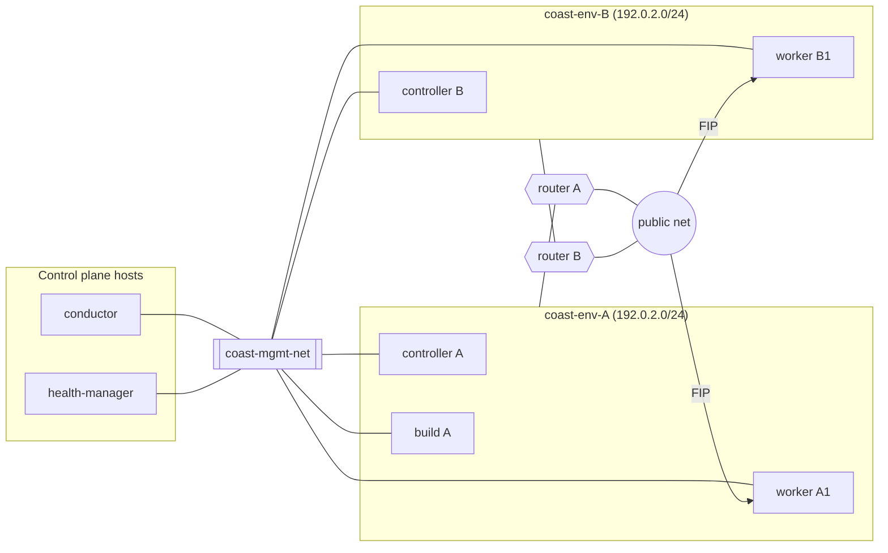

# Networking

All networking resources are created by the `coast` service user in the
`service` project and tagged `coast`, `project_id=<tenant>`,
`stack_id=<stack id>` (`coast/network/stack.py`). The janitor also
recognises the `environment_id=` tag key for resource discovery. The isolated network is
the stack network.

## Networks

| Network | Scope | Purpose | Who attaches |
|---|---|---|---|
| `coast-mgmt-net` | one, shared by Coast control plane (like Octavia's `lb-mgmt-net`) | conductor -> agent mTLS (9443/tcp), agent -> health-manager heartbeats (5565/udp) | every controller/worker/build server (NIC 0); control plane via `coast-hm0` ports in `coast-mgmt` by default, or the host namespace (see below) |
| `coast-env-<stack_id>` | one per stack (+ subnet + router to external net) | controller <-> worker SSH, service traffic, outbound internet (git, registries, Let's Encrypt) | that stack's servers (NIC 1) |
| external / provider net | existing public net | floating IPs for workers | FIPs only |

Env subnets can reuse the same CIDR (e.g. `192.0.2.0/24`) since each env has
its own router. Mgmt net CIDR is operator choice (example: `198.51.100.0/24`).



## Stack network step (M3)

The standalone module is `coast.network.stack`. It uses
`clients.get_connection('neutron')`, not a tenant token. The
controller-only stack-create flow now calls it. The class name stays
`EnvironmentNetwork`.

The operator sets `[controller_worker] external_network_id`,
`env_cidr_pool`, and `env_subnet_prefix`. Each stack reuses the
first subnet of that pool on its own router (Q71). No CIDR is supplied
by default. `dns_servers` also sets the subnet DHCP DNS list.

### Stack subnet addressing

The gateway uses address offset 1 from the subnet network address.
Coast reserves offsets 2 through 9 for fixed addresses. The controller
uses offset 2. The explicit Neutron allocation pool starts at offset 10
and ends at the last usable address, before the broadcast address.
DHCP stays enabled. DHCP/metadata ports and other automatic allocations
use this pool, not the Coast fixed-address range.

A /24 has a pool from offset 10 through 254; a /28 has a pool from
offset 10 through 14. Prefixes /29 through /32 are rejected with
`ValueError` before network creation: the subnet must hold the reserved
range and at least one pool address. The reserved-range size is a shared
code constant, not an operator configuration option.
The existing resume checks also compare the allocation pool. Coast does
not change an existing subnet with a different pool.

The caller holds the existing per-stack lock and supplies the reserved
controller fixed IPv4 address and whether build servers exist (Q73).
The returned IDs remain internal flow results, not new API or DB fields.
Resources are found by deterministic name and all three ownership tags;
a name alone is not enough. Neutron rejects `tags` in a create body even
when `tag-creation` and `standard-attr-tag` are advertised. The
[Neutron tag guide](https://docs.openstack.org/neutron/latest/contributor/internals/tag.html)
lists the resources that support the separate tag API. Coast creates the
resource with no tags, then calls that API
(`PUT /v2.0/{collection}/{id}/tags`, SDK `network.set_tags`). If tagging
fails, Coast deletes the new resource and returns the error. A resource
with the same name but without the ownership tags is not adopted. A crash
between the two calls can leave an untagged resource. Remove it before
you retry. The cloud must support the tag API and tag filters for
networks, subnets, routers, security groups, ports and floating IPs.
Before guests attach, the module removes default and stale stack SG
rules, including IPv6 default egress, and installs the exact IPv4 allow
lists. IPv6 egress remains denied; guest IPv6 DHCP and router
advertisements remain disabled. Security group rules are not tagged. On Neutron 2026.1 the rule
tag API returns HTTP 404, and the tag guide does not list security group
rules. A stack rule is identified by its parent stack security group. A
control-side peer rule stays on the operator security group and is
identified by `remote_group_id`. Every new rule description starts with
`[DEFAULT] resource_name_prefix` and then the stack ownership tags. The
description is at most 255 characters.
The operator must set sufficient service-project Neutron quotas. Internet
egress rules reference one address group per stack, so a stack needs about
the same number of rules as before plus one address group. Neutron must
provide the `address-group` and `security-groups-remote-address-group`
extensions.

The operator prepares the shared management network and a default-deny
control-side SG whose ID is `mgmt_sg_id`. Each stack gets its own
agent management SG. The module adds only reciprocal peer rules to the
control-side SG (Q72). It does not create management ports or namespaces.
It does not delete the operator's management network or control-side SG.

Create is resumable after partial failure. Delete is its explicit revert.
After the caller removes guest ports and floating IPs, delete removes SGs
and their control-side references, router interface, router, subnet, then
network. Missing resources are tolerated. Conflicts and HTTP 500/502/503/504
are retried with `network_delete_attempts` and
`network_delete_retry_interval`. Other errors stop cleanup; later calls
resume it. Revert uses the same project and stack IDs as create.

SDK calls follow the documented
[network proxy](https://docs.openstack.org/openstacksdk/latest/user/proxies/network.html).
Q74 records the TCP port exclusions and explicit DNS/NTP exceptions.

## Kolla management network (M3 c4kn)

The Coast management network is a dedicated management VLAN, like
Octavia's load-balancer management network or Trove's management network.
It is not the API network. In the Kolla overlay role, set
`coast_network_interface` to the VLAN interface and leave `coast_hm0_manage`
off. The host-namespace alternative below applies: keep forwarding off and
apply host firewall isolation. Guest NICs remain in the main namespace, as described below.
For development without a VLAN, enable `coast_hm0_manage` and select
`coast-hm0`. No VLAN ID, subnet or host address is hard-coded.
The health-manager bind and advertised heartbeat addresses use the
management interface. Conductor agent calls use management routing;
API listeners and catalog endpoints remain on the API network.

## Network namespaces (decision Q8)

The control-side namespace is separate from guest routing:

- **Control side.** On each controller node, Coast's port on
  `coast-mgmt-net` (`coast-hm0`, analogous to Octavia's `o-hm0`) lives in
  a **dedicated network namespace `coast-mgmt`** that contains only that
  interface: no default route, no IP forwarding, no other host interfaces.
  The health-manager UDP listener and the conductor's mTLS client sockets to
  agents are created inside this namespace (`setns` before `socket`, using
  the Q81 stdlib helper). A compromised guest that reaches `coast-hm0`
  therefore cannot route to RabbitMQ, the DB, internal API endpoints or anything else on the
  host. As an operator-selected alternative (M3 c4hn), an empty
  `[controller_worker] mgmt_netns` uses a host-namespace OVS internal
  port without `setns`. This mode requires host firewall controls to
  preserve control-plane isolation; see operations.md for setup.
- **Guest side (M3 c4bp, James final design).** Both NICs stay in the
  main namespace. The management NIC uses the static IPv4 address from
  Nova network data. It has no default gateway. Off-link health-manager
  destinations from the existing guest `health_manager_ips` configuration
  receive host routes through the management subnet gateway. On-link
  destinations require no extra route. The agent has no conductor/API
  callback today, so no additional destination option is required.
  The environment NIC uses Neutron DHCP; the stack router supplies the
  only default route. Packages, Docker pulls and appgroup traffic use
  that router, not the management network.

### Guest agent implementation (Q81, superseded by M3 c4bp)

`coast-guest-routes.service` runs after cloud-final and network-online.
It matches the static management address and both link MACs from the
config drive. It replaces cloud-init's Netplan file with persistent
static management configuration and environment DHCP. Cloud-init network
regeneration is disabled. No management default route is retained; the
route step also removes a stale management default from the running guest.
Missing or ambiguous network data, or an off-link destination without an
on-link management gateway, fails closed. Only the two guest NICs are
configured; Nova-supplied link MTUs are preserved. IPv6 DHCP and router advertisements are disabled.

Link selection follows the documented
[Nova network data contract](https://docs.openstack.org/nova/latest/user/metadata.html).
Netplan configuration follows the documented
[Netplan YAML contract](https://netplan.readthedocs.io/en/stable/netplan-yaml/).
The agent binds HTTPS and heartbeat sockets directly to `[agent] bind_ip`
in the main namespace, never a wildcard or loopback address. The control-side
`[controller_worker] mgmt_netns` and its socket helper remain active.
Docker and Coolify loopback connections use the same main namespace.
Management security groups and the operator provider router/firewall,
not a guest namespace, enforce management isolation. Customers control
their dedicated workers and may use host networking, privilege and other
worker features. The Neutron rules and provider firewall must protect the
control plane even when a guest has root access. API 1.17 removes workload
safety restrictions; it does not relax these network rules.

### Guest egress gate (M3 c4bp B)

After route setup, the agent checks the environment NIC using the MAC
contract in the first-boot Netplan file. The only IPv4 default route must
use that NIC and its subnet gateway. The agent allows DHCP to complete
within the existing `[agent] request_timeout` startup grace. The mTLS
listener stays available while this check runs; `/health` includes the
cached `egress` state (`pending`, `ok`, or `error`) and a fixed reason code.

`[controller_worker] egress_check_url` is rendered into guest `[agent]`
configuration for all roles. It defaults to empty: check the route and
DNS resolution of Docker Hub, but do not send an HTTPS probe. If set,
resolve the registry hostname and probe its HTTPS URL. IPv4 literal URLs
still use Docker Hub for the DNS check. Use the system DNS configuration
with a bounded resolution lifetime. Check the actual registry route and
bind the outbound socket to the environment address. Verify the TLS
certificate and hostname. Any HTTP response, including 401, 500 or a
redirect, counts as success. Do not follow redirects, read response bodies,
send credentials, or use ambient proxy settings. A URL with credentials,
a query, a fragment, control characters or a non-HTTPS scheme is invalid.

Route/DNS/connect/TLS/response-timeout failures are not engine failures.
They produce an internal health error so the conductor stops provisioning
without waiting for `build_timeout`, and stores the fixed fault
`no internet egress via stack router`. The heartbeat schema is unchanged.
The check runs once per agent start; it is not periodic monitoring.
The agent must be replaced with the updated image; missing egress results
cannot satisfy the new health gate.

DNS calls follow the documented
[dnspython Resolver API](https://dnspython.readthedocs.io/en/latest/resolver-class.html).
Neutron pre-boot reads follow the documented
[network proxy API](https://docs.openstack.org/openstacksdk/latest/user/proxies/network.html).

The management HTTPS listener requires a client certificate signed by the
configured Coast client CA. It does not use the host system CA store.
The server certificate and key come from `[agent]` configuration. Port
9443/tcp and heartbeat destination port 5565/udp are the defaults.

Heartbeats use the lifecycle JSON fields without additional fields. The
wire envelope is compact sorted UTF-8 JSON followed by its 32-byte binary
HMAC-SHA256. The per-stack Q77 hexadecimal key is decoded before
signing. The sequence is checkpointed before send; restart or clock
rollback does not reuse a previously sent sequence. Destinations are
configured IPv4 literals, with no DNS traffic on management. Worker/build
heartbeats report `engine_ok=false` because they do not host Coolify.
The M3 health-manager receiver implements HMAC, timestamp, sequence and
source-IP checks. M4 retains stale detection and failover.

## Security groups (opinionated defaults, decision Q8)

Neutron SGs are **allow-only** and stateful; anything not listed is denied.
Port security is enabled on every guest port. Principle: **default-deny
toward the control plane** - guests may reach exactly two Coast endpoints
(agent API inbound from Coast, heartbeat outbound to the health-manager)
plus the internet services they need (packages/images/git/ACME, DNS, NTP).
The provider router/firewall must block stack access to RabbitMQ, the
database, Keystone admin/internal endpoints and other internal APIs.
Coast also enforces these restrictions in environment-NIC security groups.

| SG | Applied to | Ingress (allow) | Egress (allow) |
|---|---|---|---|
| `coast-ctl-mgmt` | control-side `coast-hm0` ports | 5565/udp from `coast-agent-mgmt` group | 9443/tcp to `coast-agent-mgmt` group |
| `coast-agent-mgmt` | guest mgmt NIC (all roles) | 9443/tcp from `coast-ctl-mgmt` group only | 5565/udp to `coast-ctl-mgmt` group only. **Nothing else** (no DNS/NTP/internet via mgmt) |
| `coast-env-<id>-ctrl` | controller env NIC | `[controller_worker] registry_port`/tcp from env subnet (default 5000; per-env registry, decision Q16; only when the env has build servers) | 22/tcp to env subnet; 80,443/tcp to *internet set*; 53/udp+tcp to resolvers; 123/udp to NTP servers; 67/udp to the *internet set* (DHCP broadcast remains allowed) |
| `coast-env-<id>-worker` | worker env NIC | 22/tcp from controller env IP only; 80,443/tcp from 0.0.0.0/0 (+ ::/0 if IPv6) | *tenant egress set* |
| `coast-env-<id>-build` | build server env NIC | 22/tcp from controller env IP only | 80,443/tcp + 9418/tcp (git) + 22/tcp (git over SSH) to *internet set*; `[controller_worker] registry_port`/tcp to the controller environment address (default 5000, Q16); 53, 123 as above; 67/udp to the *internet set* (DHCP broadcast remains allowed) |

Controller and build environment ports allow IPv4 UDP destination port 67
to the *internet set*. That set still contains the DHCP broadcast address.
Neutron DHCP discovery needs this rule before the guest has an address or
default route. ML2/OVN can drop DHCP discovery when a restrictive egress
list omits it. Workers already allow this port through their all-UDP egress
rule. Management egress rules are unchanged.

Rule sets computed by the conductor:

- **internet set** = `0.0.0.0/0` minus
  `[controller_worker] control_plane_cidrs`, all subnets of `mgmt_net_id`,
  and `169.254.169.254/32`. Coast uses CIDR subtraction, since Neutron
  security groups cannot express deny rules. Subtraction uses Python
  [ipaddress.address_exclude](https://docs.python.org/3/library/ipaddress.html#ipaddress.IPv4Network.address_exclude)
  and the result is collapsed (about 50-80 prefixes). The prefixes live in
  one Neutron address group per stack, `<prefix>env-<stack_id>-egress`, and
  every internet egress rule uses `remote_address_group_id`, so the rule
  count does not grow with the number of prefixes. IPv6 egress stays denied.
- **tenant egress set** = all TCP/UDP to the *internet set* **except**
  `[controller_worker] egress_blocked_ports` (default `25,465,587`), expressed
  as port ranges (tcp 1-24, 26-464, 466-586, 588-65535; udp 1-65535); plus
  DNS/NTP as above; ICMP echo to the internet set. Adjacent and overlapping
  TCP/UDP egress ranges with the same remote are merged.
- Resolvers/NTP: `[controller_worker] dns_servers` / `ntp_servers`; if unset,
  53 and 123 are allowed to the internet set.

The operator must set `control_plane_cidrs` to every control-plane range,
including API endpoints, RabbitMQ and databases. An empty list still excludes
management subnets and metadata, but cannot identify other control-plane
addresses. Guests use config drives (`config_drive=True`); environment-NIC
metadata access is not needed. Exclusions apply to all environment egress,
including explicit DNS/NTP servers and local SSH/registry destinations.
Do not place required resolvers or stack subnets inside excluded ranges.
DHCP discovery to the broadcast address remains allowed on UDP/67.
Provider router/firewall isolation remains an additional operator control.
Example host rules that drop guest floating-IP, SNAT and management
sources to control-plane ports are in operations.md. UDP port 5565 on
the management address stays open for heartbeats.

The conductor periodically repairs owned environment security groups and
the egress address group for idle ACTIVE and DEGRADED stacks, including
stacks with no services. The repair runs on its own timer
(`[controller_worker] network_repair_interval`, default 600 s, 0 disables),
not in the service reconcile loop, with a time budget per sweep
(`network_repair_timeout`, default 120 s); unfinished stacks continue on the
next sweep. It takes no stack task, so a restart cannot strand a stack, and
skips stacks with another task running. Addresses and rules are added before
stale ones are removed, so guests never lose egress during a repair. Management
group and per-stack control-side peer rules are also repaired: heartbeats use UDP/5565 on the management NIC;
agent mTLS uses TCP/9443. No guest image update is required for SG repair.

For a guest smoke test, run the helper as root on each worker, build server
and engine VM, using the actual environment interface and a reachable public
HTTPS host:

```console
sudo python3 tools/check-control-plane-isolation.py --interface ENV_NIC \
  --control-plane-host CONTROL_PLANE_IP --public-host example.com
```

The helper requires TCP/9600 and TCP/5672 to time out on the selected NIC
and verifies public HTTPS with certificate validation on that NIC. Confirm
both target ports are listening from a trusted operator host first: a closed
service cannot prove filtering. Check recent authenticated heartbeats in
the health-manager and agent mTLS health separately; this helper sends no
heartbeat or agent request.

Tenant services can't open arbitrary inbound ports in v1 (HTTP/S via Traefik
only). TCP/UDP passthrough is a later microversion.

Unblocking SMTP for a vetted project: admin sets a project flag (later API);
the conductor regenerates the worker SG without the SMTP exclusions. FWaaS v2
may be offered later as an optional backend; SGs remain the default.

## Ingress (v1)

- Each **worker** gets one floating IP. Coolify's Traefik on the worker
  terminates TLS with Let's Encrypt (HTTP-01) and routes by Host header.
- Default URL: `https://<name>-<id4>.<dashed-ip>.<suffix>` when the
  worker has a floating IP. With no floating IP the form is
  `https://<name>-<id4>.<suffix>`. The suffix is `[domains]
  default_suffix` (default `sslip.io`). The dashed address uses hyphens, for example
  `web-a9c3.203-0-113-10.sslip.io`. Records via Designate or shown for
  manual creation - see "DNS: Designate and manual" below.
- Custom domains: TXT challenge + A/AAAA (or CNAME to the default host) to
  the worker FIP, created automatically (Designate, same project) or by the
  user from the records Coast shows; Coast verifies TXT then pushes the
  domain to the driver.
- Moving a service between workers changes its IP -> DNS change. Accepted for v1.

## Ingress (later, optional): shared edge

Octavia LB (or Traefik/HAProxy edge VMs) in front of workers to save IPv4,
centralise rate limiting/DDoS, and allow moves without DNS changes. Requires
TLS strategy decision (passthrough via SNI vs. termination at edge). Not in v1.

## DNS: Designate and manual (decision Q5)

Both modes are supported; Designate is preferred when the cloud has it.

| Mode | When | What Coast does |
|---|---|---|
| Designate (`[dns] use_designate = true`) | Cloud runs Designate | Default URLs: creates `A`/`AAAA` records for `<name>-<id4>.<dashed-ip>.<suffix>` in `[dns] designate_zone_id` (operator zone, service project). Custom domains: if the tenant's zone is in Designate **in the same project**, `auto_dns: true` on the domain lets Coast create the TXT challenge and A/AAAA/CNAME records itself. |
| Manual (default) | No Designate, or tenant zone hosted elsewhere | Coast computes and **shows the exact records** the user must create (API `dns_records` on the domain and the service; Horizon shows them with copy buttons): `TXT _coast-challenge.<fqdn>`, plus `A`/`AAAA` to the worker floating IP or `CNAME` to the service's default hostname. Verification polls DNS until the TXT matches. For default URLs without Designate, the operator points a wildcard `*.<dashed-ip>.<suffix>` per worker or uses per-worker hostnames. |

Records are recomputed when a service moves workers (FIP change); in manual
mode the new required records are surfaced as a domain event and the domain
status returns to `PENDING_DNS` until they resolve.

## IPv6
Out of scope for v1 unless the external network provides routed v6 to
tenant routers.

## Floating IP and default-app DNS steps (M3)

The standalone helpers are `coast.network.fip.FloatingIP` and
`coast.network.dns.DNS`. They do not yet run in the conductor flow.
The caller holds the existing stack lock and supplies the tenant,
stack, worker and service IDs. Returned SDK resources and required records
are internal step results, not new API or DB fields.

`FloatingIP.ensure` takes a worker stack port ID. It checks the owned
stack network, the owned worker SG and enabled port security before
allocation. It allocates from `[controller_worker] external_network_id`.
All three ownership tags plus `server_id=<worker>` are set with the tag
API immediately after allocation. They are not sent in the create body.
A retry finds and checks these tags, then associates an unbound FIP.
Tagging failure deletes the new floating IP. An untagged floating IP from
a crash between the two calls is not adopted.
It refuses duplicate matches, a different external network, or a FIP bound
to another port. It does not move FIPs between ports. Delete releases only
the tagged worker FIP; it also serves as explicit revert. Missing resources
are tolerated. Other errors stop the step; the caller can retry it.

`DNS.ensure` takes the explicit default-app hostname and worker IPv4 FIP.
It returns the exact A record in both modes. With `use_designate=false`,
no DNS client is loaded and no cloud DNS requests occur. With it enabled,
`designate_zone_id` is required; incomplete enabled configuration fails
closed. The service-project `[designate]` client uses the same authentication,
region, interface and TLS options as the other cloud clients. The configured
zone must contain the requested name. The operator-zone helper remains optional. Customer-zone records use the
credential-provider interface described below.

Designate recordsets do not support Neutron-style tags. Their description
is exactly `coast project_id=<tenant> stack_id=<stack> service_id=<service>`.
Only matching ownership is adopted or updated; an existing foreign A record
is never overwritten. Repeated calls reconcile the address and
`[dns] record_ttl` (default 300 seconds). Delete removes all records with the
exact service ownership description in the configured zone, including old names.
The operator must retain the zone configuration until cleanup completes.

There is no automatically managed shared wildcard: the wildcard in the
manual-DNS section is operator-managed. One shared wildcard cannot select
among multiple worker FIPs. Q82-Q85 record these scope clarifications.
Delete service DNS records before releasing the worker FIP; release FIPs before
removing stack ports and networks. The caller orders these steps.
API `dns_records` publication and conductor wiring remain their existing
flow work, with no schema changes here.

SDK calls use the documented
[DNS proxy](https://docs.openstack.org/openstacksdk/latest/user/proxies/dns.html),
[recordset resource](https://docs.openstack.org/openstacksdk/latest/user/resources/dns/v2/recordset.html)
and [floating IP resource](https://docs.openstack.org/openstacksdk/latest/user/resources/network/v2/floating_ip.html).

## Control-side implementation (M3)

`tools/coast-hm0.py` prepares shared service-project management resources
and plugs each controller's port through an operator-supplied OVS bridge.
Its control-side veth lives in `coast-mgmt`, with a static IPv4 address,
no default route and forwarding disabled. Shared resources use ownership
tags `coast`, `project_id=<service-project>`, and
`stack_id=control-plane`; they do not belong to a tenant stack.
Prepare uses the same create-then-tag sequence. It does not send tags in
the create body. If tagging fails, it deletes the new resource. A later
prepare still refuses a same-name resource that lacks the ownership tags.
On failure the tool prints the generic setup line, then one sanitized
cause: the exception class, the HTTP status when present, and the Neutron
message when that message has no URL or configuration value.
Per-host ports use the Neutron binding host in their name. Preparation never
adopts foreign names or modifies the stack network resources.
See operations.md for backend prerequisites, setup, verification and revert.

`coast.common.management.socket_for_agent` creates and binds control-side
sockets inside this namespace and restores the calling thread before DB/RPC
work. With an empty control-side namespace it creates and binds sockets
in the host namespace without `setns`. Named namespaces reuse Q81's
Linux setns helper without adding a dependency.
The health-manager service uses this factory for its UDP listener. Conductor
agent transport callers must use it for their mTLS sockets when their
provisioning flows are connected. The M2 direct-engine development path is
unchanged and must not be used as a production agent transport.

### Controller provisioning client sockets

The conductor agent client and the production Coolify transport create
HTTPS connections inside the configured control-side `coast-mgmt`
namespace. They use Q81's stdlib `setns` helper. The native thread is
restored after each request. An empty `[controller_worker] mgmt_netns`
uses the host namespace without entering another namespace. The agent
client uses no DNS, no ambient
HTTP proxy, no redirect, and no system CA fallback. Direct M2 development
transport stays separate. The operator must prepare the management
interface and, in named mode, its namespace before this flow. The dedicated control-side
port setup remains its own roadmap item. Controller provisioning does
not allocate a floating IP or a DNS record. Those helper calls belong to
worker and service flows.

### Management group boundary (issue 50)

The agent management group permits only TCP/9443 ingress and UDP/5565
egress to the control-side group. API 1.25 removes the former optional
management SSH allowance. A configured Nova keypair still installs the
operator key, but does not create network access for SSH.

## Customer Designate zones (issue 21, API 1.22)

The default suffix remains `sslip.io`. A stack can link `default_domain`
and `dns_zone_id` to a zone in its customer project. A deeper name such as
`app.sd.example.com` selects `sd.example.com` before `example.com` when
both zones exist. A supplied zone must contain the name and belong to the
same project. There are no wildcards or PTR records.

New apps copy the stack link and use `<host>-<id4>.<default_domain>`.
A later stack link change applies to new apps. Existing apps retain their
hostname and zone credentials. Without a link, the existing IP-encoded
hostname and optional operator-zone path continue to work.

All customer DNS calls use `CredentialProvider.proxy(project_id, zone_id,
trust_id)`. `[dns] credential_provider = service_account` uses the Coast
service session with Designate's `X-Auth-Sudo-Project-ID` header. Operators
must grant Designate sudo rights to the service user. This grants broad DNS
access if the control plane is compromised. Returned zones are also checked
against the customer project; an admin caller cannot list another project.

The `trust` provider uses the service user as trustee of an existing
Keystone v3 trust. Set `dns_trust_id` on the stack or automatic domain link.
The trust must grant DNS roles in the customer's project. Coast verifies
the authenticated project and never adds a sudo header to a trust session.
Trust IDs are opaque identity references, not bearer tokens. Tokens and
passwords are never stored in Coast. A trust can stop working if its owner
is removed. Creating and revoking trusts is an identity administration task;
Coast accepts a trust reference, and does not copy a user's token over RPC.

Automatic custom domains create `_coast-challenge.<fqdn>` TXT plus A (or
AAAA when the worker has a public IPv6 address). `record_type=CNAME` selects
the app's default hostname instead; the zone apex cannot use CNAME. An
explicit AAAA request requires a public IPv6 worker address. The existing
public TXT and address polling and TLS readiness checks still gate ACTIVE.
A DNS write does not prove propagation or certificate readiness.

The conductor retries DNS writes, including for ACTIVE domains, and updates
records when the worker address changes. The service reconciler also repairs
its default record. Failures set a fixed, safe `status_reason`; verification
and TLS errors retain the existing timeout rules. SDK response text is not
exposed. DNS HTTP payload logging is disabled because TXT records contain
verification tokens.

Only an exact ownership description permits update or delete. Foreign
records and incompatible CNAME types cause a conflict. Create preflights all
records before it writes. Partial successful writes remain owned and can be
found by description after a crash. Domain edits retain the previous link
until cleanup succeeds. Domain deletion limits cleanup to that domain's
routing and challenge names. App and real stack teardown remove owned DNS
before floating IP release. Cleanup failure retains the Coast rows for retry;
missing DNS records are already cleaned up.

SDK and authentication references:
[DNS proxy](https://docs.openstack.org/openstacksdk/latest/user/proxies/dns.html),
[Keystone authentication](https://docs.openstack.org/keystoneauth/latest/authentication-plugins.html),
and [Designate API](https://docs.openstack.org/api-ref/dns/).

### Customer worker ingress (API 1.25)

The Coast ingress rules API stores customer rules and merges them into
`rules()` for the worker group on every create and repair. Required worker
SSH, HTTP/HTTPS and egress rules remain enforced. Unknown rules added
directly in Neutron are removed. API deletions apply by the next enabled,
successful sweep. See [the API contract](api.md#worker-ingress-rules-issue-50-api-125).

## Database access

`internal_host` is the database hostname on the worker's container
network. Apps on that worker can use it with the catalog's database port.
It is not a public DNS name. Do not assume that it resolves or routes
from another worker. Internal and public URLs in ordinary responses omit
passwords; the member-only credentials route returns full URLs.

Public access is disabled by default. Enabling it publishes a database
port on the worker. Coast manages the firewall rule for the selected
public port and IPv4 source CIDR. Restrict the source to the clients that
need access. An unrestricted source permits internet-wide access.
Public access is IPv4 only. Use the returned `public.host`,
`public.private_host`, `public.port` and `public_url` for the selected
network path. Do not substitute `internal_host` for a public endpoint.
Disabling public access removes the managed exposure. Public access alone
does not enable database TLS or replace database authentication.

### Database public ingress (API 1.29, issue #123)

Enabled databases contribute managed TCP rules derived from their service
rows, using the selected public port and IPv4 source. The existing worker
security group is shared across the stack, so rules apply stack-wide.
Disabled, ERROR and DELETING databases contribute no rule; rollback and
soft deletion cannot leave independent rule rows. These rules share the
custom ingress quota and are included in the existing repair desired state.
The conductor applies firewall changes synchronously on database create,
public access updates, deletion and failed-create cleanup, even when
`network_repair_interval` is zero. The optional repair sweep also
re-converges drift. If failed-create, failed-update, failed-action or failed-delete cleanup
cannot reach the network API,
a durable event checkpoint retains the pending cleanup. The always-enabled
deployment recovery timer retries it, including after conductor restart,
without rolling back the database ERROR state, quota settlement or task
release. Retries read current desired state so a retried database keeps its
intended access.
Enabled database rows retain port and quota reservations until disabled or
deleted, including when ERROR suppresses their firewall rule.

Database public ports are unique across the stack while the worker firewall
is shared. Different workers cannot reuse a published database port with
different source restrictions: that would allow both sources to reach both
databases. Disabled databases may retain a port without reserving it;
re-enabling checks its availability again.
