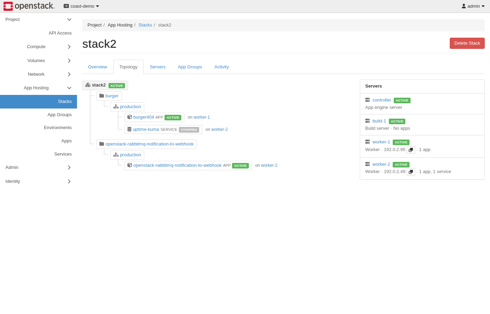
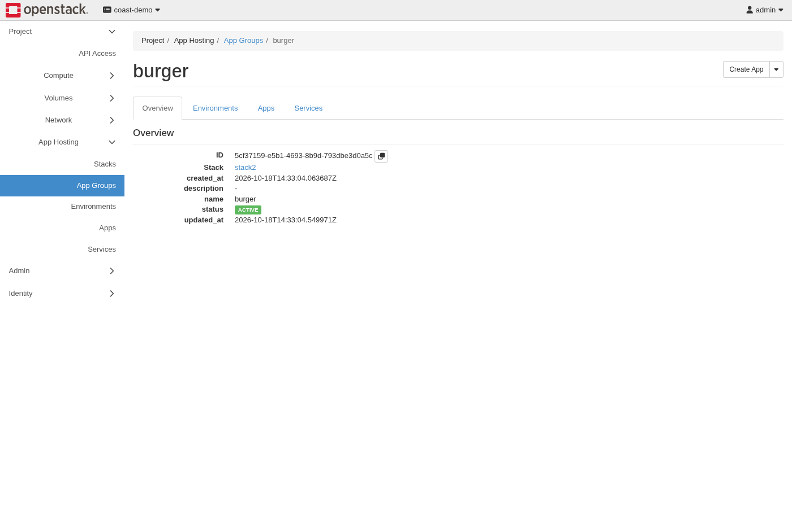
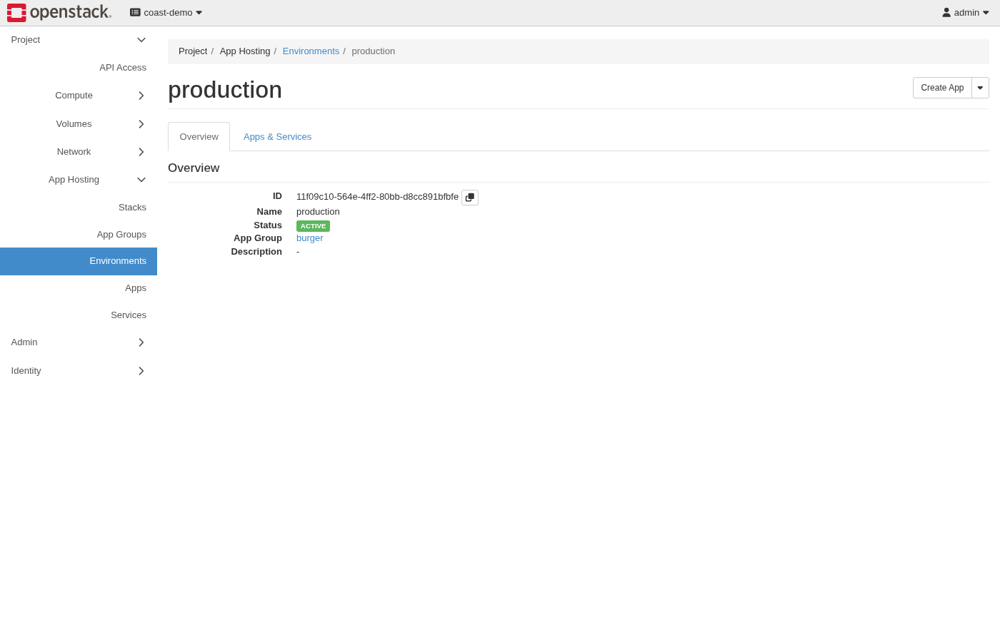
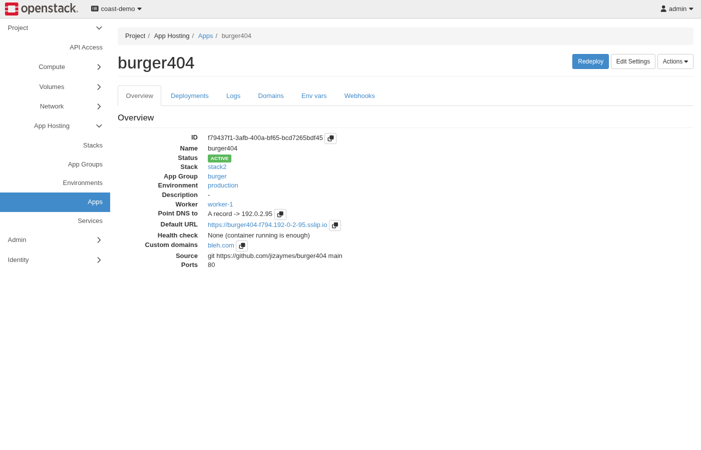
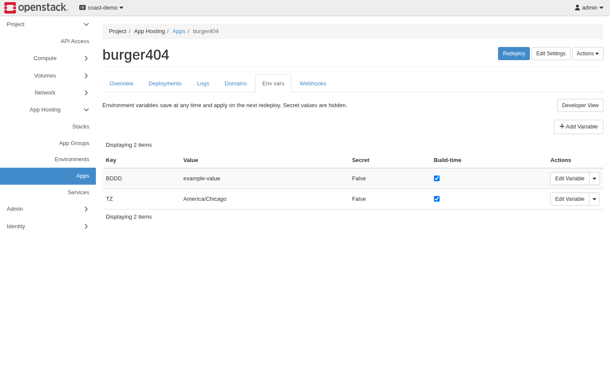
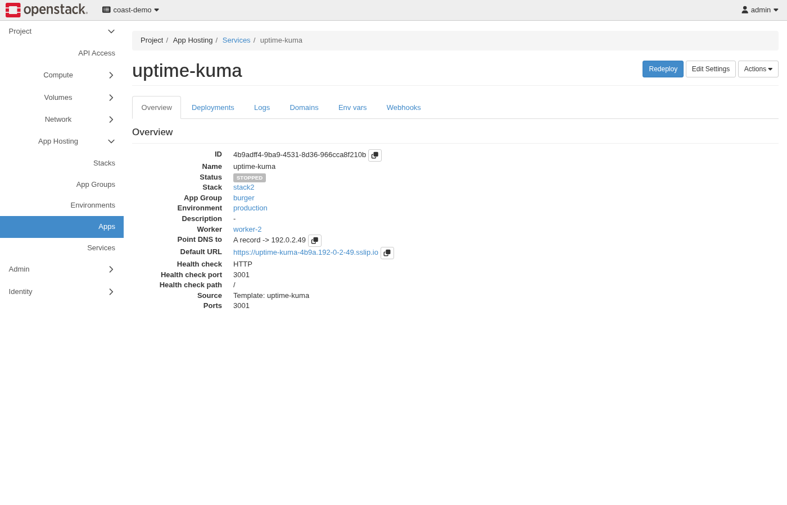
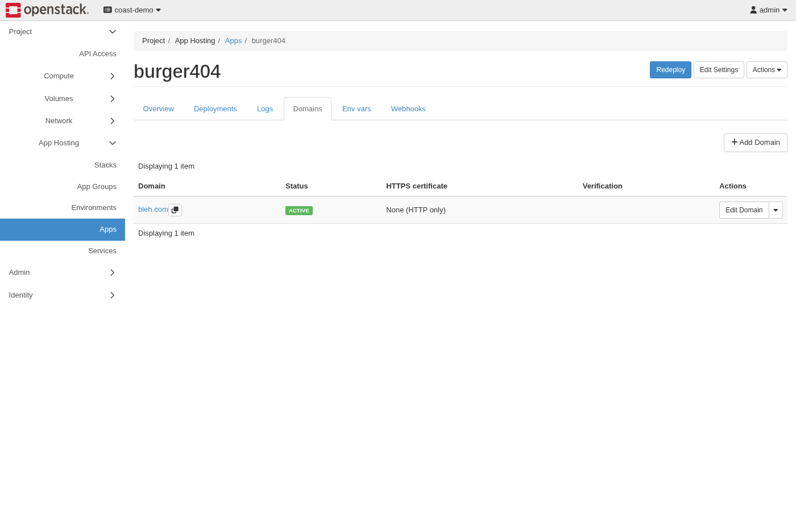
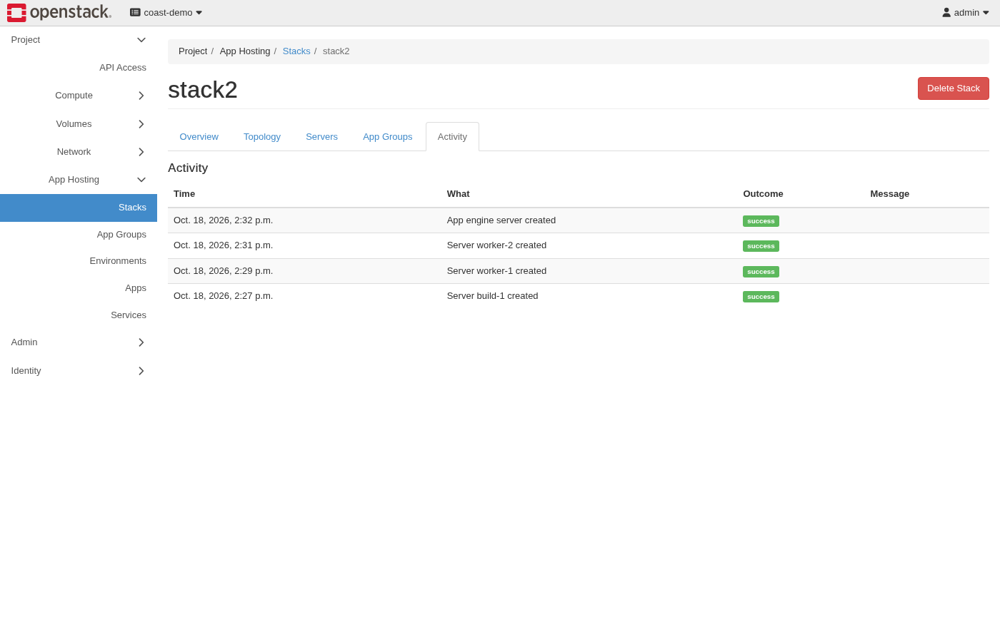

# User quickstart for v0.1.0

Use a project member account in a cloud where the operator has enabled
Coast and installed python-coastclient and coast-dashboard. Load your
OpenStack credentials with your usual OpenRC file or `OS_CLOUD` setting.
Use the public service catalog; no guest credentials are required.

A **stack** contains the App engine server and workers. An **app group**
organizes workloads. An **environment** separates stages such as test and
production. An **app** comes from git or an image. A **service** comes
from the template catalog or an image. All workloads need an explicit worker.

The client negotiates the highest API microversion that both it and the
cloud support. Leave `OS_COAST_API_MICROVERSION` unset unless you need to
pin one. Database commands need a client and cloud with database support.
Choose plan names from `openstack coast plan list`, which shows Name, Kind,
Roles and Description. The examples use `standard-2` for the control role
and `worker-small` for the worker role; replace them with your cloud's VM
plans. Commands accept names or UUIDs; this guide uses names.

Each table pairs the dashboard action with its CLI equivalent. The
screenshots are from a DevStack deployment, with addresses replaced by
documentation ranges.

## 1. Create a stack

| Dashboard path and action | Equivalent command |
| --- | --- |
| Project > App Hosting > Stacks > Create Stack. Select the App engine server flavor and the Worker flavor. | `openstack coast stack create quickstart --plan standard-2 --worker kind=vm,plan=worker-small` |
| Stacks > quickstart. Wait for ACTIVE. | `openstack coast stack show quickstart` |
| Stack detail > Servers. Note the worker name. | `openstack coast server list --stack quickstart` |


`--plan` selects the controller plan; `--worker` supplies the worker kind
and plan. `--stack` selects the stack in commands that list child resources.
The examples use the worker name `worker-1`; use the name `server list` shows. Creation is asynchronous. Stop if the status becomes ERROR; ask the operator
to check Activity before you retry. A retry can create another stack.

## 2. Create an app group

| Dashboard path and action | Equivalent command |
| --- | --- |
| Project > App Hosting > App Groups > Create App Group. Select the stack. | `openstack coast appgroup create website --stack quickstart` |


`--stack` selects the app group's stack.
Wait for ACTIVE with `openstack coast appgroup show website`. Every app
group starts with a `production` environment.

## 3. Create an environment

| Dashboard path and action | Equivalent command |
| --- | --- |
| Project > App Hosting > Environments > Create Environment. Select website. | `openstack coast environment create test --appgroup website` |


`--appgroup` selects the parent app group.
Wait for ACTIVE with `openstack coast environment show test --appgroup website`.

## 4. Create an app from git

| Dashboard path and action | Equivalent command |
| --- | --- |
| Project > App Hosting > Apps > Create App. Select Git, the app group, environment and worker. Enter repository, branch, Dockerfile build pack and port. Disable immediate deployment while you set variables. | `openstack coast app create web --appgroup website --environment test --server worker-1 --repo-url https://git.example.com/team/web.git --branch main --build-pack dockerfile --ports 8080 --no-deploy` |


Use `openstack coast app list --appgroup website --environment test`
to list this environment's apps; `service list` accepts the same filters.
A missing parent reports `App group 'X' not found.` or
`Environment 'X' not found.`. An environment name found only in another
app group reports `Environment 'X' does not belong to app group 'Y'.`.
UUIDs are sent unchanged to the API for lookup; a returned environment
must belong to the selected app group.

`--repo-url` selects a public HTTPS repository; replace the example URL
with your repository. `--branch main` selects its branch, `--build-pack
dockerfile` builds its Dockerfile, and `--ports 8080` declares its HTTP
listener. `--no-deploy` postpones deployment while you configure variables.
`--appgroup` and `--environment` select parents; `--server` selects the
worker. For SSH private repositories and deploy keys, see
[App sources](app-sources.md#deploy-from-a-private-git-repository).

## 5. Set environment variables and deploy

| Dashboard path and action | Equivalent command |
| --- | --- |
| Apps > web > Env vars. Add APP_MODE as build-time. | `openstack coast env set --service web APP_MODE=production --build-time` |
| Env vars. Add a secret with build-time disabled. | `openstack coast env set --service web API_TOKEN --secret --no-build-time` |
| Env vars. Confirm the Secret and Build time columns. | `openstack coast env list --service web --long` |
| Apps > web > Redeploy. | `openstack coast deploy web` |


`--service` selects the app or service. `--build-time` exposes values to
builds; `--secret` makes values write-only; `--no-build-time` limits the value to
runtime. `KEY=VALUE` suits values that are not secret. For a bare key such as
`API_TOKEN`, the client prompts for the value without echoing it, so the
secret stays out of shell history and the process list. `env list` shows
Key, Value, Secret and Version; `--long` adds Build time. All table values,
secret and plain, are masked as `********`, including with `-f json`
(JSON output). There is no `env show` command. Plain values are readable
through the API; secret values are stored in Barbican and never returned
(the API returns `null`). Coast stores all env values in Barbican and
keeps only references in its database.

The dashboard bulk editor accepts these `.env` lines:

```text
APP_MODE=production # build-time
API_TOKEN=replace-in-private-editor # secret, runtime-only
```

`# secret` masks later reads. `# runtime-only` disables build exposure.
`# build-time` enables it. Combine markers with commas in either order.
Plain lines preserve flags for existing keys. New keys for non-template
apps and services default to build-time on at API 1.6 and later. Template services default to off and
reject build-time on.
Secret does not mean safe for builds: builds can copy values into layers
or output. Use runtime-only for credentials. Never paste a masked export
back as a new secret. Redeploy after variable changes to update containers.

To rotate the token, set the same key again with `--secret` and a bare key
for a hidden prompt, then deploy:

```console
$ openstack coast env set --service web API_TOKEN --secret --no-build-time
$ openstack coast deploy web
```

To remove the key instead:

```console
$ openstack coast env unset --service web API_TOKEN
$ openstack coast deploy web
```

`unset` removes the key; deploy applies the removal. Old Barbican values
remain while retained deployment snapshots reference them, regardless of
status. Deployment history is not automatically trimmed; unreferenced
versions are pruned after commit. App or stack deletion removes retained
references. See [secret lifecycle](secrets.md#lifecycle).

## 6. Create a template service

| Dashboard path and action | Equivalent command |
| --- | --- |
| Project > App Hosting > Services > Create Service. Select a visible template, app group, environment and worker. | `openstack coast service create sample --appgroup website --environment test --server worker-1 --template TEMPLATE_SLUG --no-deploy` |
| Services > sample > Env vars. Enter the required template values. | `openstack coast env set --service sample REQUIRED_KEY --secret` |
| Services > sample > Redeploy. | `openstack coast deploy sample` |


Pick a slug from `openstack coast template list --stack quickstart`;
`TEMPLATE_SLUG` is a placeholder for a catalog entry. Standalone
databases use the database commands below.
Use the selected template's actual required keys, rather than the example
REQUIRED_KEY. Template service variables are runtime-only. Templates can
have several containers; check each exposed endpoint and storage
requirement. Creation with `--no-deploy` permits configuration first.

## 7. Attach a domain

| Dashboard path and action | Equivalent command |
| --- | --- |
| Apps > web > Domains > Add Domain. Enter a hostname you control. | `openstack coast domain add --service web web.example.com --no-auto-dns` |
| Domains. Read the required DNS records and verification token. | `openstack coast domain show --service web web.example.com` |
| After publishing the exact returned records, choose Verify. | `openstack coast domain verify --service web web.example.com` |


`--no-auto-dns` leaves record publishing to you.
Replace `web.example.com` with your hostname. Publish the returned TXT proof and address records at your DNS
provider. Wait for propagation, then verify. Check domain status and HTTPS
before sharing the URL. The proxy routes traffic to the configured app
port. The default URL and required records are also available from
`openstack coast app show web`; do not guess a worker address.

## 8. Read logs and Activity

| Dashboard path and action | Equivalent command |
| --- | --- |
| Apps > web > Deployments. | `openstack coast deployment list --service web` |
| Choose View Build Log for a deployment. | `openstack coast deployment log --service web DEPLOYMENT_ID` |
| Apps > web > Logs. | `openstack coast logs --service web --tail 50` |
| Stacks > quickstart > Activity. | `openstack coast stack event list quickstart --long` |


`--service web` selects the workload whose logs are read.
`--tail 50` requests the last 50 log lines; event `--long` adds the ID,
stack ID, request ID and detail columns. Replace `DEPLOYMENT_ID` with an ID
from the list; `deploy` also prints the ID of the deployment it starts. Wait
for deployment ACTIVE and confirm the app serves a request.
Activity reports infrastructure work; deployment logs explain builds.
An accepted request is not proof that deployment succeeded. A failed
first deployment needs correction before the app can serve traffic.

## Databases

| Dashboard path and action | Equivalent command |
| --- | --- |
| Project > App Hosting > Databases > Create database. Search the engine catalog; see the Versions column. Choose the engine row's Create database button, then enter Name, app group, environment, worker and version. Connection settings contains Initial database and Username only for engines that support them. | `openstack coast database create db --engine ENGINE --appgroup website --environment test --server worker-1` |
| Databases > db > Overview. Check status and wait for ACTIVE. | `openstack coast database show db` |
| Overview > Show password (project members only). | `openstack coast database credentials show db --show-password` |
| Databases > db > Public access row action. | `openstack coast database set db --public --public-port PORT --allow-from SOURCE_CIDR` |
| Databases > db > Backups > Save policy. | `openstack coast database backup policy set db --enable` |
| Backups > Back up now. | `openstack coast database backup create db` |
| Backups. Read the backup list; each backup has Restore / Download / Delete actions. | `openstack coast database backup list db` |
| Databases > db > Logs. | `openstack coast database logs db` |

`ENGINE` is a catalog entry from `openstack coast database engine list`.
Replace `PORT` and `SOURCE_CIDR` with a public port and a restricted IPv4
source CIDR for your client.
The create command requires `--engine`, `--appgroup`, `--environment` and
`--server`; `--version`, `--database` and `--username` are optional.

Name is the Coast name shown in Coast. Under Connection settings in the
Create database form, Initial database is the database created inside the
app engine server for your app (`--database`), and Username is the database
user for your app (`--username`). Both default to `app`; engines without
these settings do not show them. Coast generates a strong password and
stores it securely; there is no password input.

Create Service no longer offers standalone databases. Bundled templates,
such as an app with PostgreSQL, remain template services.

A database is a standalone workload, separate from a template service.
Run `openstack coast database engine list` for engines, versions and
backup support. Use `openstack coast database create --help`, then create
one with a name, engine, app group, environment and worker. The worker
must belong to the app group's stack.
Use `openstack coast database show` until the database is `ACTIVE`.
Each database uses one service quota slot.

For an app on the same worker, use the returned `internal_host` or
internal URL.
After creation, project members can reveal the password with Show password
on the Overview tab or
`openstack coast database credentials show NAME --show-password`.
Replace `NAME` with the Coast name. Without `--show-password`, secrets are
masked. Revealed output, including the full connection URL, is secret;
keep it private. Store the URL at the hidden prompt:

```console
$ openstack coast env set --service web DATABASE_URL --secret --no-build-time
$ openstack coast deploy web
```

Ordinary show URLs omit passwords. Keep the full URL private.
Public access is off by default. To enable it, use
`openstack coast database set` with a public port and a restricted IPv4
source CIDR. Coast manages the firewall rule. Use the returned endpoint;
internal hostnames do not work from the internet. IPv6 is not supported.

Database backups require Swift-compatible object storage in the cloud. They are not verified end to
end in 0.1.0; full verification is tracked for 0.1.1 in issue #124.

For engines with backup support, use
`openstack coast database backup policy set` to save a policy, then
`openstack coast database backup create` and
`openstack coast database backup list`. The policy derives the engine
and container. Restore a backup ID with `openstack coast backup restore`.
A `new_copy` restore creates a database with the same engine, version and
placement. An overwrite requires the current name and takes a safety
backup first.

Use `openstack coast database stop` from `ACTIVE`, and
`openstack coast database start` from `STOPPED`. Restart requires `ACTIVE`.
Stopping keeps data.

In the dashboard, the delete modal shows "To delete, type `<name>` below".
Type Name, the Coast name shown in Coast, to confirm deletion.

`openstack coast database delete` destroys the
database, its data volumes and its backups. Download backups you need to
keep first. Wait for deletion before deleting its parents.
See the [database guide](portal-guide.md#databases) for details.

## Cleanup

Delete only resources created by this guide. Deletion destroys
application data. Delete from the bottom up: a stack with app groups, an
app group with environments, and an environment with apps or services
each refuse deletion with a 409 that names what remains. Wait for each
delete to finish before the next one. Stack delete needs the project
`manager` role.

| Dashboard path and action | Equivalent command |
| --- | --- |
| Services > sample > Delete Service; Apps > web > Delete App. | `openstack coast service delete sample`; `openstack coast app delete web` |
| Environments > test, then production (created with the app group) > Delete Environment. | `openstack coast environment delete test --appgroup website`; `openstack coast environment delete production --appgroup website` |
| App Groups > website > Delete App Group. | `openstack coast appgroup delete website` |
| Stacks > quickstart > Delete Stack. Confirm the selected stack. | `openstack coast stack delete quickstart` |
| Refresh Stacks until it is gone. | `openstack coast stack list` |

For repeatable CLI checks, use `tools/walkthrough/quickstart.py` as described
in `tools/walkthrough/README.md`. Its default exit path deletes its stack.
