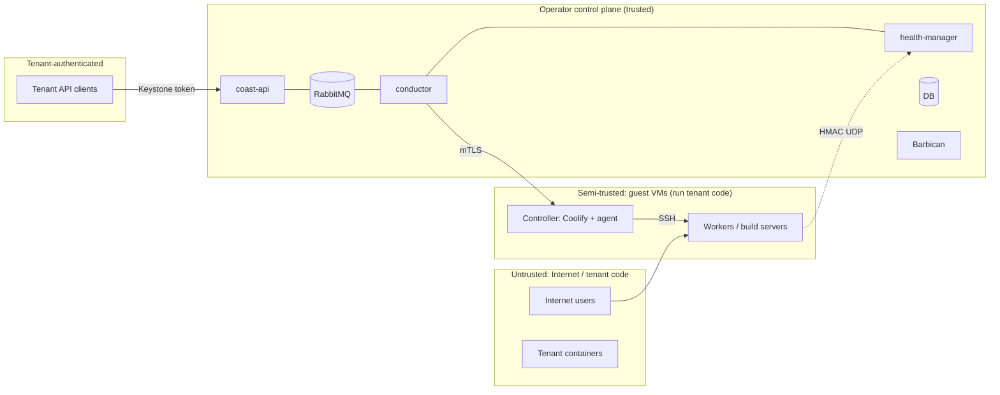

# Security

Engine releases and defaults come from `coast/common/engine_versions.py`.
Upstream source paths below refer to that release’s tag; dated evidence
refers to the recorded supported release, not the new-stack default.

## Assets
1. Tenant source code, images, env secrets, data volumes.
2. Coast control plane (API, conductor, health-manager, DB, RabbitMQ).
3. Credentials: `coast` service user, Coast CA key, engine API tokens,
   per-stack SSH keys, and the per-stack heartbeat HMAC key.
4. The operator's IP reputation and shared infrastructure (hypervisors, networks).

## Credentials

### Service credentials

`coast.common.clients` loads Keystone authentication and session options
from `[service_auth]`. The operator configures the dedicated `coast` user
and the OpenStack service project. Conductor infrastructure clients do not
accept a tenant token or a request-context session. Missing service
authentication fails closed; it does not fall back to API credentials.

Use these credentials for Nova servers, Neutron networks, subnets,
routers, ports, security groups and floating IPs, Cinder volumes and
snapshots, Glance image lookups, and Coast-owned Barbican secrets.
Default DNS records use the service credentials in the operator's
Designate zone. Export storage also uses service credentials. Guests get
only limited, short-lived upload URLs, not these credentials.

The service project owns cloud infrastructure, including worker floating
IPs. Tenants own Coast API resources, not the underlying cloud resources.
See [the ownership model](architecture.md#3-ownership-model-octavia-amphora-pattern)
and [network ownership](networking.md). Configure the service user's role
as specified in [operations](operations.md#keystone-registration-manual-without-the-kolla-role)
(decision Q7). Do not use a tenant user for `[service_auth]`. See
[Why the Coast service user has admin](service-permissions.md#why-the-coast-service-user-has-admin)
for the 0.1.0 grant and credential protection requirements.

### Agent credential

The guest agent does not use Keystone. It uses management mTLS and a
per-stack HMAC key. `[agent_auth]` holds a second password on the
control plane for user `coast-agent` in the service project. The only
role is `coast_agent`. Do not grant `admin`, `member`, `reader`,
`manager` or the Keystone `service` role. That `service` role is for
service-to-service APIs and can be privileged on other services. See
[Service API protection](https://docs.openstack.org/keystone/latest/admin/service-api-protection.html).

Coast policy does not name `role:coast_agent` on any API rule. A token
for this user can pass only a rule that allows every project token.
`coast:plan:get_all` uses `@`, so that list is allowed. Other Coast
API rules deny the role.

Use a user and a role, not an application credential. The Keystone
register task creates users and roles. An application credential cannot
hold a role that its parent user does not have. The `coast` user defaults to
`admin`; Kolla exposes `coast_keystone_user_roles`. See the
[admin rationale](service-permissions.md#why-the-coast-service-user-has-admin)
and permission inventory before changing it.

Cloud calls stay on `[service_auth]`. This release stores the agent
credential and checks it when conductor, health-manager and
console-proxy start. It does not send the credential to Keystone
during guest operations. Startup does not request a token. An unset
`auth_type` does not change an existing deployment. The config drive
does not receive `[agent_auth]`.

Rotation is in
[operations](operations.md#rotate-the-agent-credential).
Kolla stores the password as `coast_agent_keystone_password` in
`passwords.yml`. The DevStack plugin creates the same user in the
`extra` phase. See
[DevStack plugins](https://docs.openstack.org/devstack/latest/plugins.html).

### Tenant credentials and API validation

A tenant sends a Keystone token to the Coast API. `keystonemiddleware`
validates it, and `oslo.policy` authorizes the operation. A project
member can create a stack (Q96, James, 2026-10-11 09:28 CT). Manager
and admin stay required for elevated operations. The authenticated
project scopes Coast database queries and quotas. The RPC serializer
removes the token before conductor handoff. Tenant credentials must not
select infrastructure clients, including cleanup and recovery clients.

`[keystone_authtoken]` configures API token validation. It is separate from
`[service_auth]`: validation credentials do not provision infrastructure.
There is no implemented tenant-token exception for FIPs or Barbican
containers in these flows. Tenant DNS automation described in
[networking](networking.md#dns-designate-and-manual-decision-q5) does not
permit a fallback to tenant credentials. Any future tenant-owned cloud operation needs an explicit
credential and authorization contract before implementation.

### Tenant attribution and secrets

The service-project ownership of a cloud resource is different from its
Coast tenant attribution. Coast stores the authenticated tenant
`project_id` on its API objects and filters tenant queries by that value.
Created cloud resources carry `coast`, tenant project and stack ownership
labels. Use native tags where supported, Cinder metadata for volumes and
snapshots, and exact ownership descriptions for Designate records and
Neutron security group rules. Set Neutron tags with the tag API after
create. Do not send `tags` in the Neutron create body.
Ownership labels do not change the cloud resource's Keystone project.
Usage notifications attribute service-owned resources to the tenant.

Barbican stores secret payloads in the service project; Coast database
rows store references only. Coast controls tenant access through its API. Each new secret has an
identifier-only `coast:<stack>:<kind>:<owner>` name and ownership metadata.
Its read ACL disables project access and names only the Coast service user;
Barbican policy can still allow project or service administrators access.
ACL or metadata setup failure attempts deletion and fails the write.
See [secret attribution and ACLs](secrets.md#backend-and-client).
Coast validates each reference against the SDK catalog endpoint's scheme
(HTTP or HTTPS), host, port and versioned secret path, rejects userinfo,
queries and fragments, and passes only the secret UUID to the SDK.
Never put service passwords, tenant tokens or secret payloads in logs,
faults, notifications, guest configuration or Git. Per-guest keys and
certificates in the config drive are not OpenStack service credentials.
[Secrets and Barbican](secrets.md) lists every secret, its reference
column, when it is created, read and deleted, and the known gaps.

## Trust boundaries

Guests are **semi-trusted**: they execute tenant code, so assume any
worker or build server can be fully compromised by its tenant. Controllers
run no tenant code but are reachable from workers' SSH responses and
render tenant data, so treat them as per-tenant blast radius too.

## Agent engine proxy allow-list

The controller agent exposes only approved method/path pairs under
`/api/v1/`, over the existing management mTLS listener. Match resource
UUIDs with the existing `[A-Za-z0-9_-]{1,128}` pattern and match the full
path. Do not forward arbitrary engine routes, redirects, engine error
bodies, or unapproved headers. Worker and build agents have no engine
proxy access.

**Issue 56 run 6 live-contract repair (project-lead request):** permit
exactly `GET /api/v1/servers/{uuid}/resources` for read-only workload
inventory before build-role conversion and after deployment. Unapproved
methods and sibling paths remain denied. This uses the same
controller-only mTLS proxy and engine credentials. Older controller agents
reject the route; update the controller image/agent before running enabled
build-role contracts. There is no direct-engine fallback.

**M27 James-approved template logs (2026-10-17):** add exactly
`GET /api/v1/services/{uuid}/logs`, matching the existing application logs
read route. Other service-log methods and sibling routes remain denied.
Existing stack controller agents can reject this route with HTTP 403.
For this template log read only, Coast returns an empty, complete result
without retries or an error. Service metadata and env authorization failures
and HTTP 401 retain their existing error handling. Existing controllers are
not updated by this change. Container logs become available when the
controller guest image or agent is updated through an operator-managed
process; there is no direct-engine bypass.

**M20 project-lead request 2026-10-17:** application runtime variable sync
uses existing GET, POST and PATCH `/api/v1/applications/{uuid}/envs` routes,
and DELETE `/api/v1/applications/{uuid}/envs/{env_uuid}`. It does not need
a controller agent upgrade (Q105) or a bulk env PATCH proxy route.

**PM-decided 2026-10-13 (Q108; FYI James):** add exactly
`PATCH /api/v1/servers/{uuid}` for worker build-role switching. No other
methods or paths are added. Previously approved GET/DELETE server-item
and PATCH server-proxy routes remain unchanged. Regression tests reject
sibling paths, unapproved methods, invalid identifiers and path escapes.
Authentication, network isolation and engine credentials are unchanged.

Stacks with older controller agents deny this route. Build-mode switching
fails closed with ERROR status and failure events; the build guest and
its dependencies are retained. Update the controller image to include
the new agent route before using Q108 switching. Failed compensation
confirmation requires operator inspection; no direct engine access or
allow-list bypass is permitted.

**PM-decided 2026-10-13 (Q125; FYI James):** add exactly
`GET` and `POST /api/v1/servers/{uuid}/registries`. No logout `DELETE`
and no `/check` route. Regression tests reject sibling paths, unapproved
methods, invalid identifiers and path escapes. The controller agent also
accepts `POST /v1/registry/gc`. Worker and build agents return 404 for
that path. The body names repositories to delete before blob collection.
It does not carry the registry password.

## Shell sessions

A project member or admin can open a shell on an active app or service.
A reader cannot. The API stores only the SHA-256 hash of a single-use
token. The token expires after 60 seconds and cannot be reused. The
activity log records the user, the resource and the session duration.
It does not record the command, keystrokes or output.

## Threats and controls

| # | Threat | Controls |
|---|---|---|
| T1 | Tenant A reads/modifies tenant B's resources via API | Keystone tokens only; `project_id` from token; DB filters by project on every tenant query; 404 on foreign IDs; policy-in-code with `enforce_scope`; unit tests for cross-project access on every endpoint |
| T2 | Compromised guest attacks the control plane (RabbitMQ, DB, internal APIs) - the Trove weakness | **No guests on RabbitMQ.** Default-deny toward the control plane: guest SGs allow only agent API inbound (9443/tcp from Coast) and heartbeats outbound (5565/udp to health-manager); environment SGs subtract configured control-plane ranges, management subnets and metadata from all egress; operator provider router/firewall also blocks stack access to those networks; control-side `coast-hm0` lives in a dedicated `coast-mgmt` netns with no route to host services by default; optional host-namespace mode (M3 c4hn) requires host firewall isolation; heartbeats parsed defensively, size- and rate-limited |
| T3 | Compromised guest impersonates another guest / forges status | Per-server client/server certs from **Coast's own CA** (separate from kolla CA, Octavia model), CN = server id; heartbeat HMAC key per stack; health-manager checks heartbeat source IP == server.mgmt_ip |
| T4 | Lateral movement between tenant stacks / onto the mgmt network | Per-stack Neutron network + router; guest mgmt NIC has no default route; agent sockets bind only to its static IP in the main namespace; operator provider firewall and management SGs enforce isolation; customers control dedicated workers; control-plane isolation is enforced outside the guests; mgmt SGs use remote-group rules (Coast <-> agent only, no guest-to-guest); per-stack SSH keys; controllers never shared |
| T5 | Tenant reaches Coolify UI/API, escalates to engine admin | Coolify UI/API bound to loopback on the controller; API allowlist remains unset in the pinned release (Q78: RESOLVED, James approved 2026-10-13); only coast-agent (mTLS, mgmt IP) proxies to it; controller has **no floating IP**; root user pre-created at install (registration page never exposed); tenants never get engine credentials |
| T6 | Engine token / root password / SSH key / env secret theft | Stored in Barbican (service project), refs only in DB; engine token created **locally by coast-agent** and returned once over mTLS (one-shot bootstrap endpoint, then 409); the engine `.env` (root user password, `APP_KEY`, database passwords) is generated on the controller at first boot and stays on the controller data volume and in volume snapshots; payloads are read into conductor memory per call and never logged. Engine API tokens rotate with durable two-phase checkpoints (see [secrets](secrets.md#rotation)); other stored credentials are unchanged |
| T7 | Malicious build (supply chain, crypto-mining, escaping build container) | Builds run on the tenant's own worker or dedicated build server, **never shared**; build server has scratch volume only, rebuilt freely; resource limits; optional Trivy scan of built image (later) |
| T8 | Container escape on worker | Worker is single-tenant (only that tenant's services); hardened golden image (minimal, unattended security updates, no password SSH, SSH only from controller IP); userns-remap/rootless where Coolify supports it; optional Kata/gVisor later |
| T9 | Abuse of operator IPs (spam, scanning), metadata abuse | Egress policy blocks tcp/25, 465, 587 by default (admin can unblock per project) - implemented as allow-list SG egress ranges (SGs are allow-only, see networking.md); guests boot from **config drive only** and egress to 169.254.169.254 is not allowed; abuse monitoring / rate limits later at shared edge |
| T10 | Bare-metal node reused with prior tenant's data or firmware implants | Bare metal single-tenant per stack; Ironic automated cleaning (disk erase) on release; secure boot where supported; only Coast-owned images |
| T11 | Domain hijacking (claiming someone else's domain) | Domain must pass TXT verification `_coast-challenge.<fqdn>` before it is pushed to Traefik; FQDN globally unique across projects |
| T12 | Upstream engine change/compromise (Coolify release, license change) | Pin exact versions in golden images; disable self-update; contract tests; owner-initiated image upgrades; image build pulls by digest; driver abstraction allows replacement |
| T13 | Secrets leaking via logs/notifications/faults | `mask_password`, structured fault sanitization; notification payloads are an allow-list of IDs and status; tests asserting no secret strings, env values, tokens, or Barbican refs in captured notifications or logs |
| T14 | Denial of service via API | Quotas; API rate limiting at HAProxy; conductor work queue limits per project |
| T15 | Data loss / unrecoverable offboarding | Cinder data volumes, snapshot action, snapshot retention on delete, export to object storage (lifecycle.md) |
| T16 | Export archive leakage | Objects in a Coast-owned container in `service`, per-env prefix, server-side encryption where supported; guests upload via short-lived pre-signed PUT URLs (no object-storage credentials on guests); download URLs time-limited (`[export] url_ttl`), shown only to project managers/admins, never stored or logged; objects auto-deleted after `retention_hours`; archives exclude secret values |

Container exec is an agent mTLS websocket. The agent starts a process
only in one running container that has the app engine labels for the
requested resource and this guest's project. It does not start a host
shell. The built-in terminal on each app engine server stays disabled.
Exec does not write keystrokes or output to logs.

## Default network policy (decision Q8)

Opinionated, strict defaults; full rule table in `networking.md`
("Security groups"). Summary:

| From → To | Coast agent API | Health-manager | RabbitMQ / DB / internal & admin APIs / metadata | Internet (pkgs, images, git, ACME) | DNS / NTP | Other envs |
|---|---|---|---|---|---|---|
| Coast control plane (`coast-hm0`) | **allow** 9443/tcp | n/a | isolated by netns or host firewall | deny | deny | allow 9443 only |
| Guest mgmt NIC (agent) | n/a | **allow** 5565/udp | **deny** | deny | deny | **deny** |
| Controller env NIC | - | - | **deny** | allow 80/443 | allow | **deny** |
| Worker env NIC (tenant services) | - | - | **deny** | allow all except SMTP 25/465/587 | allow | **deny** (except via public FIPs) |
| Build env NIC | - | - | **deny** | allow 80/443, git 9418/22 | allow | **deny** |
| Internet | - | - | - | - | - | workers 80/443 only |

Environment-NIC security groups exclude `[controller_worker]
control_plane_cidrs`, management-network subnets and `169.254.169.254/32`
from every egress allow-list (M30, James-approved control-plane isolation).
The operator must list all internal API, database and broker ranges. Empty
configuration cannot protect undisclosed control-plane addresses. IPv6 egress
remains denied. Explicit DNS/NTP settings cannot bypass these exclusions.
Guests use config drives; metadata access is not needed. Existing idle stacks
converge through periodic security group reconciliation without hand edits.
Provider router/firewall isolation remains an additional control. Example
host rules are in operations.md. Management mTLS and UDP/5565 heartbeat
remote-group rules remain unchanged. The heartbeat listener binds the
management address only.

## Controls checklist by component

**API**: keystonemiddleware, `enforce_scope=true`, `enforce_new_defaults=true`,
JSON schema validation on every body, max body size, CORS restricted,
admin-only fields filtered by `get_detail` policies, CADF audit.

**Conductor**: dedicated service user in the service project, with the
role specified by Q7 in operations.md. The agent credential is a
different user and is not used for cloud calls. A least-privilege role
for the `coast` user is a future goal, not the current deployment
default. Every created resource carries
ownership labels. Use idempotent flows with revert so
failures don't leak resources, secrets only in memory.

**Coast CA**: generated by `tools/gen-ca.sh`, separate from the Kolla CA.
The CA files live in `/etc/kolla/config/coast/certs` on the deploy host.
The Kolla role copies the server CA key only to `coast-conductor` and never
distributes the client CA key; neither is stored in Barbican. The script creates a
server CA and a client CA. Server certs CN = server UUID, SAN = mgmt IP.
Leaf lifetime is `[certificates] cert_validity_time` (default 730 days).
The health-manager checks the authenticated leaf's actual validity and rotates
serverAuth certificates at 80% life. It scans at most 100 eligible servers per
sweep, nearest `agent_cert_expires_at` first, with a 30-second sweep budget
plus the final bounded connection timeout. A null expiry sorts first. The
sweep does not wait for an idle stack task. A long deployment keeps that
task, and rotation still runs. The conductor claims only that server's
RECONCILING task (compare-and-swap from NONE) and does not change the stack
task. It skips a busy server, a stack delete, and failover of that server.
Controller, worker and build guests use the existing management mTLS listener:
`POST /v1/certificates/rotate`. The JSON fields are `expected_serial` (decimal
string), `certificate` (one PEM leaf) and `private_key` (PEM). Extra fields are
rejected. No proxy allow-list change is required.

The config drive includes `[agent] server_ca`, the existing server CA public
certificate, for all three roles. This trust is never accepted or replaced by
HTTP. The endpoint checks the CA signature, server UUID CN, management IP SAN,
current validity, private-key match and serverAuth usage. It does not accept a
new CA, client credential, heartbeat key or a caller-selected file path.
Serialized updates reject a stale expected serial with 409; an identical
already-installed pair is an idempotent retry. New files and the saved previous
pair are private and durable. A durable pending marker precedes replacement;
a new TLS context serves later connections. An uncertain install closes later
TLS handshakes and prevents agent startup until operator recovery. Existing
connections can finish. The conductor authenticates a fresh connection and
checks the exact new leaf and serial before updating the existing DB serial
and expiry. No certificate private key is persisted in the control-plane DB.
Signature verification uses the documented
[Cryptography X.509 API](https://cryptography.io/en/stable/x509/reference/);
identity, validity and key-usage checks are separate from signature checks.

**Golden images** (`coast-coolify-controller`, `coast-worker`): built from
a minimal Ubuntu LTS. The GitLab job `build-images` is manual or scheduled.
It does not run on merge request pipelines. It installs diskimage-builder
in a virtual environment, builds both qcow2 images, and publishes
`SHA256SUMS` with the artifacts. It accepts `COAST_COOLIFY_INSTALLER_SHA256` or defaults to the reviewed
installer checksum in `RELEASES[DEFAULT]` in
`coast/common/engine_versions.py`. It rejects invalid checksum inputs.
It does not upload to Glance and it has no cloud credentials. Image signing
is a TODO (OPEN). Do not use cosign or gpg. At upload time, set the Glance
`img_signature` properties and point `img_signature_certificate_uuid` at a
certificate in Barbican. `SHA256SUMS` is not that signature. The controller
image stages the pinned Coolify **stock install script**, checksum-pinned
support files and a reviewed digest-locked container archive. The image
build does not run the installer or create secrets. First boot sets
`AUTOUPDATE=false` and unique root-user variables in the private `.env`.
Stock `app:init` disables updates on each start; `RootUserSeeder` creates
root and disables registration after successful creation. The worker
image does not install Coolify. SSH password auth is off. Unattended-upgrades
are on. The operator uploads the image to Glance in the `service` project
as a private image. See `tools/build-images/README.rst`.
Q78 is **RESOLVED (James approved 2026-10-13)**. First boot loads the image archive
and starts Compose without fetching install artifacts. The API allowlist
stays unset because the pinned stock release has no supported API/env/Artisan path.
Engine ports bind to `127.0.0.1`; agent management sockets bind to the static
management IP in the main namespace. The management NIC has no default
route; configured heartbeat host routes use its subnet gateway. The
environment NIC uses DHCP and the stack router is the sole default route.
Controller and build SGs allow IPv4 UDP destination port 67 for Neutron
DHCP discovery; without this rule ML2/OVN can leave these NICs without
a lease. Management SGs remain unchanged. First boot does not access the engine database.

The first-start egress gate uses verified HTTPS on the environment NIC.
The operator's probe URL cannot contain credentials or query tokens.
Any HTTP response proves connectivity; authentication errors do not fail
provisioning. Probe bodies, target values and exception text are never
returned in health or logged. The internal mTLS health response reports
only fixed egress states/reasons. Public API and heartbeat schemas are
unchanged. The probe does not install or download engine artifacts.

**Audit**: oslo.messaging notifications for create, update, and delete.
Payloads carry IDs and status only. The pycadf paste audit filter
remains later (Q46). The conductor events table is the tenant-visible
history. Owner/admin engine upgrades and rollbacks, admin failover, and quota
actions are audited.

## Licensing / trademark
Coolify is Apache-2.0: commercial hosting allowed. Coast does not modify or
redistribute modified Coolify. Don't use the Coolify name/logo as product
branding; descriptive "powered by Coolify" is acceptable.

### Optional operator SSH (M3 c4ak)

James approved an optional service-project Nova keypair for operator SSH
on 2026-10-12. The default remains disabled. When enabled, only guest
management NICs permit TCP/22 from the management network IPv4 CIDR.
Environment NIC and floating-IP rules remain unchanged. The operator
keeps the private key outside Coast. Per-stack Coolify keys remain
separate. No tenant credentials or portal access are provided (Q104).

Worker and build-server root SSH accepts only the stack's Coolify engine
key when `[coolify] ssh_user=root`. Admins use the image's default user
(`ubuntu` in the golden image) with sudo, never root. Their Nova key is
assigned only to that user. Worker config drives disable automatic metadata
key import: cloud-init otherwise also writes those keys to root, even with
`disable_root=true` (which adds a forced command rather than excluding keys).
The root authorized-keys file replaces any image-provided keys. With a
non-root engine SSH user, that file is empty. Controller SSH is unchanged.

## Dedicated stack worker trust (API 1.17)

Customers control their dedicated stack workers. Coast permits host paths,
Docker sockets, privileged containers, host namespaces, devices and extra
capabilities for templates and customer Compose. Image workloads have the
same trust boundary. No workload safety checker or deployment/reconcile
recheck remains. The Compose parser keeps bounded input, SafeLoader and
structural checks to protect control-plane memory and secret storage.

Protect the control plane with the existing Neutron security group and
address-group rules on both NICs and the operator provider firewall.
Environment egress excludes control-plane CIDRs, management networks and
metadata. Management traffic retains only the existing agent mTLS and
heartbeat routes. Root access on a guest does not confer control-plane
access. Do not put cloud service passwords or the coast-agent Keystone
credential on guests. That credential stays on the control plane and has
no tenant-resource API grants. Worker certificates are server-only, and
per-worker heartbeat keys authenticate the server and stack IDs. A worker
cannot use these credentials to change another stack.

Project-scoped API queries, resource ownership checks, mTLS verification,
secret masking, Barbican storage and audit events remain mandatory.

## Database backup secrets and isolation

See [Database backups](contributor/specs/database-backups.md) for the
API contract, durable operations, storage permissions, secrets and limits.

## Customer Designate credentials

Customer DNS uses one swappable credential-provider interface. Service-user
sudo is the initial default and needs operator-granted Designate rights.
Every returned zone must still have the caller's project ID. Trust sessions
must authenticate to the recorded customer project and have no sudo header.
Trust references are not bearer secrets and are not included in API output.
DNS payload logging is disabled. Exact project, stack and service ownership
must match before Coast updates or deletes a recordset. See
[customer DNS](networking.md#customer-designate-zones-issue-21-api-122).

## Database access controls

Database metadata and logs are readable by project readers. Credential
retrieval requires project member access under
`coast:database:get_credentials`. The credentials response includes
passwords and full URLs and sets `Cache-Control: no-store`. Do not log,
cache or send these values to notifications or analytics. Ordinary URLs
omit passwords. Missing and other-project databases return 404.

Public database access is opt-in and IPv4 only. Coast manages the
firewall rule for the configured public port and source CIDR. Restrict
the source to the clients that need access; an unrestricted source exposes
the listener to the internet. Database authentication is still required.
Public exposure does not guarantee transport encryption. Internal access
uses the worker container network. Keep application connection URLs in
runtime secret environment variables.

Database create accepts no passwords. Coast generates independent passwords
with `secrets.token_urlsafe` and commits only Barbican references before
engine calls. References and passwords are excluded from public metadata,
RPC options, notifications and events. The member-only credentials endpoint
resolves the references and sends `Cache-Control: no-store`; project readers
cannot retrieve credentials. Database passwords join the runtime log mask
inventory. Deletion retains discoverable references until cleanup succeeds.
