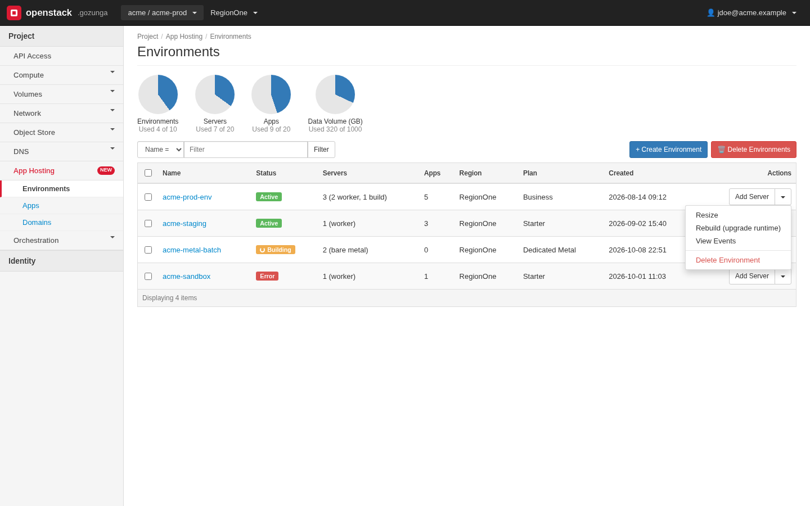
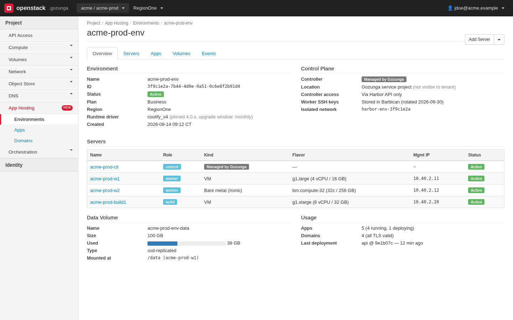
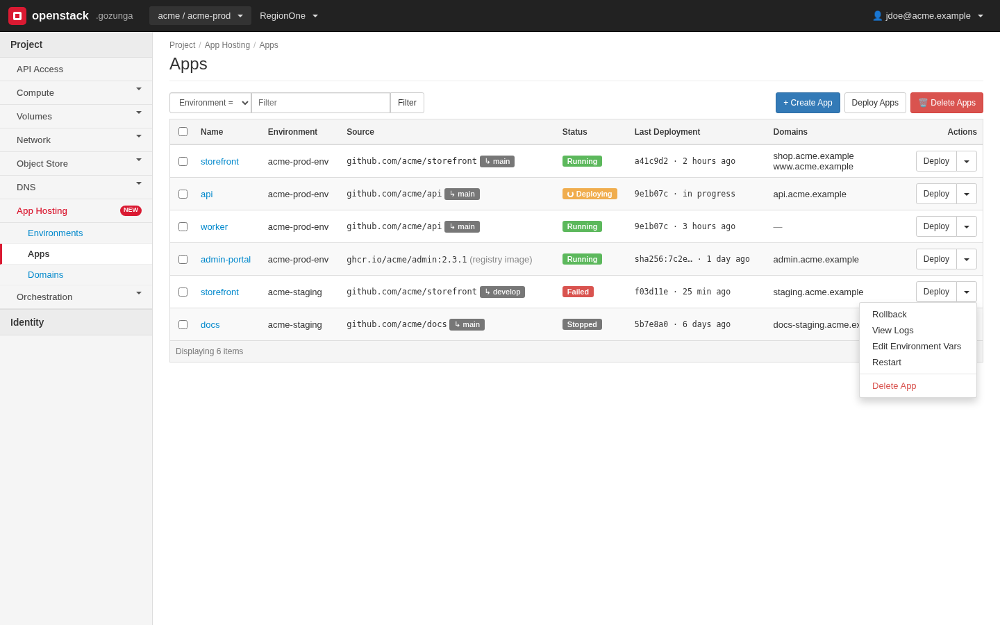
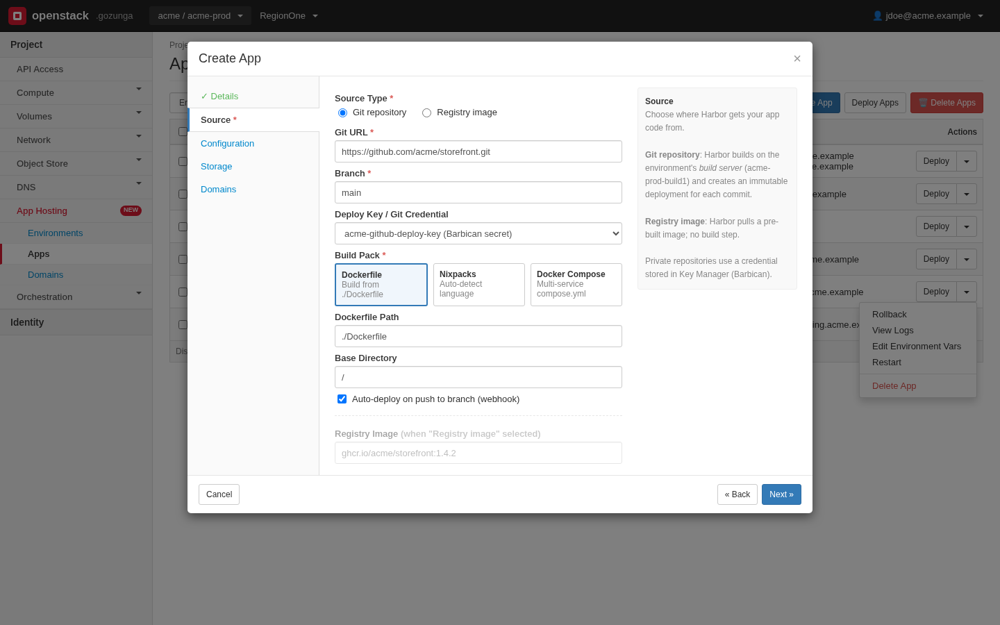
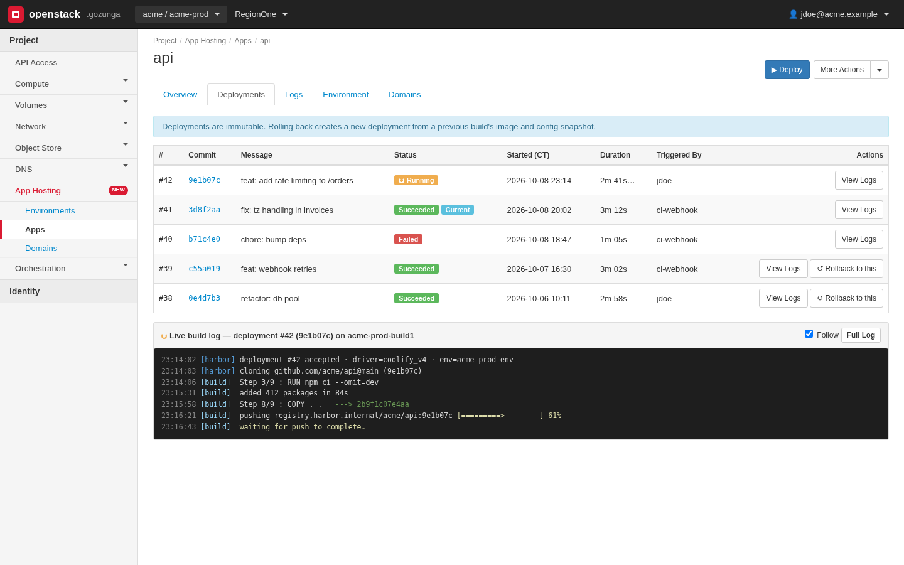
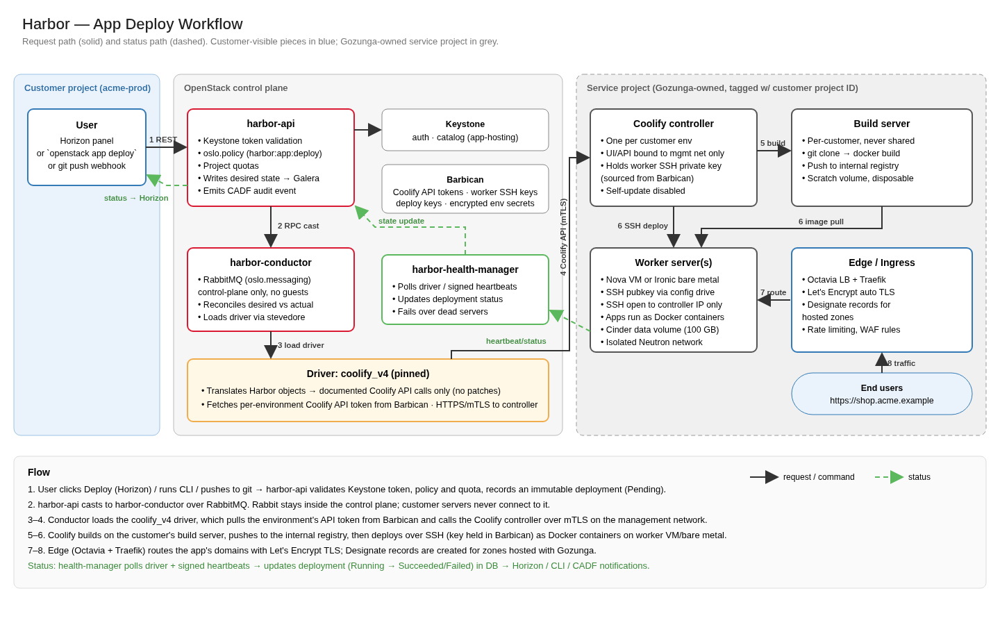

# UI mockups

Dated static mockups of the Horizon panel ("App Hosting"). The images
record design intent; they are not screenshots of the current dashboard.
The implemented panels and forms live in `coast-dashboard/coast_dashboard/content/`.

> **Example only:** all project, stack, service, server and domain names,
> IPs, versions, sizes and counts shown in these images are illustrative
> sample data, not defaults or a real deployment. Branding in the images is
> placeholder.

## Q94 resource model and image limits

The navigation is Stacks -> Appgroups -> Environments -> Services.
A stack owns infrastructure. App groups organise workloads and contain
environments. A service is the workload.
Deployments, logs, domains and env vars belong to the service.
CLI nouns are `openstack coast stack`, `openstack coast appgroup`,
`openstack coast environment`, `openstack coast app` and
`openstack coast service` (Q148). The dashboard shows Apps and Services.

The images below predate Q94. Their labels are not the current contract:
"Environment" on infrastructure pages means Coast stack; "App" means
Coast service. Image filenames remain unchanged. Appgroups and their
Coast environments are not shown in these images. Follow
[api.md](api.md), not the old image labels.

## Stacks list
The implemented Stacks table shows name, plan, status, engine version
and creation time. The image includes additional illustrative columns.

## Stack detail
Controller managed by the operator (not tenant-editable), VM and bare-metal
workers, optional build server, data volume.

## Services list
Use a flat service list filtered by appgroup and environment. A service
belongs to one appgroup and one environment in that appgroup.

## Create form illustration

The current dashboard uses a Create App form and a separate Services
catalog with a Deploy form, rather than this multistep wizard. Select the
app group, environment and worker. Edit env vars and domains after create.

## Service detail - Deployments tab
Deployment history and polled build logs. The dashboard does not offer
rollback; use the CLI or REST API for that.

## Deploy workflow
End-to-end path: Horizon -> coast-api -> conductor -> driver -> controller -> worker.
The conductor polls deployment status; guest heartbeats let the
health-manager detect stale servers.

## Not yet mocked up
- **Appgroups**: list/create under `/v1/stacks/{stack_id}/appgroups`;
  show/update/delete under `/v1/appgroups/{appgroup_id}`.
- **Environments**: list/create under
  `/v1/appgroups/{appgroup_id}/environments`; show/update/delete under
  `/v1/environments/{environment_id}`. These are labels inside an
  appgroup, not infrastructure or plans.
- **Templates**: implemented catalog selected by the stack driver and
  engine version, with template-based creates. The dashboard Services
  panel lists templates; the old images do not show it.
- **Export data** (decision Q10): button on the Stack detail page ->
  choose volumes -> progress -> download link with expiry time and sha256,
  "renew link" action.
- **DNS records panel** (decision Q5): on Domains, a copyable table of the
  records Coast requires (TXT challenge, A/AAAA or CNAME), with status.

## Implementation notes for coast-dashboard and third-party portals
- Only call the public Coast API (`app-hosting` endpoint); no direct
  OpenStack resource views for Coast-owned VMs.
- Poll resources in transitional states every 5s; poll logs through the
  deployment log endpoint.
- Never display secret env values; show `••••` with "replace" action.
- Show `X-Coast-Redeploy-Required` as a "Redeploy to apply changes" banner.
- Use `/v1/services` for list and create, with `appgroup_id` and
  `environment_id`. Do not use a nested environment/services collection.
- Use `/v1/services/{service_id}` for service detail and child resources.
- Keep Q47 event strings: `environment` means stack and `app` means service.
- Keep quota keys and option names unchanged: `environments` counts stacks
  and `apps` counts services. Do not relabel Coast environments as stacks.
